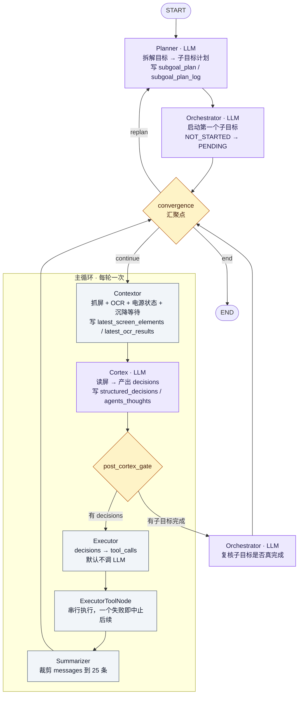
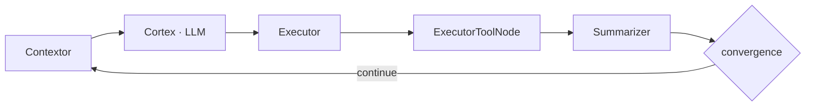
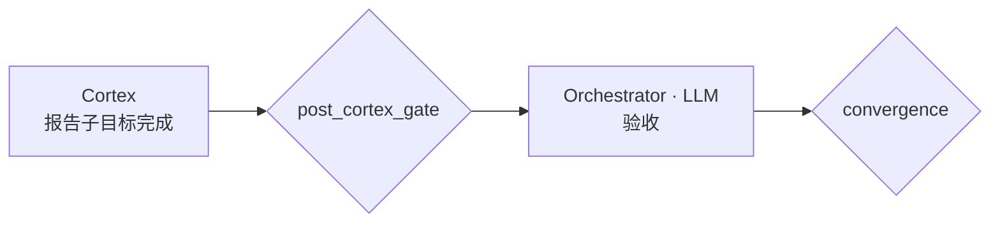
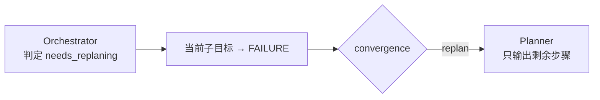
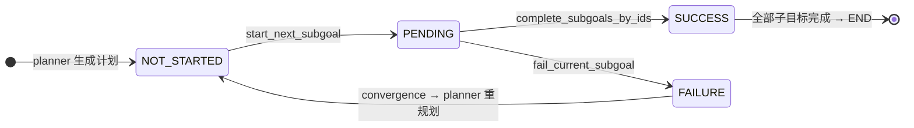

# mobile-use 多智能体协作全景

> 讲解顺序：**先讲系统长什么样 → 再讲谁在什么时候上场 → 最后讲横切全局的机制**。
> 代码基线：`minitap/mobile_use/`，2026-10-21。
> 文中所有"实测"数字来自真机（Redmi Turbo 4 / Android 16）与真实归档，来源见各节标注。

---

## 第一层：全局认知

### 1.1 一句话

mobile-use 是一个**多智能体协作的 GUI 操作闭环**：

> 把"操作手机"拆成 **看屏 → 决策 → 动手 → 复核** 四段，每段由一个专职智能体负责，
> 它们**不互相聊天**，而是轮流读同一份共享状态（`State`）、往同一份状态里写，
> 循环直到目标达成。

### 1.2 关键认知：协作 = 共享状态的时序协议

初学者最容易犯的错，是把它想象成"一群机器人开会讨论"。实际不是：

| 误解 | 实际 |
|---|---|
| 智能体之间互相发消息 | 它们之间**没有任何直接通信**，全部经由 `State` 字段传递 |
| 每个智能体都能看到全部上下文 | 每个只读**自己该读的那几个字段**（见 §4 每一节） |
| 智能体越多越聪明 | 数量由**职责边界**决定：切分标准是"这事的判断依据是否同一份" |
| 循环是线性的 | 是**嵌套循环**：内层循环跑动作，外层循环管里程碑与重规划 |

### 1.3 人形类比

```
   Planner      项目经理   —— 定里程碑（WHAT）
   Orchestrator 监理       —— 验收里程碑、决定要不要重规划
   Contextor    眼睛       —— 看屏（层级树 / OCR / 截图 / 电源状态）
   Cortex       大脑       —— 决定下一步按哪个（HOW）
   Executor     手         —— 把决策落成工具调用并真的按下去
   Summarizer   记忆整理   —— 裁剪过长的历史
   Outputter    交付       —— 整理最终答案（离线，不在主循环内）
```

一句话分工原则（`planner.md:94` 原文）：

> **The Cortex decides HOW, the Planner defines WHAT milestone to reach.**

### 1.4 全景图



> 配色约定：**紫色 = 会调 LLM 的 agent**，灰色 = 纯代码节点，橙色 = 判定门（gate）。
> 一眼能看出：常规一轮里只有 Cortex 一次 LLM 调用。

---

## 第二层：角色总表

| 智能体 | 职责一句话 | 读 State 的字段 | 写 State 的字段 | 调 LLM | 在主循环 |
|---|---|---|---|---|---|
| **Planner** | 把目标拆成子目标 | `subgoal_plan` `agents_thoughts` `initial_goal` | `subgoal_plan` `subgoal_plan_log` `plan_version` | ✅ | 只在开始/重规划时 |
| **Orchestrator** | 验收里程碑、决定重规划 | `subgoal_plan` `complete_subgoals_by_ids` `agents_thoughts` | `subgoal_plan` `complete_subgoals_by_ids`(清空) `agents_thoughts` | ✅ | 只在有完成上报时 |
| **Contextor** | 看屏（感知） | `last_action_at` | `latest_screen_elements` `latest_ocr_results` `latest_screenshot` `latest_ui_hierarchy` `screen_state` `focused_app_info` `device_date` | ❌（仅 app-lock 分支会） | ✅ 每轮 |
| **Cortex** | 决定下一步动作 | 感知块 + `agents_thoughts` + `subgoal_plan_log` + `executor_messages` | `structured_decisions` `complete_subgoals_by_ids` `agents_thoughts` `cortex_last_thought` | ✅ | ✅ 每轮 |
| **Executor** | 把决策落成工具调用 | `structured_decisions` `cortex_last_thought` `executor_messages` | `executor_messages` `cortex_last_thought` | ⚠️ 默认**不调**（直连），兜底才调 | ✅ 每轮 |
| **Summarizer** | 裁剪历史 | `messages` | `messages` | ❌ | ✅ 每轮 |
| **Outputter** | 生成最终结构化输出 | `initial_goal` `agents_thoughts` `messages` | —（不改 State） | ✅ | ❌ 图外 |
| **Hopper** | 把人类可读 app 名 → 真机包名 | — | — | ✅ | ❌ 被 `launch_app` 工具内部调用 |
| **VideoAnalyzer** | 视频内容分析 | — | — | ✅ | ❌ 工具侧 |

**注意 Contextor 的真相**：`contextor.md` 看起来像个"决策者"（app lock 判定），但从
`contextor.py:36-155` 看，它的主体职责是**感知**——抓屏、OCR、读电源状态、等屏幕沉降。
app-lock 判定只是一条**可选分支**，仅当 `execution_setup.app_lock_status` 存在时才走，
而且那一步才会调 LLM。**真正的决策权在 Cortex。**

---

## 第三层：三条流转路径

系统不是一条直线，而是**三条路径交织**。搞清楚谁触发谁，是读懂这个系统的关键。

### 3.1 路径 A：主循环（动作流）



每一轮跑一次，是系统 90% 的时间花在哪里。Cortex 看一眼屏、决定点哪、手按下去、
下一轮重新看屏。**每轮都有一次 Cortex 的 LLM 调用**（这是主要的 token 开销）。

### 3.2 路径 B：里程碑复核流（目标流）



`post_cortex_gate`（`graph.py:60-74`）的判定：

```python
if len(state.complete_subgoals_by_ids) > 0 or not state.structured_decisions:
    node_sequence.append("review_subgoals")   # → Orchestrator
if state.structured_decisions:
    node_sequence.append("execute_decisions") # → Executor
```

两个分支**可能同时触发**——Cortex 可以一边报告"子目标 3 完成"、一边给出下一步动作。
Orchestrator 验收后会把 `complete_subgoals_by_ids` 清空（`orchestrator.py:145`），
所以这个复核流不会重复触发。

### 3.3 路径 C：重规划流（纠错流）



`convergence_gate`（`graph.py:39-57`）三个出口：

| 条件 | 去向 | 含义 |
|---|---|---|
| 有子目标 FAILURE | `planner` | 计划走不通了，重新拆 |
| 全部 SUCCESS | `END` | 任务完成 |
| 其余 | `contextor` | 继续下一轮动作 |

Planner 进入重规划时**只输出剩余步骤**，已 SUCCESS 的子目标原样保留（`planner.py:173-178`），
所以不会重做已经完成的事。

### 3.4 步数上限

`recursion_limit = task.request.max_steps`（`sdk/agent.py:680`）。
LangGraph 的 recursion_limit 数的是**图的迭代步数（superstep）**，不是 LLM 调用次数——
一轮主循环要过 contextor / cortex / executor / executor_tools / summarizer / convergence
共 5~6 步，所以 `max_steps=100` 大约只够跑 15~20 轮动作。

---

## 第四层：逐角色细节

### 4.1 Planner — 定里程碑

**做什么**：把 `initial_goal` 拆成有序的 `Subgoal` 列表。

**输入**：`initial_goal`、上一次的计划（带状态）、`agents_thoughts` 末 25 条、
当前前台 app、锁定 app。

**输出**：`subgoal_plan`（当前计划）+ `subgoal_plan_log`（**只追加**的日志）+ `plan_version`。

**三个设计要点**：

1. **子目标 ID 每次重新生成**（`utils.generate_id()`），所以 ID 不能当稳定标识用，
   `render_plan_skeleton` 干脆不渲染状态到日志里。
2. **计划日志只追加**（`planner.py:108-119`）。改写旧段会击穿 Cortex 提示词的前缀缓存，
   只追加则天然单调。replan 时尾部追加一段 `PLAN vN`。
3. **前台 app 已经在时，禁止生成"打开 X"子目标**（`planner.md:9-12`）。这是靠 prompt 里
   注入 `current_foreground_app` 实现的，实测能省掉一整个无意义的子目标。

**子目标状态机**（`utils.py`）：



### 4.2 Orchestrator — 验收与纠错

**做什么**：三个决策——标记子目标完成、判定需要重规划、给出理由。

**关键点**：它的判定是**独立的第二次审核**。Cortex 说"我做完了"是一回事，
Orchestrator 看执行反馈后说"确实做完了"是另一回事。这道复核防止 Cortex 自说自话。

**它不调 LLM 的情况**（`orchestrator.py:39-51`）：计划刚生成、还没有任何子目标开始时，
直接调 `start_next_subgoal` 把第一个子目标置为 PENDING，不浪费一次调用。

### 4.3 Contextor — 感知

**做什么**：抓屏 + 三通道感知 + 状态采集。

**三个通道**（`context.py:78-161` `PerceptionConfig`）：

| 通道 | 内容 | 关掉的后果 |
|---|---|---|
| `ui_hierarchy` | UI 层级树 → 元素表 | 失去坐标合法性校验，只剩 OCR 框 |
| `ocr` | 截图 OCR 文本 | 坐标校验退回只看层级树 |
| `screenshot` | 截图（**三态**） | 看不到颜色/图标/图片/遮挡 |

`screenshot` 的三态是 `True`（每轮带）/ `False`（不带）/ `"on_demand"`（**默认**）。
`on_demand` 的含义：模型在结构化输出里把 `need_screenshot` 置 true，
Cortex 在**同一轮内**补一张图再问一次（`cortex.py:392-398`）——不是多开一轮，
因为多一轮意味着多一次完整的 prompt 重算。

**两个时序细节**：

1. **屏幕沉降等待**（`contextor.py:157-176`）。换页后交互控件是**延迟挂载**的——
   真机实测新页面的 like 类 resource-id 在动作后 2.0s / 2.5s 才出现在层级树里。
   抓早了会拿到一棵"控件还没挂上"的树，看起来像"这个按钮不存在"。
   `settle_delay_ms` 默认 3000ms，但它是**下限不是固定延迟**：实测决策延迟中位 19.2s，
   绝大多数轮次时间早就够了，一个字都不等。
2. **OCR 与抓屏重叠**（`contextor.py:49-106`）。OCR 走 `on_screenshot` 回调在采集线程里就地跑，
   dump_hierarchy 真机要 ~1.2s、OCR 只要 ~0.4s，整段推理藏进 dump 的等待窗口里，
   关键路径不增加。电源状态读取同理，和抓屏并发，实测 698ms → 589ms。

**息屏处理**（`contextor.py:62-102`）：息屏时 uiautomator **仍然**会返回元素——
真机实测熄屏后拿到的是 19 个 systemui 残留，截图才是全黑的。
所以"层级树为空 ⇒ 屏幕灭了"这个判据永远不触发（被实测证伪）。
改成无条件读 `dumpsys power` 的 `mWakefulness`，并把"屏幕灭着"这件事写进 Cortex 提示词，
否则模型会在黑屏上反复尝试（真机实测：息屏超时让一个任务从 30 步涨到 51 步没跑完）。

### 4.4 Cortex — 决策

**做什么**：看屏 → 决定下一步按什么 → 报告哪些子目标完成了。

**这是系统里最重要的一个 agent**，也是 token 消耗的大头。它的提示词组装见
`cortex.py:210-367`，共有 10 个消息块，**顺序不是随便排的**（§5.3 展开）。

**输出**（`CortexOutput` 结构化）：

| 字段 | 含义 |
|---|---|
| `decisions` | JSON 数组字符串，如 `[{"action":"tap","target":{"index":12}}]` |
| `decisions_reason` | 为什么这么决定 → 进 `agents_thoughts` |
| `goals_completion_reason` | 为什么目标算完成 → 进 `agents_thoughts` |
| `complete_subgoals_by_ids` | 本轮判定完成的子目标 ID → 触发 Orchestrator 复核 |
| `need_screenshot` | "看不清，要图" |

**空响应保护**（`cortex.py:142-152`）：四个字段全空 → 抛错 → 切 fallback 模型。
**但 `need_screenshot=True` 单独算合法应答**——否则 on_demand 模式下模型每次要图都会
在这里抛"empty response"，整轮失败、agent 白烧步数（真机实测 51 步没跑完）。

**未知子目标 ID 会被过滤**（`cortex.py:129-140`），不让模型幻觉的 ID 污染计划。

### 4.5 Executor — 执行

**做什么**：把 Cortex 的 `decisions` 变成实际的工具调用。

**默认不调 LLM**。`dispatch_decisions`（`agents/cortex/dispatcher.py:157`）认为
`action` 字段**本身就是工具名**，那次 LLM 调用只是「JSON → tool_calls 的机械转写」。
`executor.md` 第一条规则本来就写着 "Don't reason about strategy - just execute what
Cortex decided"。

**直连成功的收益**（实测，`scripts/probe_dispatch_hit_rate.py`）：

| 项 | token |
|---|---|
| executor.md | 284 |
| 16 个工具的 schema | 4469（占 92%） |
| thought + decisions | 85 |
| **合计** | **4838 / 轮** |

外加省掉一次完整生成 + 网络往返。探针用**真实工具** + `cortex.md` 文档形状测得 **16/16 命中**，
坏数据（未知工具名 / 缺必填参数 / 未知参数名）**3/3 正确退回 LLM**。

**退回 LLM 的六种情况**：解析不出 JSON 数组、没有 agent_thought、工具名不认识、
参数名不认识、缺必填参数、声明为 object 的参数传了非 dict。
注意是**全有全无**——一个动作不合法，整个 decisions 全部退回。

**承载语义的那部分不在 LLM 里**：

- 「按顺序串行执行」+「一个失败中止后续」在 `tool_node.py:131-152` 的 `failed` 标志循环里，
  是代码不是 prompt。
- `agent_thought` 由 Cortex 的 `decisions_reason` 提供。

**ExecutorToolNode 的额外职责**（`tool_node.py:42-60`）：给"动过屏幕"的工具打时间戳
（`last_action_at`），供 Contextor 算沉降等待。只有 13 个会改变屏幕的工具参与这个判定——
`wait_for_delay` 不算（等待本身就是在给屏幕时间）。

### 4.6 Summarizer — 裁剪

**做什么**：把 `state.messages` 裁到 25 条（`MAX_MESSAGES_IN_HISTORY`）。
从尾部找连续的 ToolMessage/HumanMessage 边界删，避免删掉一半的对话轮次。

**注意它管不到 `executor_messages`** —— 后者由 Cortex 每轮用
`RemoveMessage(id=REMOVE_ALL_MESSAGES)` 整体清空（`cortex.py:439`），
所以 Executor 的兜底路径看到的永远只是**本轮**的反馈，不会累积膨胀。

### 4.7 Outputter / Hopper / VideoAnalyzer — 图外的三个

- **Outputter**：图跑完后（`sdk/agent.py:1193`）把 `initial_goal` + 全部 `agents_thoughts` +
  最后一条消息交给 LLM，产出最终结构化输出。支持 pydantic schema。
  它要的是**完整推理过程**，所以 `agents_thoughts` 在 state 里必须保持原文不压缩。
- **Hopper**：只被 `launch_app` 工具调用（`tools/mobile/launch_app.py:28`），
  干的事是把 "WhatsApp" 这种人类可读 app 名映射成真机上的包名——
  输入是设备上全部包名列表，输出 `{found, output, reason}`。
- **VideoAnalyzer**：把录屏视频发给支持视频的模型做内容分析。

---

## 第五层：横切全局的四个机制

理解了这四个，才算真正理解这个系统为什么能跑得稳。

### 5.1 State：唯一的通信总线

`graph/state.py` 定义了 21 个字段。几个关键的：

| 字段 | 归谁 | 特殊之处 |
|---|---|---|
| `agents_thoughts` | 全员 | **只追加**，是唯一的公共记忆 |
| `subgoal_plan` | planner/orchestrator | 原地改写状态 |
| `subgoal_plan_log` | planner | **只追加**，给 Cortex 渲染 |
| `executor_messages` | executor | **每轮由 Cortex 整体清空** |
| `latest_screen_elements` | contextor→cortex→executor | **不清空**（索引契约，见下） |
| `latest_ocr_results` | contextor→cortex→executor | **不清空**（同上） |
| `latest_ui_hierarchy` | contextor→cortex | **清空**（工具侧现取即可） |
| `latest_screenshot` | contextor→cortex | **清空**（不重复传 base64） |
| `failed_targets` | 工具层 | 熔断器 + 提示词素材 |

**"索引契约"是一处精妙的设计**（`cortex.py:422-433` 的注释）：Cortex 看到的元素表里
每个元素有一个统一编号（`[7]`），执行时工具要把 `Target.index=7` 还原成真实坐标。
**只有那一次裁剪的结果算数**——执行时重新 dump 再重新编号是不行的，屏可能已经变了，
编号会和模型看到的不一致。所以这张表必须活着穿过 executor。

**`agents_thoughts` 是只追加的**（`state.py:161-178`）：每个 agent 写自己的 thought，
自动加 `[cortex] ` / `[executor] ` 这样的角色前缀。写完立刻触发 `on_agent_thought` 回调
（TUI 实时渲染）和 trace 记录。

### 5.2 thoughts 的压缩：压散文，留事实

`utils/thoughts_compaction.py` 处理发给 LLM 的那一份，**state 里的原文不动**
（trace / TUI / steps_count / outputter 都要全量）。

| 角色 | 内容 | 性质 | 处置 |
|---|---|---|---|
| `cortex` | `Decisions reason` / `Goals completion reason` | **散文** | 压：留首句 + 末句 |
| `executor` | 工具结果（"Tap ... was successful"） | **事实** | 逐字保留 |
| `orchestrator` | `==== NEXT SUBGOAL: ... ====` 里程碑 | **事实** | 逐字保留 |

**为什么用压缩而不是滑窗**：thoughts 是 Cortex prompt 里唯一随轮次线性增长的段，
真机归档实测（exec 212，122 条 thoughts）末轮占整个 prompt 的 65%。
但直接截断会让提示词前缀每轮整体左移 → 前缀缓存永远命中不了 → 满价输入涨约 3 倍。
实测滑窗命中率只有 47.2%（基线 93.5%）。

**本模块的做法是"位置无关"压缩**：每一条 thought，无论新旧，都用同一条规则渲染。
这保证 `f(ts[:k])` 恒为 `f(ts[:k+1])` 的字节前缀——已经发出去的字节永不改变。
实测命中率 91.1%（基线 93.5%），满价重算反而比基线低 9.2%，末轮 prompt 降 40.3%、
全链路 token 降 34.2%。

事实不能压有两个硬理由：归档统计口径是数 `[executor]` 开头行；Cortex 硬规则 2 要求
"不重复失败动作"，失败事实就是它的判断依据。

### 5.3 提示词的块排序：前缀缓存

Cortex 的 10 个消息块按**首次变化时刻**从早到晚排（`cortex.py:210-367`）：

```
恒定 ─────────────────────────────────────────────────────────► 每轮变

[1] SystemMessage   cortex.md（整段静态，不接任何每轮变量）
[2] HumanMessage    设备信息 + Initial goal          ← 任务内恒定
[3] HumanMessage    Agent thoughts history            ← 只追加
[4] HumanMessage    Subgoal plan (append-only log)    ← 只追加
[5] HumanMessage    Subgoal status                   ← 固定槽位原地替换
[6] HumanMessage    failed targets                   ← 有才发
[7] HumanMessage    Executor feedback                ← 每轮变
[8] HumanMessage    Device state                     ← 每轮变
[9] HumanMessage    屏幕元素表 / OCR                 ← 每轮变
[10] HumanMessage   截图（on_demand 时才有）          ← 每轮变
```

**规则**：越靠前越稳定，被前缀缓存覆盖的公共前缀就越长。

**为什么计划日志要排在 thoughts 之后**（`cortex.py:249-274`）——这是一个反直觉的排序，
值得单独记：

- 计划日志虽然"只追加"，但**只追加 ≠ 不击穿**。只要它排在 thoughts 前面，
  追加点之后的全部重算，而 thoughts 恰恰在它后面。
- 真机实测（MiniMax M3.1-Flash 真实 API，122 条 thoughts）：
  - 计划日志在 thoughts 前 → replan 当轮 cached 2,329，满价重算 8,261
  - 计划日志在 thoughts 后 → replan 当轮 cached 10,411，满价重算 183
- **一次 replan 差 8,078 token，且这个差随 thoughts 变长而变大。**

**另一个反直觉的点**：thoughts 绝不能塞成 assistant 回合。state 给每条 thought 加了
`[role] ` 前缀，模型会把它们当成 few-shot 照抄，于是无视 `tool_choice` 改用纯文本回答，
解析器再把这段中文当 JSON 解析 → pydantic `json_invalid` → 整个 goal 挂掉。
压成单个 user 回合后，M3 的 tool_calls 实测恢复 2/2。

**工具名清单按名称排序**（`tools/index.py:69-92`）：这串名字会进 system prompt，
实测在 cortex system prompt 的第 3950/6861 字符处（约 58% 深度），
换个顺序缓存从 10,477 token 掉到 1,169。把"碰巧稳定"变成"按定义稳定"。

### 5.4 熔断器：failed_targets

连续点同一个已经不在屏上的元素，必然失败，而且每次要白花一次 1.2s 的 live dump。
所以工具层记一本账（`utils/failed_targets.py`）：

- **成功即清账**——模型换了目标，"连续失败"这件事到此为止。
- **连着失败同一目标到阈值**（`FAILURE_BREAKER_THRESHOLD = 2`，即第 2 次连续失败就熔断）
  → 工具不再执行它，直接返回熔断理由。账本最多留 5 条（`MAX_TRACKED_FAILURES`）。
- 同时把这些目标列进下一轮 Cortex 提示词（`cortex.py:284-291`），
  告诉模型"这些已经不在屏上了，不要再用，换一个现在还在的元素"。

账本键 = 索引 + 元素身份（不只是索引，避免不同元素同索引误伤）。

---

## 第六层：容错与成本

### 6.1 每个 agent 都有 fallback

`with_fallback(main_call, fallback_call)` 是统一的降级包装（`services/llm.py`）。
主模型返回**空响应**或**校验不过**时切备用模型。注意不只是"调用失败"才降级——
`planner.py:103-105` 里空 plan 也会抛错触发降级，`cortex.py:142-152` 同理。

### 6.2 每一轮要花几次 LLM 调用

| 场景 | LLM 调用 |
|---|---|
| 常规一轮 | **1 次**（Cortex）—— Planner/Orchestrator 都有条件跳过 |
| Cortex 报完成子目标 | +1（Orchestrator 复核） |
| Executor 直连失败 | +1（Executor 兜底） |
| on_demand 要图 | +1（同一轮内补图重问） |
| 重规划 | +1（Planner） |
| 任务结束 | +1（Outputter） |

### 6.3 降级不阻断

整套系统的降级哲学是一致的：**能降级就降级 + 上报事实，绝不硬拦截**。
例如 OCR 失败只 warning 不中断（`contextor.py:208-210`）——层级树和截图还在；
`dumpsys power` 读不到就是 `None`（未知），绝不会误判成 `off` 去无谓地唤醒屏幕。

---

## 第七层：一页速查

| 我想知道… | 去哪看 |
|---|---|
| 图怎么连的 | `graph/graph.py` |
| 状态字段与 reducer | `graph/state.py` |
| 谁在什么时候上场 | `graph/graph.py` 的 `post_cortex_gate` / `post_executor_gate` / `convergence_gate` |
| 每个 agent 的提示词 | `agents/*/[name].md` |
| Cortex 提示词怎么拼 | `agents/cortex/cortex.py:210-367` |
| Executor 为什么不用 LLM | `agents/cortex/dispatcher.py` + `agents/executor/executor.py` |
| 感知通道开关 | `context.py:78-161` `PerceptionConfig` |
| thoughts 压缩规则 | `utils/thoughts_compaction.py` |
| 统一元素索引 | `utils/screen_elements.py` |
| 熔断器 | `utils/failed_targets.py` |
| 工具清单 | `tools/index.py` |
| 成本与缓存分析 | `doc/token-context-analysis.md`、`doc/cache-hit-rate-audit-20261020.md` |

---

## 附：几个容易记错的点

1. **Executor 默认不调 LLM**，但**没有开关能彻底关掉兜底**——兜底是无条件的，
   这是有意的设计（最坏情况 = 改造前的行为）。
2. **`executor_messages` 不累积**——Cortex 每轮整体清空，别按"add_messages 就是累加"来理解。
3. **Contextor 不是决策者**，它是感知者；app-lock 只是可选分支。
4. **Orchestrator 是独立复核**，不是走过场。
5. **`latest_screen_elements` 不清空**是有原因的（索引契约），不是漏写。
6. **thoughts 压缩只影响发给 LLM 的那份**，state 里的原文必须完整。
7. **计划日志排在 thoughts 之后**是反直觉但经过实测的最优解。
