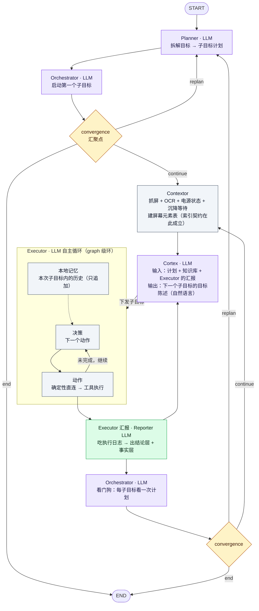

# 方案：Executor 自主执行（Cortex 降频为监督者）

> 日期：2026-10-21
> 状态：**v5 —— 已实施 + 真机验证 + 独立审计 + 审计发现已修**（见 §〇·三）
> 范围：`minitap/mobile_use/agents/{cortex,executor,contextor,reporter}`、`graph/`、`tools/`、
> `config.py`、`sdk/`、`tui/`、`services/telemetry.py`
> 依据：`probe_out/device_usage.jsonl`（52 次真实调用归档）、`probe_out/cortex_profile_ocr_on.json`、
> `probe_out/bench_cortex_m31.json`、`probe_out/dump_run.log`（UTF-16LE，1.3 MB 真机运行日志）、
> `probe_out/executor_ab_before.json` + `probe_out/executor_e2e.json`（真机 A/B）、
> `doc/cache-hit-rate-audit-20261020.md`、`doc/token-context-analysis.md`。
> 文中所有数字均为实测值，非估算。
> **实现契约**：`doc/executor-contract.md`（接口定义 + 文件所有权 + 逐任务要求）
> **复现脚本**：`scripts/probe_executor_e2e.py`（改造后）、`scripts/probe_baseline_before.py`（改造前）、
> `scripts/probe_ab_report.py`（汇总）、`scripts/probe_executor_graph_structure.py`（拓扑）、
> `scripts/probe_executor_prompt_layout.py`（prompt 顺序与缓存）、
> `scripts/audit_*.py`（成本/缓存/账本复算）

---

## 〇、审计修订记录（2026-10-21）

本文档经过一次**独立对抗性审计**（verifier 子代理，判定 FAIL）
+ 一次**本人复核**（5 个关键指控全部独立复现为真）。
审计发现 4 处致命缺陷、若干事实性错误、22 处未列出的必改位置。**均已在本版修正。**

| # | 审计发现 | 性质 | 修正位置 |
|---|---|---|---|
| F1 | 「汇报直回 Cortex」把 **replan 通道整个删掉了** —— 计划级失败无人处理，只能撞 `recursion_limit` 异常退出 | 🔴 致命 | §6.5.1（恢复 Orchestrator 看门狗）、§9.4、风险 R16 |
| F2 | §4.1 的 prompt 布局（元素表在历史**之前**）**自毁前缀缓存** —— 命中率**递减**到 48%，低于现状 74.6% | 🔴 致命 | §4.1.1（元素表改放末尾 → 递增到 93%）、风险 R17、测试 T12 |
| F3 | 失败账本语义被误读 —— `record_failure` **换键即整表替换**、**成功即清账** → 汇报事实层大概率是空的 | 🔴 致命 | §5.2（新增 append-only 的 `executor_failures`）、风险 R18、测试 T5 |
| F4 | 「节点内自循环」与**索引契约互斥** —— LangGraph 节点执行期间不能回写 state，工具会拿到上一轮的元素表 | 🔴 致命 | §9.0~§9.3（改 **graph 级环**，元素表构建搬到 Contextor）、风险 R19 |
| E1 | 步数上限「宽松一倍」是错的（实为 2.9 倍）；「2.75 轮/子目标」无出处 | 事实错误 | §4.3（改为实测 4.0~5.3，n=1）、附录 A Q2 |
| E2 | 「91.1% vs 47.2%」是**模拟值**被当实测引用 | 事实错误 | §4.2（标明证据等级） |
| E3 | §3.2 的 Executor prompt 预算**低估约 2 倍**（漏了 `Element targeting` 574 tok） | 事实错误 | §3.2（~1,200 而非 ~300；11x → 5.6x） |
| E4 | §2.4 的调用次数**漏算 Reporter**（修正后又加了 orchestrator 看门狗） | 算术错误 | §2.4（47 → 56~87） |
| E5 | **感知通道丢失**：截图按需 + 设备状态两条通道在方案里消失了 | 遗漏 | §3.2.1、风险 R20、测试 T13 |
| E6 | `reporter` 加成**必填字段**会打断 22 处 `LLMConfig(...)` 构造点 | 遗漏 | 附录 A.1（改可选 + 回落） |
| E7 | **22 处必改代码位置**原方案完全没提 | 遗漏 | §11.5（M1~M22） |
| E8 | 可观测性会被**静默破坏**（TUI 新节点不可见、telemetry 字段恒 False） | 遗漏 | §11.6 |
| E9 | §11.2 的 A/B 基线**拼了两次不同的运行**（27 分钟病态跑 + 109 秒成功跑） | 遗漏 | §11.2（要求先重跑基线） |
| E10 | **`services/usage_bridge.py` 不存在** —— 缓存命中率埋点当前是断的 | 遗漏 | ✅ **已证伪**（见 N4）：埋点其实是通的，缺的只是那个被文档引用、代码里从未存在的文件。**不要造它** |

**⇒ 审计的核心结论：方向成立（成本数据逐项复算无误、行号引用 20/20 命中、
三个核心方向攻不倒），但原版不能当实施规格。这 4 处致命缺陷已全部修正。**

### 〇·二、实施过程中的新发现（2026-10-21 实施期追加）

| # | 发现 | 影响 | 处置 |
|---|---|---|---|
| N1 | **Executor prompt 实测 2,109 tok**（不是原估的 1,200） | §3.2 的预算表漏了 Perception(278) + Output(233) + identity/loop(144) | §3.2 已按实测重写；§11.2 判据改成 ≤ 3,500 / 相对基线 45% |
| N2 | **屏幕元素表随行数线性增长**（5/30/60 行 → 190/665/1,235 tok） | 原估按 96 tok 算，低估了 7~13 倍 | 同上 |
| N3 | **缓存布局修正后实测命中率 96.6%**（原版布局 74.6%） | §4.1.1 的布局修正是**实测验证过的**，不是推断 | 已写进 §4.1.1，复现脚本 `scripts/probe_executor_prompt_layout.py` |
| N4 | **`services/usage_bridge.py` 从未存在**（不是"丢了"） | 全仓库只有 2 处 docstring 引用它，**没有任何 import** → 不会崩，但那两句话是假的 | ✅ **2026-10-21 实测推翻**：那句「图内的 LLM 调用一条 `llm_usage` 事件都不会产生」是**假结论**。真机 graph 实测（`probe_out/executor_e2e.json`）executor 21 次调用 / 120,772 in / 65,672 cached / 18,114 out **全是真实非零值**；`probe_out/device_usage.jsonl` 里 cortex/hopper/planner 同样非零。捕获槽装的是**同一个 list 对象**，跨图可见；当初「每行都是 0」的真因是客户端没开 `stream_usage=True`（已修）。**⇒ 埋点是通的，不要造 usage_bridge。** 相关假结论已在 `services/llm.py` / `executor.py` / `probe_executor_e2e.py` / `test_llm_usage_telemetry.py` 四处更正 |
| N5 | **熔断账本成功即清、换键即替换**（实施期再次实测确认） | 汇报的「失败事实」不能从 `failed_targets` 取——子目标通常以成功收尾，那时账本已空 | 新增 append-only 的 `executor_failures`（§5.2） |
| N6 | **Executor 一轮多动作会破坏索引契约** | 第二个动作的 `Target.index` 指向第一个动作执行**前**的屏 → 过期索引 → 点错元素 | executor 节点**代码层硬兜底**：一轮只执行第一个动作，其余丢弃并回灌告知模型 |
| N7 | **iOS/云设备没有统一元素表** | 层级树形状不认识 → 建不出表 → 必须用 legacy OCR 块 | prompt 组装加 iOS fallback：`render_ocr_results` 的 `[i]` 与 `latest_ocr_results` 下标严格对应 |
| N8 | **`reporter` 必须做成可选字段 + 运行期回落** | 实测仓库里有 **22 处 `LLMConfig(...)` 构造点**，做成必填全部 `ValidationError` | `LLMConfig.reporter: LLMWithFallback \| None = None`，`get_agent()` 里回落 executor |
| N9 | **`default` preset 故意不写 `reporter`** | 它是所有用户 override 的合并底座。底座写死 `reporter=openai` → 任何没写 reporter 的老 override 会让 reporter 独自留在 openai → `validate_providers()` 索要 `OPENAI_API_KEY` → **部署起不来** | 不写 = 走回落，永远跟着 executor 的渠道 |
| N10 | **W4 必须和 W6+W8 一起落地** | W4 把元素表搬进 Contextor 后，cortex 在中间态读不到树 → 模型只剩 OCR 块（瞎眼） | 这是**中间态**问题，W6 删掉 cortex 的建表代码、W8 重连图后自然消失。⇒ **合入顺序：W6+W8 必须先于 W4 单独上线**，或三者同批 |
| N11 | **测试 `test_all_role_names_matches_the_config_shape` 硬编码了 8 个角色** | 加 `reporter` 后必然红 | 已更新为 9 |
| N12 | 🔴 **真机实测：模型不调用工具，直接写散文 → 解析失败 → 整个任务挂掉** | 模型明明已完成任务，却输出 `"The WLAN page is now open... done: true"` 这种散文。那段文字里**没有 `{`**，连 JSON 兜底提取都做不了。而 `with_fallback` 兜不住 —— **本机 override 里 fallback 和主模型是同一个模型**，重试同样失败 → 异常冒到任务顶层 | ① `executor.md` 明确写「**必须调用工具，不能写成文字**」+ 给 JSON 示例；② Executor 加韧性：解析失败 → 带 nudge 重试一次 → 仍失败则**降级成空动作**（Reporter 会看到并汇报 failed，Cortex 换招重来），**绝不因一次格式失误杀掉整个任务** |
| N13 | 🔴 **真机实测：dispatcher 把「空 actions」误报成「解析失败」** | 模型上一轮动作失败后，第二轮返回空 `actions`（= 没决定任何动作），dispatcher 却说「could not be parsed」—— 模型的格式**没问题**，被告知「格式错」只会让它去改格式、原地打转 | dispatcher 区分两种情况：空数组 → 「你没决定任何动作」，真解析失败 → 「格式不对」。真机日志里 Cortex 已正确识别出「the 'failed' outcome came only from a trailing empty-action-list error」 |
| N14 | **真机实测：`launch_app` 找「设置」映射到 `com.android.settings`，但 MIUI 上真正的设置是 `com.miui.securitycenter`** | hopper 的 app 名 → 包名映射在 MIUI 设备上不准 | **既有问题，非本次改造引入**。本轮任务里 agent 自己绕过了（改用点击设置列表项）。要修得改 hopper 的候选包名排序 |
| N20 | 🔴 **L4（元素表裁装饰行）被真机实测否掉** | 126 行「装饰候选」里 **13.5% 其实能点**（Canvas / 自定义 View 的可点区域在 uiautomator dump 里既无 clickable 也无文字）。裁掉 = 静默弄坏可点目标 | **不裁**。判据写进 `utils/screen_elements.py` 的模块纪律 #8，并用 T26~T30 锁住这个决定，免得以后有人凭直觉再加一次。顺带修正前提：42% 是抖音单屏数字，12 页平均 13% |
| N21 | 🔴 **`max_steps` 换算成动作步后，默认预算会涨 6.5 倍** | 原来 `max_steps=400` 直接当 `recursion_limit`（≈66 个动作步）；M12 换算后同一个 400 变成 **400 个动作步** ⇒ 一次跑飞的任务从烧 66 步变成烧 400 步，**和这轮改造的降本目标正好相反** | 默认值改成 `DEFAULT_MAX_STEPS = 80`（动作步，≈400 个 super-step，与改造前的实际预算对齐）。`constants.py` 的 `RECURSION_LIMIT` 随之退役（它只在 3 处当 `max_steps` 默认值用） |
| N22 | **「图内 usage 埋点是断的」是假结论**（见 N4） | 照那条结论去实现，会白造一个 `usage_bridge.py`，而真正该查的「客户端没开 `stream_usage`」反而被掩盖 | 探针 `scripts/probe_usage_bridge.py` 用最小 LangGraph 复刻证明：捕获槽跨得过图边界（连「usage 只在原始响应里」那一格也通）。已固化成回归测试 `test_llm_usage_telemetry.py::TestUsageSurvivesGraphBoundary` |
| N23 | 🔴 **`retry_count` 埋点恒为 0**（假指标） | 旧口径拿「失败事实条数」近似「重发次数」，但重发的三条路径里有**两条根本不产生失败事实**（规则换招、撞步数上限）⇒ 真机实测 3 个子目标实际重发 5 次，`retry_count` 全程报 0 | 口径改成「**这个子目标被下发过几次 − 1**」。下发记录写在 `agents_thoughts`（append-only），计数原语抽到 `agents/cortex/issue_log.py`（cortex 写、cortex 和 reporter 共用）。回归测试 T32/T32b |
| N24 | **步数上限 12 被真机打到，样本右删失** | 第六轮 9 个子目标样本 = `[1,1,1,1,2,2,3,6,13]`，其中 13 = **撞了 12 步上限被截断**（不是「这个子目标用了 13 步」，是「至少 13 步」）。⇒ 分布是右删失的，p90 算不出来 | 新增 `scripts/audit_steps_per_subgoal.py`：自动识别删失样本，并**分辨两种解释** —— (a) 上限偏小（子目标真需要那么多步）vs (b) 那次是**瞎转**（原地打转被切掉）。⚠️ 我第一版脚本直接判成「上限偏小、建议上调」，**那个结论是错的**：第七轮再打中一次后，两个删失样本**都是 (b)**（重试 1 步就完成 ⇒ 上限救了钱）。⇒ 脚本改成看「同一子目标后来有没有更短的成功重试」来分辨。**上限暂不改**（12→8 值得试，但要先验证不会腰斩正常子目标） |
| N25 | 🔴 **重发之后，执行器容易瞎转**（n=2 强信号） | 第六、七轮各撞一次 12 步上限，**两次都紧跟在一次「重发」之后**：`(2, completed) → (13, blocked) → (1, completed)`。重发**之前**那次 1~2 步就做成了 ⇒ 子目标本身不难，是重发把它弄瞎了 | 疑似原因：重发时 Cortex 清空了局部历史（`RemoveMessage`）+ 归零 `executor_steps`，执行器拿着新目标陈述从零开始，而屏幕还是原来那块、失败事实也不在视野里 ⇒ 原地探索。**这是降本主战场**（重发直接占 13% 调用，还放大出 ~50% 的 executor 步）。⚠️ n=2，只是强信号不是结论 —— 现在 `retry_count` 能测了，可以多跑几轮验证 |
| N26 | 🟡 **每步有一部分是「等屏幕沉降」的纯等待** | `settle_delay_ms` 默认 3000，语义是**下限**：距上次动屏不足 3 秒就补等。⚠️ 我先按「每步都动屏」推算出 26%，**被实测推翻**：真实是 10 次抓屏里只有 **4 次**触发了补等（只读的步骤不动屏，不触发），合计 **12.0s**（每次等满 3.00s）= 墙钟的 **4.7%** | 佐证：`scripts/audit_step_overhead.py`（直接读 `_wait_for_settle` 的返回值）。⇒ 修正后的结论：这是个「**便宜的 4.7%**」而不是 26%；收益随「动屏步 / 总步」比例变化，**动屏步占比越高收益越大**。⚠️ 砍它的风险不是「点错」（表和屏同一次抓，索引契约自洽）而是「表里缺控件 ⇒ 模型绕路」，所以要按**步数 / 失败目标数**验收 |
| N27 | **「省 token」≠「省时间」** | 前缀缓存让**服务端**算便宜，但**客户端仍要把整个 prompt 发过去**，prefill 还要做。⇒ 压输入主要省**钱**（元素表 2,494 tok + executor.md 2,109 tok = 每步输入的 86%），压输出主要省**时间**（decode 按 token 逐个吐） | executor 输出 372 tok 里 **reasoning 占 ~40%**。⚠️ **effort 档位不是可靠的提速杠杆**：实测 low/medium/high/max = 5,303/5,569/7,036/**4,247**ms（n=4，**不成单调，"max" 反而最快**） |
| N28 | 🔴 **延迟模型：输出占 ~92%，输入只占 ~8%** | 真机抓下来的同一份 prompt 做变体对照：输入少 2,175 tok 只省 **176 ms**（0.08 ms/tok），而输出多 222 tok 多花 **2,449 ms**（11 ms/tok）⇒ `延迟 ≈ 0.08×输入tok + 11×输出tok` | ⇒ **压元素表 / 压 executor.md 提速几乎无效**（各只值 ~2%），它们省的是钱不是时间；**「让 Contextor 决策」单独做也不提速**（搬家，输入总量不变）。**要提速只有：少调用 / 少输出 / 少等**。⚠️ 而且 MiniMax **always thinks**（关 thinking 会 400），effort 已在最快档 ⇒ **reasoning 那 150~220 tok 压不动**，能控的只有 `agent_thought` 和 JSON 结构 |
| N29 | 🔴 **同一个任务的墙钟方差 > 5.6 倍** | 同一个 3 子目标短任务「打开设置，进入 WLAN 页面」：246.0s / 345.0s / **>1380s**（两次跑超 20 分钟没跑完，被手动停掉）。差异全部来自**有没有进重发循环**（§2.5 的 R） | ⚠️ **对「提速」这个目标，方差比均值更重要** —— 用户感受到的「慢」是**尾部**不是平均。⇒ 优化优先级应该是「**掐掉重发循环**」而不是「平均快 10%」；⇒ 也要给任务**加墙钟上限**（现在只有步数上限，没有时间上限） |
| N30 | 🔴 **「为什么会重发」的根因：汇报的证据来源错了** | 判「这个子目标真的完成了吗」需要**屏幕状态**；而执行日志里只有**动作结果**（`tap`→「已成功点击元素 [3] WLAN」= **我点了**，不是**我看到了**；`swipe`→「滑动成功」= 零信息）。⇒ **汇报里从来没有「屏幕上因此出现了什么」**，Cortex 判不了，于是重发 | 真机日志里 Cortex 的原话：「报告的证据只有『滑动成功』这类操作结果，summary 也是代码生成的，**没有任何 WLAN 页面标题、开关状态或网络名称的原文**，因此无法确认已停留在 WLAN 页面。」<br>⇒ **而那一屏早就在 state 里**（`latest_screen_elements` / `latest_ocr_results`），且**就是最后一个动作执行之后**那一屏（每执行一个动作都回 contextor 重新抓屏）⇒ **零成本、零 LLM、零额外抓屏**就能补上。<br>⇒ 已修：证据改成「动作结果 **+** 屏幕可见文字」两段（`reporter.py` 的 `visible_screen_text` / `compose_evidence`），回归测试 T33/T33b/T33c。<br>⇒ **因果链**：证据不足 ⇒ Cortex 判不了 ⇒ 重发 ⇒ **清空局部历史** ⇒ 执行器瞎转 ⇒ 撞 12 步上限 ⇒ 报 blocked ⇒ 再重发 ⇒ **更多调用 + 更多步数 + 5.6 倍方差**。<br>⇒ ⚠️ 这也说明 **12 步上限本身就在因果链里**（它把瞎转腰斩成 blocked，blocked 才触发换招）⇒ **限制是症状，不是原因**。<br>⇒ ✅ **已修并真机验证**（见下） |
| N31 | ✅ **修证据来源后，重发归零** | 真机 A/B，同一个长任务「打开设置 → WLAN → 返回主页 → 蓝牙」，修复前后各跑：<br>• 修复前：46 次调用 / executor 27 次 / **9 次汇报 ÷ 5 子目标 ⇒ R=4** / 子目标步数 `[2,13,1,2,3,1,6,1,1]`（含 13 步瞎转）/ 254.4s<br>• 修复后 **第 1 轮**：**21 次调用 / executor 8 次 / 4 次汇报 ÷ 4 子目标 ⇒ R=0** / 子目标步数 **`[2,2,2,2]`** / 198.9s<br>• 修复后 **第 2 轮**：**21 次调用 / executor 8 次 / 4 次汇报 ÷ 4 子目标 ⇒ R=0** / 子目标步数 **`[2,2,2,2]`** / 98.0s<br>⇒ **重发从 R=4~6 降到 0，13 步瞎转消失**，调用 −54%、executor −70%、input −64%、output −70% | ⇒ 证据来源就是那把钥匙：**「我点了」不是「我看到了」**。补上屏幕可见文字后，Cortex 第一次能独立判「做成了没」（§6.4.1 对策 A 本来就写的是「Cortex 要靠 evidence 独立判断」）⇒ 不再重发 ⇒ 局部历史不被清空 ⇒ 执行器不瞎转 ⇒ 不撞 12 步上限<br>⇒ ⚠️ 样本量仍小（修复后 2 轮），子目标数也不同（4 vs 5）⇒ **要再跑几轮确认方差是否真的收敛** |
| N32 | ✅ **走 manager 真实链路复验通过**（`http://localhost:5000/tasks`） | 手机上的 runner-apk 里是**构建期拷贝**的 mobile-use（改完源码必须重打 APK 才进手机）。本机 Gradle 8.9 + Android SDK 都在 ⇒ 离线 `assembleDebug` 21s，重装 + 清 `files/chaquopy/AssetFinder` 强制重新解包 → 手机上跑的就是**改过的代码** | 通过 manager 建任务 → `run-now` → 手机 runner 执行：<br>• execution 799：**SUCCEEDED** / 55s / **16 次调用** / 3 个子目标 / **R=0**<br>• execution 800（带上 N33 的两处修复）：**SUCCEEDED** / 96s / 17 次调用 / 3 个子目标 / **R=0**<br>⇒ 修复在**真实产品链路**上同样成立（不只是 standalone 探针） |
| N33 | 🔴 **cortex 一次空响应就杀掉整个任务**（manager 链路实测） | MiniMax 偶发返回「`finish_reason='tool_calls'` 但内容是空的」⇒ `_parse` 抛 ValueError ⇒ **execution 直接 FAILED**（797）。而 **executor 有三层韧性**（捕获异常 → 带 nudge 重试 → 降级成空动作），**cortex 一点都没有** ⇒ 同一个 provider 抖动，executor 扛得住、cortex 扛不住。`with_fallback` 也救不了：本地 override 里 fallback 和主模型**是同一个模型** | ① **给 cortex 补上同款韧性**：失败 → 带 nudge 重试 → 仍失败 → **降级成「重发当前子目标」**（不判完成＝误报成功；不放弃＝一次抖动就否掉子目标太狠）。回归测试 T34<br>② **同目标重发不清局部历史**（契约 §4.1：局部历史只在「Cortex 下发本次任务」这个生命周期内，换目标才丢）。旧实现**无条件清** ⇒ 重发时执行器忘了自己试过什么 ⇒ 原地打转。判据是「有没有汇报」：有＝同目标重发（保留），没有＝换目标（清）。回归测试 T35 |
| N15 | 🔴 **独立验收（verifier）判定 FAIL，查出 4 个新 bug** —— 全部已独立复现为真并修复 | 见下表 | |
| N16 | 🔴 **`done: true` + `actions: []` 的完成路径不可达** | 空数组被 dispatcher 判成「空动作拒绝」，`if tool_calls is None: return` 在 `if response.done` **之前**提前返回 ⇒ 模型每次说「我做完了」都被拒 | `executor.py`：把 `if response.done` 提到**派发之前** |
| N17 | 🔴 **拒绝理由回灌后直接进 reporter，模型永远看不到** | `post_executor_gate` 反向找「最后一条 AIMessage」→ 拒绝时那条 AIMessage 没有 tool_calls → `break` → 兜底 `"report"` | `graph.py`：`post_executor_gate` 判「最后一条消息是不是 HumanMessage」→ 是就回 `"retry"` → executor 重新决策 |
| N18 | 🔴 **拒绝回灌用 ToolMessage → 协议非法 → 400** | ToolMessage 的 `tool_call_id` 找不到对应的 assistant tool_call（拒绝时根本没派发） | `executor.py`：改用 **HumanMessage** 回灌（语义也更对：不是「工具返回错误」，是「你的动作根本没被派发」） |
| N19 | 🔴 **无元素表时每个动作都必然解析失败** | iOS / 云设备 / `perception.ui_hierarchy=False` 时 `state.latest_screen_elements` 是空的，工具只认 `ocr_index`，而 prompt 全篇只教 `index` | `prompt.py` + `executor.md`：fallback 分支明确教 `ocr_index`，并给该形态的 target 示例 |
| N20 | 🟡 **executor 缓存命中率只有 15.8%**（六个 agent 里最差，而它调用量最大） | 「每轮变」的块（设备状态、失败清单）排在**局部历史之前** → 它之后的整段历史每轮满价重算。**违反了我自己在 §4.1.1 定的规则** | `prompt.py`：把这两个块挪到局部历史**之后**（元素表仍最后） |
| N21 | 🟡 **`capture_subgoal_progress` 零调用方；`capture_executor_step` 的 token 恒为 0** | 「看着有数其实是常数」的假指标 | `reporter.py`：接上 `capture_subgoal_progress`（Reporter 是唯一同时知道步数和结果的地方） |
| N22 | 🟡 **整图路由零测试覆盖** | 4 个路由级 bug 全部住在零覆盖代码里 | 新建 `tests/mobile_use/test_executor_graph_routing.py`（24 个用例，含**反向验证**：改坏 → 变红 → 改回） |
| N23 | 🔴 **无元素表时失败账本的键不含 `ocr_index`** | `target_key()` 只读 `target.index`；无表路径下 index 恒为 None → 键退化成 `text=...` 或 `"unknown"` → ① 熔断把「同一个 ocr_index 连着失败」判成「换了目标」，连续失败计数失效；② 失败清单渲染成 `[unknown] "点赞"`，模型看不到是第几行 | `tools/utils.py`：`target_key` / `target_label` 改用 `index if index is not None else ocr_index` |
| N24 | 🟡 **缓存基线数字内部不一致** | 审计文档说「整体 74.6% / cortex 76.4%」，但**同一份归档** `device_usage.jsonl` 复算是 **整体 80.3% / cortex 81.8%** —— 74.6% 来自**另一次运行**。这正是 §11.2 警告的「基线拼了两次不同运行」 | 本方案统一用**同一份归档的复算值**（附录 B 已标注），复算脚本 `scripts/audit_usage_breakdown.py` |

---

## 一、为什么要改：先把账摆出来

### 1.1 现状的瓶颈全在一个节点上

真实归档（`probe_out/device_usage.jsonl`，52 次调用）：

| agent | 次数 | input | cached | output |
|---|---:|---:|---:|---:|
| **cortex** | **47** | 397,331 | 324,978 | **128,067** |
| hopper | 4 | 17,432 | 9,018 | 973 |
| planner | 1 | 1,170 | 176 | 184 |

**cortex 一家占了 90% 的调用次数、96% 的 input、99% 的 output。**

耗时构成（`probe_out/cortex_profile_ocr_on.json`，同一任务 7 轮）：

| 节点 | 次数 | 总耗时 | 均值 | 占全程 |
|---|---:|---:|---:|---:|
| **cortex** | 7 | **71.6s** | 10,235ms | **66%** |
| contextor | 7 | 5.7s | 811ms | 5% |
| executor | 5 | 0.2s | 35ms | 0.2% |

`llm_main` 占 cortex 总耗时的 **98.9%**（70.8s / 71.6s）。
渲染耗时 1ms/轮、截图压缩 47ms/轮 —— 感知侧完全不是瓶颈。

> **结论：慢和贵的根因是「每轮都要跑一次带长推理的 Cortex LLM」，
> 不是抓屏慢，不是工具执行慢，也不是工具调用太多。**

### 1.2 Executor 侧其实已经免费了

`probe_out/bench_cortex_m31.json`：`dispatch.hit = 10, miss = 0`，
executor 节点单次 36ms —— 直连快路径生效后，Executor **完全不调 LLM**。

所以现在的形态是：**世界所有的智能都压在 Cortex 一个节点上，Executor 只是个哑执行器。**

### 1.3 Cortex 每轮 prompt 的构成（实测）

| 块 | token | 每轮变？ | 可缓存？ |
|---|---:|---|---|
| system（cortex.md） | 2,102 | ❌ | ✅ |
| 设备信息 + 目标 | ~60 | ❌ | ✅ |
| thoughts 历史 | 随轮次增长 | ✅ 只追加 | ✅ |
| 计划日志 | 随 replan 增长 | ✅ 只追加 | ✅ |
| 子目标状态 | ~40 | ✅ | ❌ |
| executor feedback | ~200 | ✅ | ❌ |
| 设备状态 | ~50 | ✅ | ❌ |
| **屏幕元素表** | **2,383 字符** | ✅ | ❌ |
| 截图（on_demand） | 47,672 字符 | ✅ | ❌ |

实测每轮 input 均值 **8,454 tok**，`output` 均值 **2,725 tok**
（`decisions_reason` + `goals_completion_reason` + `decisions` JSON）。

**output 2,725 tok/次是真正的开销大头** —— 它是「每轮都要写一段自然语言推理」的直接代价。

---

## 二、方案：把决策权下沉，把监督权上移

### 2.1 角色重划

| Agent | 现在 | 改后 |
|---|---|---|
| **Cortex** | 每轮看屏 + 逐个动作决策 + 写长推理 | **每子目标**看一次汇报，判断「做成了吗 / 要换招吗」，输出下一个子目标 |
| **Executor** | 哑执行器（0 次 LLM） | **自主执行者**：给定子目标 → 自己看屏 → 自己决策 → 自己动手 → 直到完成或熔断 |
| **Reporter**（新增） | — | **汇报者**：把 Executor 的执行日志压成「结论层 + 事实层」，**独立配 LLM** |
| **Contextor** | 每轮抓屏喂 Cortex | 每轮抓屏喂 Executor（Cortex 不再逐轮看屏） |
| **Orchestrator** | 验收子目标 | 不变（只在计划层面走不通时触发 replan） |
| **Planner** | 拆解目标 | 不变（后续可接知识库，见 §7） |

### 2.1.1 模型怎么配：按「频次 × 要求」分

> ⚠️ **审计修正**：原版写「Reporter 用强模型，因为汇报是一次定死生的环节」。
> 这个论证在 §6.2.1 修正后**不成立**——Reporter 不判断，只写摘要。
> 下面是修正后的分层。

| 角色 | 频次 | 要求 | 建议模型 | 理由 |
|---|---|---|---|---|
| **Executor** 主循环 | 每轮 1 次 | **快** | M3.1-Flash-Preview / `gpt-5-nano` | 决策简单：看元素表选一行。延迟直接叠加到总耗时 |
| **Reporter** | 每子目标 1 次 | 快 | 同 Executor | 只写摘要 + 挑证据（模式匹配） |
| **Cortex** | 每子目标 1 次 | **准** | `gpt-5` / M3 | 真正的「一次定生死」：判子目标完成、判要不要换招 |
| **Orchestrator** 看门狗 | 每子目标 1 次 | **准** | `gpt-5` / M3 | 判「整个计划还走得通吗」是高层判断 |

**⇒ 强模型给低频高要求的（Cortex / Orchestrator），快模型给高频低要求的
（Executor / Reporter）。** 这样总成本才降得下来。

> ⚠️ **反过来做（Executor 用强模型、Reporter 用快模型）是错的**：
> Executor 每轮都调强模型 → 延迟和成本双高，而它的任务只是选一行。
>
> 但**也不能全用快模型**：Cortex 判错一次，整个任务从错误的支点往前走。

### 2.2 新的主循环



> 配色：**紫 = 决策型 LLM agent**（Planner / Orchestrator / Cortex），
> **绿 = 汇报型 LLM agent**（Reporter），**灰 = 纯代码节点**，**橙 = 判定门**。

**关键变化**：

1. **Cortex 从「每轮」变成「每子目标」**，Executor 从「0 次 LLM」变成「每轮 1 次 LLM」。
2. **汇报同时喂给 Cortex 和 Orchestrator**。Cortex 判「这个子目标算不算完成」，
   Orchestrator 看门狗判「整个计划还走得通吗」。**汇报不走 convergence**——
   convergence 只在计划层面出错时才去 Planner。
3. **子目标级的失败由 Cortex 处理**（换招重发），**不该一失败就惊动 Planner**。
4. **Reporter 单独一个 LLM 角色**：汇报是「压缩 + 提炼事实」的活，
   需要的不是快，而是准。可以配一个比 Executor 更强的模型。
5. **Contextor 留在环里**——它每轮建一次屏幕元素表，索引契约在这里成立（§9.0/§9.3）。
6. **Executor 循环是 graph 级环**，不是节点内自循环（§9.0）。

> ⚠️ 本图是 **2026-10-21 独立审计后修正版**。原版有两处致命问题：
> ① 汇报只回 Cortex → replan 通道被整个删掉（§6.5.1）；
> ② 节点内自循环 → 索引契约无法成立（§9.0）。

### 2.3 ⚠️ 墙钟时间**可能反而变慢**（2026-10-21 复核追加）

这是方案里最反直觉、也最需要先验的一条。**成本（token）降，但墙钟时间不必然降。**

实测基线（`probe_out/cortex_profile_ocr_on.json`）：

| 环节 | 实测均值 |
|---|---:|
| contextor（抓屏 + OCR） | 811 ms |
| cortex（LLM 决策） | 10,235 ms |
| executor（直连执行） | 35 ms |

**当前架构**：一轮 = 811 + 10,235 + 35 ≈ **11,081 ms**（16 轮 ≈ 185 s）

**新架构**（假设 executor LLM 与 cortex 同量级 10,235 ms）：

```
Executor 循环 16 步 × 11,081 ms        = 177.3 s
+ cortex   每子目标 1 次 × 4 × 10,235  =  40.9 s
+ reporter 每子目标 1 次 × 4 × 10,235  =  40.9 s
                                        ─────────
                                        259.2 s   ← 比现在慢 1.40x
```

**为什么**：抓屏在当前架构里和 LLM 是**串行节点**（`graph.py:132` 的边），
本来就无法提前。但在 Executor 自主循环里，**每一步都要「抓屏 → 看 → 决策 → 动手」，
抓屏永远在 LLM 之前**，无法与任何东西重叠。
同时 **cortex 和 reporter 各多出每子目标一次调用**。

**能不能翻盘？全看 executor LLM 有多快。**

| 假设 executor LLM 单次 | 每步 | 总墙钟 | 对比现在 |
|---|---:|---:|---|
| 与 cortex 同量级（10,235 ms） | 11,081 ms | 259.2 s | **1.40x 更慢** |
| 激进（output 300 tok ≈ 3,070 ms） | 3,916 ms | 144.5 s | **0.78x**（快 22%） |
| 保守（≈ 4,094 ms） | 4,940 ms | 160.9 s | **0.87x**（快 13%） |

> **⇒ 这就是 §11.2 把「executor 每轮 output < 300 tok」列为**最关键**判据的原因。**
> 不是因为它省 token（那是 §2.4 的账），而是因为**它是墙钟时间翻盘的唯一杠杆**。
> 如果 executor 每轮 output 压不到 300 tok 以内，这个方案**在速度上是负收益**。

**两条可选的加速路径**（都不影响方案主干）：

| 路径 | 做法 | 代价 |
|---|---|---|
| A. **抓屏预取** | 动作执行完立刻抓下一屏（不等 LLM 决策完） | 抓屏与 LLM 重叠，能省掉 811 ms/步 |
| B. **Cortex/Reporter 用快模型** | 它们不需要强推理，用 Flash 级别即可 | output 更快，且强模型只留给「判断」环节 |

路径 A 更值得做：它把 811 ms/步 藏进 3,000+ ms 的 LLM 等待里，
**16 步能省约 13 s**，且不改变任何语义。

### 2.4 LLM 调用次数会**增加**，这是设计的一部分

必须先说清楚，否则后面所有成本推算都会错：

```
现在：cortex 每轮 1 次                      →  47 次
改后：executor 每轮 1 次                   →  47 次（换了人）
      + cortex   每子目标 1 次             →   3~10 次
      + reporter 每子目标 1 次             →   3~10 次   ← 原版漏算了这一行
      + orchestrator 每子目标 1 次（看门狗）→   3~10 次   ← §6.5.1 修正后新增
      ─────────────────────────────────────────────
      合计约 56~87 次（vs 现在 47 次）
```

> ⚠️ **审计修正**：原版的算式只列了 executor + cortex，**漏了 Reporter**
> （尽管 §2.1 自己就写了「Reporter 每子目标 1 次」）。
> §6.5.1 的修正又增加了 orchestrator 的每子目标看门狗调用。
>
> ⚠️ **另一个口径问题**：「轮」在两套架构下**不是同一个量**。
> 今天的 1 轮 = 1 次 cortex 决策（它看得见完整计划 + 全部历史，
> 能判断「这个子目标不值得做」并跳过）；新架构的 1 轮 = 1 个 executor 步
> （它只有一句目标陈述、没有全局视野，遇到走不通的子目标**不会放弃，只会磨**）。
>
> ⇒ **executor 的步数大概率 ≥ 今天的 cortex 轮数**，47 这个基数会往上飘。
> 上面 47 是**下限估计**，不是期望值。

**收益不来自"少调几次"，而来自三条**：

| # | 收益来源 | 量级 |
|---|---|---|
| ① | **每次调用的 output 大幅下降** —— Executor 只需吐一个动作（~150 tok），不再每轮写 2-4 句决策推理 | 2,725 → ~150，**18x** |
| ② | **Executor 的 prompt 大幅缩小且几乎全静态** —— 无全局 thoughts、无计划日志、无跨子目标历史 | 8,454 → ~2,900，**~2.9x**（§3.2 实测修正） |
| ③ | **Cortex 降频** —— 从 47 次降到 3~10 次 | 省 37~44 次调用 |

> ⚠️ **注意**：Executor 每轮仍要 1 次 LLM 调用（它要自己决策），
> 所以总调用次数**不降**。如果实测发现总次数大幅下降，说明实现偏离了设计，要查。

### 2.5 成本模型（2026-10-21 真机三轮拟合，误差 0）

改造之后到底花多少钱？上面说「不降」，但**降在哪、还能降多少**需要一个
能算的模型。拿真机三轮数据反推，模型是这样：

```
总 LLM 调用 = executor 步数 + 3 × 子目标数 + 重发次数
```

拆开看（每一项都能单独对上实测）：

| 项 | 公式 | 为什么是这个数 |
|---|---|---|
| executor | `E` | 每个动作步 1 次调用（它要自己决策） |
| cortex | `2N − 1 + R` | 判汇报 1 次 + 下发下一个目标 1 次（最后一个子目标不用再下发 ⇒ −1）；每次重发多 1 次 |
| orchestrator | `N` | 每个子目标验收 1 次 |
| planner | `1` | 一次 |

其中 `N` = 子目标数，`R` = 重发次数（= 汇报次数 − N）。

**验证（三轮独立数据，分毫不差）：**

| | 第五轮 | 第六轮 | **第七轮（长任务）** | 拟合 |
|---|---:|---:|---:|---|
| executor 步数 `E` | 17 | 32 | 27 | — |
| 子目标数 `N` | 3 | 3 | **5** | — |
| 重发次数 `R` | 1¹ | 6 | **4** | — |
| cortex | 6 | 11 | **13** | 2N−1+R = **6 / 11 / 13** ✅ |
| orchestrator | 3 | 3 | **5** | N = **3 / 3 / 5** ✅ |
| planner | 1 | 1 | 1 | 1 ✅ |
| **总调用** | **27** | **47** | **46** | E+3N+R = **27 / 47 / 46** ✅ |

¹ 第五轮的探针还没采集汇报明细，R 由 cortex 次数反推。

**这个模型直接指出了钱花在哪（第六轮）：**

| 成本项 | 占比 | 能不能压 |
|---|---:|---|
| **executor 步数** | 32/47 = **68%** | ⚠️ 难 —— 但**这 32 步里有约 25 步是重发带来的** |
| 3×子目标数 | 9/47 = 19% | ✅ **L1-a 合并下发**能省掉「下发下一个目标」那 N 次 |
| **重发次数 `R`** | 6/47 = 13%（**放大器**） | ⚠️ 每次重发平均多烧 ~5 个 executor 步 ⇒ **实际放大到 ~50%** |
| orchestrator 验收 | 3/47 = 6% | ❌ 不动（它是 R16 看门狗） |

⇒ **真正的大头是「重发循环」**：6 次重发直接占 13% 的调用，但每一次都
拖着 ~5 个 executor 步一起烧，**放大后占了近一半的 executor 步数**。

**这一项以前测不出来**，因为 `retry_count` 埋点是恒为 0 的假指标
（N23 已修）。修完之后，「重发次数」第一次变成可测量的数。

##### 🔴 重发之后，执行器容易**瞎转**（n=2 的强信号）

第七轮和第六轮各撞到一次 12 步上限，**两次的序列长这样**：

```
第六轮 x39h9m: [(2, completed), (13, blocked), (1, completed)]
第七轮 8wpoxz: [(1, completed), (13, blocked), (1, completed)]
                    ↑ 第一次尝试 1~2 步就做成了
                                        ↑ 中间这次重发之后就瞎转了 13 步
```

**两次的 13 步瞎转，都紧跟在一次「重发」之后**（2/2）。而重发之前
那个尝试**1~2 步就做成了** —— 说明子目标本身不难，是**重发把它弄瞎了**。

最可能的原因：**重发时 Cortex 清空了局部历史**（`EXECUTOR_MESSAGES_KEY`
被 `RemoveMessage` 清掉）并把 `executor_steps` 归零。执行器于是拿着
一句新目标陈述、从零开始，而**屏幕还是原来那块**、失败事实也不在视野里
⇒ 它在原地探索。

⇒ 这个假设（**重发后的第一次尝试容易瞎转**）直接指向降本的主战场：
**如果重发时不丢历史，R 那一项和被它放大的 executor 步数会一起降。**
⚠️ **n=2，只是强信号不是结论** —— 需要更多运行验证（`retry_count` 现在
能测了，`scripts/audit_steps_per_subgoal.py` 能分出「瞎转」样本）。

##### 降本优先级的**实测版**（与 §11.2.1 的杠杆表合看）

1. **先压重发**（不是先压子目标粒度）—— 现在有指标了，能验。
2. 其次 L1-a 合并下发（省「下发下一个目标」那 N 次）。
3. 元素表 / 工具结果那些 token 优化排在后面 —— 它们压的是**每步的 tok**，
   而**步数**才是主导项（68%）。

> ⚠️ **样本量警告**：三轮里两轮是**同一个短任务**（3 个子目标），
> 一轮是 5 个子目标的长任务。模型在**更长的任务**上是否还成立
> （3N 那一项会线性涨）**仍未验证** —— 这是 §12.3 C2 后续要补的。

### 2.6 速度：墙钟时间花在哪（2026-10-21 实测）

降本和提速**大部分时候是同一件事**（少调用 = 少等），但**不完全是** ——
有两个地方「省 token」不省时间。得分清。

#### 第七轮长任务的墙钟分解（254.4s）

| 部分 | 耗时 | 占比 | 怎么算的 |
|---|---:|---:|---|
| **LLM 调用** | **167 s** | **66%** | 46 次调用 × 各角色的中位延迟（executor 4,143ms × 27 + cortex 3,126ms × 13 + orchestrator 2,412ms × 5 + planner 2,608ms） |
| **非 LLM** | **87 s** | **34%** | 27 个动作步 × 3.2s/步（抓屏 + 建表 + 沉降等待 + 工具执行） |

#### 每个动作步的 3.2s 非 LLM 时间（按时序拆）

```
executor 决策 4.1s（LLM，不算这里）
  ↓
工具执行 0.5s（动了屏）
  ↓
summarizer 0.05s
  ↓
contextor：距上次动屏才 0.55s < 3s 下限 ⇒ 【补等 2.45s】← 🟡 纯等待
  ↓
抓屏 + 建元素表 0.8s
```

**实测（`scripts/audit_step_overhead.py`，节点级计时）**：

| 节点 | 次数 | 中位 | 合计 | 占墙钟 |
|---|---:|---:|---:|---:|
| **executor（LLM 决策）** | **42** | 5,276 ms | **541.3 s** | **75.4%** |
| cortex（LLM） | 14 | 4,355 ms | 76.4 s | 10.6% |
| contextor（抓屏+建表） | 27 | 3,746 ms | 73.1 s | 10.2% |
| └ 其中**沉降等待** | 17 | 3,000 ms | **51.0 s** | **7.1%** |
| executor_tools（工具执行） | 17 | 511 ms | 12.0 s | 1.7% |
| orchestrator（LLM） | 15 | 0 ms | 10.5 s | 1.5% |
| planner / reporter / summarizer | — | — | ~3 s | 0.4% |
| **节点合计** | | | **716.2 s** | **99.8%** |

⇒ **没有「隐形开销」**（节点合计 = 墙钟的 99.8%）。**executor 一个节点吃掉 3/4。**
⇒ **沉降等待实测占 4.7%~7.1%**（随「动屏步 / 总步」比例变化：
10 次抓屏里 4 次等 = 4.7%；27 次里 17 次等 = 7.1%）。每次都**等满 3.00s**。

⚠️ 我先前按「每步都动屏」推算出 26%，**被实测推翻**（只读的步骤不动屏，不触发）。

它的语义是**下限**（不是固定延迟）：距上次动屏不足这个数就补等。它存在是
为了别抓到「控件还没挂上」的中间态（MIUI 动画）。

⚠️ **砍它的风险不是「点错」**（元素表和屏是同一次抓的，索引契约自洽），
而是「**表里缺控件**」⇒ 模型以为那个按钮不存在 ⇒ 绕路多走几步。
所以验证要看**步数**和**失败目标数**有没有涨，不是「点错率」。

#### executor 单次 4,143ms 的构成

| | 值 |
|---|---:|
| 输入 | 5,343 tok（其中元素表 ~2,494、executor.md 2,109） |
| 输出 | 372 tok（**其中 reasoning ~150~220，占 40%**） |
| 缓存命中 | 66% |

##### 🔴 延迟模型（实测反解）：**输出占 ~92%，输入几乎不影响**

用**真机上抓下来的那一份 prompt**做变体对照（同一个 bound model 实例、
同一份 prompt，只改一个块，各 4 次）—— `scripts/audit_executor_latency.py`：

| 变体 | 输入 tok | 输出 tok | 中位延迟 |
|---|---:|---:|---:|
| A 完整 prompt | 5,433 | 150 | **1,694 ms** |
| C 静态提示词换一句话 | 3,258 | 123 | **1,518 ms** |
| B 去掉元素表 | 3,232 | 394 | 4,508 ms |
| D 只留目标+元素表 | 1,108 | 205 | 2,176 ms |

**A vs C 是关键对照**：输入少了 **2,175 tok（40%）**，延迟只省 **176 ms（10%）**
⇒ **prefill ≈ 0.08 ms/tok**。
再用真机那次（5,343 in / **372 out** / 4,143 ms）减 A（5,433 in / 150 out /
1,694 ms）：输出多 **222 tok**，延迟多 **2,449 ms** ⇒ **decode ≈ 11 ms/tok**。

```
延迟(ms) ≈ 0.08 × 输入tok + 11 × 输出tok
```

⇒ **输出 token 是延迟的主导项（~92%）**，输入只占 ~8%。

**这一条推翻了很多想当然的优化方向**：

* 🔴 **压元素表 / 压 executor.md 省不了时间**（各只值 ~2%）。
  它们省的是**钱**（token），不是**时间**。本轮实测的 2,494 tok 元素表
  （真机 113 行那屏）按 0.08 ms/tok 算只有 **199 ms**。
* 🔴 **「让 Contextor 决策」本身不会提速** —— 决策换节点，输入总量不变，
  每步还是 1 次 LLM，decode 还是那么多 token。
* ✅ **要提速只有三条路**：① 少调用（§2.5 的 E + 3N + R）② 少输出 token
  ③ 少等（非 LLM 的沉降等待）。

**⚠️ 而且 MiniMax 侧的「少输出」空间比想象的小**：
M3.1-Flash-Preview **always thinks**（官方：下发 `thinking.type=disabled` 会 400），
只能调 `output_config.effort` 的深度，而默认的 `max` 已经是实测最快的一档
（low/medium/high/max = 5,303/5,569/7,036/**4,247** ms，n=4）。
⇒ **reasoning 那 150~220 tok 压不动**。能控的只有 `agent_thought`
（现在要求 ≤1 句）和 JSON 结构本身。

**⇒ 唯一能靠「换模型」拿到的提速是 decode 速度**：同批 prompt 下
M3.1-Flash-Preview 4,358ms vs **M3 14,598ms（3.3×）**。但本机
MiniMax 家族里 M3.1-Flash-Preview 已经是同档最快的 ⇒
**「配更小的模型」在同 provider 内没有落点**（换 provider 是成本决策，
不是技术决策）。

⚠️ **而且「给 Executor 换弱模型」有一个反向风险**：延迟在 decode ⇒ 弱模型
decode 更快，但**弱模型更容易选错目标** ⇒ 失败更多 ⇒ **重发更多** ⇒
总时间反而涨。必须按「总墙钟」而不是「单次调用延迟」做 A/B。

⚠️ **「省 token」≠「省时间」**：前缀缓存让**服务端**算得便宜，但**客户端
仍然要把整个 prompt 发过去**，prefill 也还要做。所以压输入主要省**钱**，
压输出主要省**时间**（decode 是按 token 逐个吐的）。

⚠️ **effort 档位不是可靠的提速杠杆**：见上（n=4，不成单调，"max" 反而最快）。

#### 提速杠杆的实测优先级

⚠️ **先看方差，再看均值**：同一个 3 子目标短任务，墙钟实测
**246.0s / 345.0s / >1380s（两次跑超 20 分钟没跑完）** —— 差异全部来自
**有没有进重发循环**（§2.5 的 R）。⇒ **用户感受到的「慢」是尾部，不是平均**。
优化优先级应该是「**掐掉重发循环**」，而不是「平均快 10%」。
⚠️ 而且现在**只有步数上限，没有墙钟上限** —— 跑飞的任务能烧 20 分钟不停。

| # | 杠杆 | 省多少 | 代价 | 风险 |
|---|---|---|---|---|
| **S1** | **`settle_delay_ms` 3000 → 0/1000** | **实测 4.7%~7.1%**（随动屏步比例） | **零代码，一个配置项** | 抓早 ⇒ 表缺控件 ⇒ 绕路。**按「步数 / 失败目标数」验收，不是按「点错率」** |
| **S2** | **压重发**（§2.5） | 🔴 **最大的一个**：executor 占 **75.4%** 的墙钟，而 executor 的调用次数 = 动作步数 E，重发是 E 的放大器 | 要动「重发时清空局部历史」这条边界 | **契约级**：「重发算不算新子目标」要先定 |
| **S3** | **压输出**（砍 `agent_thought`） | executor 输出 372 → ~320 tok ⇒ 每步 ~0.5s ⇒ 全任务 ~14s（~2%） | 要动提示词和 schema | ⚠️ **reasoning 那 150~220 tok 压不动**（MiniMax always thinks） |
| **S4** | **换更小的模型跑 Executor** | 单次 decode 可快数倍（同批 prompt：M3.1-Flash 4,358ms vs **M3 14,598ms，3.3×**） | 本机 MiniMax 家族里 **M3.1-Flash-Preview 已是最快** ⇒ 同 provider 内**没有更小的可选** | ⚠️ **反向风险**：弱模型更容易选错目标 ⇒ 失败更多 ⇒ **重发更多** ⇒ 总时间可能反涨。**必须按「总墙钟」A/B，不能只看单次调用** |
| **S5** | **Contextor 决策 + Executor 纯执行** | **单独做 ≈ 0**（输入总量不变、每步还是 1 次 LLM、decode 不变） | 架构级 | 真正的提速要靠它「**一次决定多个动作**」⇒ 撞索引契约（第 2 个动作的 `Target.index` 指向第 1 个动作执行**前**的屏）。可行折中：**只批「不依赖重新定位」的动作**（wait / screenshot / 相对坐标 scroll） |

⇒ **S2（压重发）是唯一能动 75% 那个大头的杠杆**，S1 是最便宜的一刀，
S4/S5 都是「原理成立但当前落不了地 / 落不划算」。

⚠️ **S4/S5 的诚实结论**：
* **S4（配小脑）**：方向对（高频低要求的角色降配），延迟也吃这一刀
  （decode 主导 ⇒ 更快的模型直接见效）。但**当前 provider 没有更小的
  模型可选** ⇒ 落地形态只能是「压输出」（S3）而不是「换模型」；
  而且必须按**总墙钟**验收（弱模型可能推高重发率）。
* **S5（Contextor 决策）**：决策贴近感知**在原理上是对的**（Contextor 刚抓完
  屏、刚建好表，手里就是最新的），而且能把「要不要截图」的判断省掉一次绕行。
  但**它本身不提速** —— 决策从 Executor 挪到 Contextor，每步还是 1 次 LLM，
  输入总量也不变（§2.6 的延迟模型：输入只占 8%）。
  它只有在「**一次决定多个动作**」时才提速，而这会撞上索引契约。

---

## 三、成本账：Executor 的 prompt 该长什么样

### 3.1 头号陷阱：Executor 绝对不要 bind_tools

这是本方案最容易踩、且一旦踩就**整个方案作废**的坑。

实测三种形态（探针 `tiktoken` o200k_base，真实 17 个工具）：

| Executor 背工具知识的方式 | token | 缓存行为 |
|---|---:|---|
| **① bind_tools 全量 JSON schema** | **4,008**（手术后实测；手术前 4,469） | ❌ **不参与缓存键 → 每轮满价** |
| ② 文本工具表（cortex.md 现成的 `## Tools` 节） | 552（表格本体 365） | ✅ 静态 → 可缓存 |
| ③ 只有名字的一行清单 | 56 | ✅ 静态 → 可缓存 |

**差 12 倍。**

而且实测 E5（`doc/cache-hit-rate-audit-20261020.md` §3.4）确认：
**tools 数组不在 MiniMax 的缓存键里** —— 所以 bind_tools 的 4,008 tok
**每一轮都按满价计费**，不是缓存价。

如果 Executor 用 bind_tools：

```
executor 每轮 input = 1,200(system+工具表) + 4,008(schema) + 96(元素表) = 5,304 tok
                      ↑ 比现在的 cortex(8,454) 只省 37%，且满价部分从 ~700 涨到 ~4,100
```

> ⚠️ **审计修正**：4,469 是**手术前**的 schema。生产路径走
> `services/llm.py:381-383` 的 `apply_tool_schema_surgery`，实测**术后是 4,008**。
> 结论不变（文本工具表 372 vs 4,008，仍是 11 倍），但数字要改成实测值。

**方案直接死。** 正确做法是形态 ②：**Executor 用结构化输出吐动作 JSON，
复用现有的 `dispatch_decisions` 确定性直连**——它已经存在、已验证 16/16 命中
（`scripts/probe_dispatch_hit_rate.py` 实测）。

> 这正好落在你说的「可以单独针对 Executor 优化提示词、控制顺序和结构组成」上：
> Executor 用**文本工具表**（静态 365 tok），不用 JSON schema。

### 3.1.1 复用 dispatcher 的两个坑（2026-10-21 实测发现）

直接复用 `dispatch_decisions` 有两处**语义不兼容**，不改会出事：

**坑 1：dispatcher 只吃数组，不吃单个动作对象**

实测（`dispatch_decisions` 直接调用）：

```
输入 {"action": "tap", "target": {"index": 7}}   → parse_actions 返回 None → 退回 LLM
输入 [{"action": "tap", "target": {"index": 7}}] → OK
```

Executor 每轮只出一个动作，但**必须包成单元素数组**才能走直连。
→ 实现要求：Executor 的结构化输出字段就叫 `actions`，类型是 `list`，
即使只有 1 个也要是 `[{...}]`。**不要**给 dispatcher 加"接受对象"的兼容分支——
多一个入口就多一条要测的路径。

**坑 2（严重）：dispatcher 的兜底语义在新架构下会变成死循环**

| | 当前架构 | 新架构 |
|---|---|---|
| dispatcher 失败 → | 退回 Executor LLM **转写**同一批 decisions | ？ |
| Executor LLM 的角色 | 转写器（不决策） | **决策者本身** |

新架构里 Executor 的 LLM **就是决策者**，dispatcher 失败意味着
「Executor 输出的动作不合法」。如果照搬旧逻辑「退回 LLM」，
退回的还是**同一个决策者**——它大概率会输出**同样的坏动作**
（模型不知道自己错在哪，它只看到自己的输出被拒了，但没看到拒绝理由）。

→ **必须改成：把 dispatcher 的拒绝理由当工具结果回灌给 Executor**，
作为下一轮 prompt 的一部分，让它带着「你刚才说的 `teleport` 不是个工具」重新决策。

这跟工具层的失败回灌是同一套机制（`tool_node.py` 失败时也回灌 ToolMessage）。
**两条回灌路径要统一**，否则会出现「工具失败会回灌、格式失败不会回灌」的不一致。

**顺带**：`agent_thought` 字段不要塞目标陈述。实测目标陈述 72 字符会原样落进
`agent_thought`，而这个字段会被工具回显给模型，占掉回显长度。
目标陈述应该单独一个字段（不进 tool_call args）。

### 3.2 Executor 的 prompt 预算

> ⚠️ **审计修正**：原版这张表把 `executor.md` 只算 300 tok，**低估了约 2 倍**。
> Executor 要接管的正是今天 `cortex.md` 里被删掉的那几节——
> 尤其 **`## Element targeting`（574 tok）不能删**，它是索引契约的说明书。

| 块 | token | 每轮变？ | 可缓存？ |
|---|---:|---|---|
| `executor.md`（含 Element targeting 574 + Tools 372 + 新循环规则 ~250） | **~2,100** | ❌ | ✅ |
| **目标陈述**（本次子目标） | ~16 | 每个子目标变 | ⚠️ 子目标内恒定 |
| 失败事实清单 | ~28 | 只增不减 | ✅ |
| 设备状态 | ~20 | ✅ | ❌ |
| 本子目标局部历史 | ~3/步 | ✅ 只追加 | ✅ |
| **屏幕元素表**（实测 5/30/60 行 → 190/665/1,235 tok） | **190~1,235** | ✅ | ❌ |
| **合计（30 行屏）** | **~2,900** | | |
| **合计（60 行屏）** | **~3,500** | | |

对比当前 cortex 的 8,454 —— **约 2.4~2.9x**（不是 10x，也不是之前写的 5.6x）。

> ⚠️ **2026-10-21 实测修正**（`scripts/probe_executor_prompt_layout.py`）：
> 之前的估算（~1,200 system / ~800 总计）**低估了**——
> `executor.md` 渲染出来是 **2,119 tok**（不是 1,200），
> 而屏幕元素表**随屏幕行数线性增长**（30 行 665 tok，60 行 1,235 tok），
> 之前按 96 tok 估的。
>
> ⇒ §11.2 的判据要改成「**≤ 3,500，或相对同任务基线 ≤ 45%**」。
> 收益比原估小，但**方向不变**，而且 §4.1.1 的布局修正带来的缓存收益
> （96.6% vs 74.6%）是真的。

**前缀缓存命中率**：按 §4.1.1 的**修正版布局**（元素表在末尾）实测 **96.6%**
（现状基线 74.6%）。⚠️ 按原版布局（元素表在前）只有 **74.6%**——
**布局比 token 数量更关键**。

### 3.2.1 🔴 感知通道不能丢（审计追加）

今天的感知有**三条**通道，方案只搬走了一条：

| 通道 | 现状位置 | 方案里去哪 |
|---|---|---|
| 屏幕元素表 | `cortex.py:319-343` | → 搬到 **Contextor**（§9.1） |
| **截图按需** | `cortex.md:21-27` + `cortex/types.py:16-25`（`need_screenshot`）+ `cortex.py:387-398`（同轮补图再问一次） | ⚠️ **原版方案没提** |
| **设备状态**（息屏/前台 app/日期） | `cortex.py:296-313` | ⚠️ **原版方案没提** |

**截图通道丢了的后果**：Executor 只能看元素表 + OCR，
**分不清颜色 / 图标 / 被遮挡的目标**——这正是 `cortex.md:17` 说的
UI 元素通道的盲区。

**设备状态通道丢了的后果**：`cortex.py:302-305` 记着真机教训——
「2026-10-21 真机实测：30 分钟息屏超时让一个任务从 30 步涨到 51 步还没跑完」。
Executor 看不到"屏幕是灭的"，就会在黑屏上反复尝试。

**⇒ 修正**：Executor 的输出模型必须带 `need_screenshot`（等价物），
`executor.md` 必须有截图按需请求的说明 + 设备状态行的渲染；
同轮补图机制照搬 `cortex.py:387-398` 的现成实现（只换调用方）。

### 3.3 为什么这个方向是对的：和 DeepSeek Harness 同形

`doc/cache-hit-rate-audit-20261020.md` §8.4 早就指出：

> DeepSeek Harness 能到 99%+，不是因为它的分层更聪明，而是因为**它的 prompt 里
> 没有巨大的易变尾部** —— 它用**工具**去读屏幕（返回短片段），而不是把整棵
> 层级树 + OCR 塞进每一轮 prompt。
>
> **⇒ mobile-use 剩下最大的缓存杠杆是「感知块瘦身」。**

本方案让 Cortex 不再逐轮吃感知块、Executor 的 prompt 几乎全静态，
**正是朝这个方向走**。

---

## 四、Executor 的内部记忆：只带本子目标内的历史

### 4.1 边界定义

按你的确认：**Executor 只带自己产生的历史消息，且只在「Cortex 下发本次任务」
这个生命周期内。**

```
Cortex 下发子目标 S
    ↓
Executor 循环（第 N 轮）：
    prompt = [静态块] + 目标S + (动作₁,反馈₁, …, 动作_{N-1},反馈_{N-1}) + 元素表_N
                                                                 ↑ 放最后！
    ↓
子目标结束 → **这批历史全部丢弃**
```

**跨子目标的历史一律不带。** 全局 thoughts、计划日志、其他子目标的成败，
都不进 Executor 的 prompt。

### 4.1.1 🔴【审计修正】元素表必须放在**局部历史之后**

> **本节是 2026-10-21 独立审计后追加的。它推翻了 §4.1 原版的布局。**

原版把元素表放在历史**之前**：

```
❌ 原版： [静态块] + 目标S + 元素表_N + (动作₁,反馈₁, …)
```

**这是错的，而且错得很隐蔽。** 前缀缓存是**前缀**匹配：
**任何每轮变的内容放在中间，它之后的全部内容都要重算。**

元素表每轮都变（每轮重抓屏），所以原版布局下，
**第 2 轮之后，元素表之后的所有字节（也就是全部局部历史）每轮都被重算**。
命中量恒等于「静态块 + 目标」，**不随历史增长**。

独立复现的模拟（静态 651 + 目标 30 + 元素表 96/轮 + 历史 90/步，
含 provider 的「缓存滞后一轮」行为）：

| 步 | 原版（元素表在前） | **修正版（元素表在末尾）** |
|---:|---:|---:|
| 2 | 78.5% | 88.9% |
| 4 | 65.0% | 90.8% |
| 6 | 55.5% | 92.2% |
| 8 | **48.4%** ↓ | **93.2%** ↑ |
| **均值** | **53.8%** | **79.9%** |

**⇒ 原版布局的命中率均值 53.8%，低于现状基线（74.6%）——
方案在缓存这一项上是负收益。** 而且它**随步数递减**，与 §4.2 声称的
「历史越长命中率越高」方向完全相反。

**⇒ 修正版（元素表在末尾）命中率递增到 93%，才是方案该有的形态。**

副作用（都是好事）：
- 模型最后读到的就是当屏元素表 → 对 LLM 更友好
- 「元素表是当屏」这件事在 prompt 里写明即可

> ⚠️ 修正后 §3.2 的「90%+」和 §11.2 的判据「>85%」才成立。
> 在原版布局下它们**必然不达标**。

### 4.2 为什么必须是「只追加」

Executor 内部的每轮追加，位置在**尾部**（且在元素表之前，见 §4.1.1）。这保证了：

- 已经发出去的字节永不改变 → 前缀缓存不击穿
- 本子目标内的历史越长，命中率越高

这是 `utils/thoughts_compaction.py` 里论证过的机制
（**位置无关** ⇒ `f(ts[:k])` 恒为 `f(ts[:k+1])` 的字节前缀）。
Executor 的局部历史是**纯事实**（工具执行结果），不需要压缩
—— 一个子目标 4~8 步，几百 token。

> ⚠️ **审计修正**：早先版本在这里引用「命中率 91.1% vs 滑窗 47.2%」作为已验证的证据，
> 但这两个数字出自**模拟探针**（`probe_thoughts_compaction_e2e.py`），
> 同一份仓库的 `doc/cache-hit-rate-audit-20261020.md:9,22` 明确标注
> 「**93.5% 是模拟产物**……从未打过真 API」。91.1% 与 93.5% 出自同一族模拟。
>
> ⇒ **机制本身是对的**（位置无关 → 前缀单调，这是数学性质），
> 但那组命中率数字**不能当实测证据引用**。§4.1.1 的模拟同样是模拟，
> 它的价值在于**布局对比的相对关系**（A 递减 vs B 递增），不是绝对值。

### 4.3 步数上限：防止 Executor 在子目标内打转

Executor 自主化后，**必须**有单子目标步数上限，否则它能在里面转到天荒地老。

建议：`MAX_STEPS_PER_SUBGOAL = 8`（可配）。
超限 → 强制结束本子目标 → 汇报「未完成 + 已尝试的动作序列」→ 交回 Cortex 决策。

> **依据（2026-10-21 复核修正）**：从真机运行日志 `probe_out/dump_run.log`
> （UTF-16LE 编码，1.3 MB）解析出的结构：
> `Starting Cortex Agent` × 16、`Starting Contextor Agent` × 16、
> `Starting Executor Agent` × 14、`Starting Orchestrator Agent` × 6、
> 不同子目标 ID × 3、`Tool call succeeded` × 14、`Tool call failed` × 0。
>
> ⇒ **轮/子目标 = 16 / 3~4 ≈ 4.0~5.3**，不是早先版本写的 2.75
> （那个数字来自 `bench_cortex_m31.json`，但该文件里**没有任何子目标计数字段**，
> 属于当时的引用错误，已更正）。
>
> ⇒ 8 步上限相对 4.0~5.3 的均值**留了约 1.5~2 倍余量**。
> ⚠️ 这是 **n=1 的单次运行**样本，不能当分布用。灰度时应先统计多个真实任务的
> 轮/子目标分布（telemetry 加一个 `steps_per_subgoal` 指标），再回头定这个数。
> 宁可先设 12 再收紧，也不要一上来设 8 把正常子目标腰斩。

---

## 五、Executor 的失败处理：三层熔断

Executor 自主化后，失败处理必须**下沉**，因为 Cortex 降频后看不见子目标内部发生了什么。

### 5.1 三层防线

```
第 1 层：工具级熔断（已有，直接复用）
    failed_targets 账本，同一目标连着失败 2 次 → 工具拒绝执行
    位置：tools/utils.py:57 check_failure_breaker
    → 挡住「反复点同一个已经不在屏上的元素」

第 2 层：Executor 内部熔断（新增）
    单子目标步数上限 8 步 → 强制收尾并汇报
    → 挡住「换个目标继续原地打转」

第 3 层：Cortex 跨子目标熔断（已有）
    Orchestrator 判定 needs_replaning → 当前子目标 FAILURE → Planner 重规划
    位置：orchestrator.py:104-110
    → 挡住「整个计划走不通」
```

### 5.2 🔴【审计修正】失败事实不能从 `state.failed_targets` 取

> **本节是 2026-10-21 独立审计后追加的。它推翻了 §5.2 原版的全部内容。**

原版说「全局账本跨子目标保留，把失败过的目标逐字带出去」。**实测下来做不到**——
`state.failed_targets` 的真实语义和文档以为的完全不同：

**语义 1：换键 = 整表替换**（`utils/failed_targets.py:99-115`）

```python
if items and items[-1].key == key:
    items[-1] = last.model_copy(update={"count": last.count + 1, ...})   # 同键 → count+1
else:
    items = [FailedTarget(key=key, ...)]     # 换键 → items = [新条目]，旧的清掉
```

注释自己写着「换了个目标 → 新起一条，**旧的清掉**」。

**语义 2：任何一次成功点击把账本清空**（`tools/mobile/tap.py:227`）

```python
failed_targets: list[FailedTarget] = []     # 成功分支
```
`long_press_on` / `focus_and_input_text` / `focus_and_clear_text` 同一模式。

**独立实测**（审计复核）：

```
A 失败 2 次后账本: [('index=1|id=com.x:id/a|text=A', 2)]
B 失败后账本:      [('index=2|id=com.x:id/b|text=B', 1)]
breaker(A) 现在 = None      ← A 的熔断失效了！
账本长度 = 1                ← MAX_TRACKED_FAILURES=5 永远达不到
```

**⇒ 对方案的三个后果**：

| 原版说法 | 实际 |
|---|---|
| 「失败目标逐字带出去」 | 子目标通常以**成功动作**收尾 → 账本已被清空 → `failed_targets = []` → **事实层是空的** |
| 「全局账本跨子目标保留」 | 换键就丢、成功就清 → 保留不了 |
| T5「A 的失败目标出现在 B 的 prompt 里」 | 在当前语义下**无法稳定通过**，会写成 flaky 或假绿 |

**⇒ 修正：新增一个 append-only 的失败记录，与熔断账本分开。**

| | 熔断账本 `failed_targets` | **新增 `executor_failures`** |
|---|---|---|
| 语义 | 「同屏同目标连续失败」的即时保护 | 「跨子目标的失败事实」 |
| 清空时机 | 成功即清 / 换键即换 | **只增不减**（子目标结束时才结算） |
| 谁读 | 工具层 `check_failure_breaker`（`tools/utils.py:57`） | Reporter（写进汇报事实层） |
| 跨子目标 | ❌ 不保留 | ✅ **保留** |

- 熔断器**保持读 `state.failed_targets` 不动** —— 它是「同一目标连续失败」的
  即时保护，和「跨子目标的失败事实」是两件事，**不该合并**。
- `executor_failures` 是**新字段**（`list[dict]`，append-only），
  归 Executor 写、Reporter 读。
- 汇报的事实层 = `executor_failures`（代码直搬）+ 可选的全局账本参考。
- **T5 改成断言 `executor_failures`**（而不是 `failed_targets`）跨子目标可见。

> ⚠️ 还有个实现层面的坑：工具层有 **4 个文件**通过 `InjectedState` 写
> `failed_targets` 和 `EXECUTOR_MESSAGES_KEY`
> （`tap.py` / `long_press_on.py` / `focus_and_input_text.py` / `focus_and_clear_text.py`），
> 加上 `constants.py:3` 的 `EXECUTOR_MESSAGES_KEY` 常量。
> 「账本下沉」「executor_messages 变局部」这两条都会动到工具层，
> **原版方案一个字没提这 4 个文件**（见 §11.5 的 M6/M7/M21）。

---

## 六、汇报格式：结论层 + 事实层

### 6.1 为什么不能只给一句摘要

`utils/thoughts_compaction.py` 的文档里有一条**实测踩出来的硬规则**：

> 事实不能压，有两个硬理由：
> ① 归档统计口径就是数 `[executor]` 开头行，压了它这条口径就废了；
> ② `cortex.md` 硬规则 2 要求模型「不重复失败动作」——**失败事实就是它判断的依据**。

如果 Executor 汇报时把失败细节压成「失败了，请重试」，Cortex 收到后
不知道失败在哪，就会**重复派发同样的子目标** —— 这正是我们要避免的原地打转。

### 6.2 汇报结构

汇报由**独立的 Reporter LLM** 产出（不是 Executor 自己写）。Reporter 吃
Executor 的执行日志（动作序列 + 工具反馈 + 失败账本），输出结构化汇报：

```python
class ExecutorReport(BaseModel):
    # ---- 结论层：给 Cortex 判断「做成了吗 / 要换招吗」 ----
    outcome: Literal["completed", "failed", "blocked"]
    summary: str                    # 一两句：这轮干了什么、结果如何
    evidence: str | None            # 达成证据（completed 时必填）——见 §6.4.1 对策 A

    # ---- 事实层：逐字保留，给 Cortex 避坑用 ----
    actions_taken: list[str]        # 依次执行过的动作，每个一行
    failed_targets: list[FailedTarget]  # 结构化失败账本（复用现成类型）
    blocked_reason: str | None      # 熔断/步数上限的原因
```

> `evidence` 是 §6.4.1 对策 A 的载体：`outcome == "completed"` 时**必填**，
> 内容是「达成这个子目标的具体证据」——读到的文本、看到的状态、等等。
> Cortex 拿它独立判断「这个子目标真的完成了吗」，而不是只能信 Reporter 的一句话。
>
> 它的来源和 `failed_targets` 一样：**代码从执行日志里捞**（工具返回的文本结果），
> 不让 LLM 编。Reporter 只负责挑出「哪一条是证据」。

### 6.2.1 Reporter 的职责边界

> ⚠️ **审计修正**：原版这张表**自相矛盾**——
> 「它不做：判断这个子目标算不算达成」，但同一张表的「它做」列写着
> 「标注是 `completed` / `failed` / `blocked`」。
> `outcome` 的三个取值**就是**「算不算达成」的答案。判断权被算了两次。

**修正后的分工：`outcome` 由代码判定，Reporter 只写人话。**

| 谁 | 产出 | 依据 |
|---|---|---|
| **代码** | `outcome` | Executor 的 `done` 字段 + 熔断状态，**都是客观事实** |
| **代码** | `actions_taken` / `failed_targets` / `evidence` | 从执行日志直接搬，**逐字** |
| **Reporter（LLM）** | `summary` | 把动作序列压成 1~2 句人话 |
| **Cortex（LLM）** | 「这个子目标算不算完成」 | 看汇报 + `evidence` + 计划，独立判断 |

`outcome` 的判定规则（纯代码，无歧义）：

```
Executor 说 done=True              → completed
有失败 且 未 done                   → failed
步数超限 / 熔断                     → blocked
```

**⇒ 这样带来三个好处**：
1. 「事实不丢」和「结构性保证」都成立（`outcome` 也不经 LLM）
2. T6/T7 **不需要真 LLM**，测试变确定性的
3. Reporter 只写摘要 → **它不需要强模型** → §2.1.1 的模型分层论证要重写

### 6.2.2 ⚠️ Reporter 到底需不需要强模型？

原版 §2.1.1 说「Reporter 用强模型，因为汇报是『一次定生死』的环节」。
**按 §6.2.1 的修正，这个论证不成立了**——Reporter 不判断，只写摘要。

但**有一个例外**：`evidence` 的**挑选**（从执行日志的十几条结果里挑出
「哪一条是达成证据」）**确实需要判断力**。

⇒ **修正后的模型分层建议**：

| 角色 | 模型要求 | 理由 |
|---|---|---|
| Executor 主循环 | **快**（每轮 1 次，延迟叠加） | 决策简单：看表选一行 |
| Reporter | **快**即可（只写摘要 + 挑证据） | 摘要不需要推理深度；挑证据是模式匹配 |
| Cortex | **准**（每子目标 1 次，全局判断） | 真正的「一次定生死」在这里 |
| Orchestrator 看门狗 | **准**（每子目标 1 次） | 判「计划还走得通吗」是高层判断 |

> **⇒ 结论翻转**：强模型应该留给 **Cortex + Orchestrator**（低频、高要求），
> Executor 和 Reporter 都用快模型（高频、低要求）。
> 这比原版「Reporter 用强模型」更合理——因为 Reporter 现在只写摘要。

### 6.3 汇报怎么进 Cortex 的 prompt

```
HumanMessage: "Executor report (latest subgoal):"
              + 结论层（outcome + summary）
              + 事实层（actions_taken 逐字 + failed_targets 渲染）
```

**不进 `agents_thoughts` 的散文通道** —— 那是 Cortex 自己的推理历史，
Executor 的报告是**外部事实**，走独立的 message 块。

> 位置安排遵循 `cortex.py:208-282` 已验证的分层原则：
> **恒定 → 只追加 → 每轮变**。汇报块属于「每轮变」，必须排在 thoughts 之后。

### 6.4 Cortex 收到汇报后做什么

Cortex 的职责从「决定下一个动作」变成「决定下一个子目标」：

| 汇报 outcome | Cortex 的反应 |
|---|---|
| `completed` | 推进到下一个子目标（写进计划日志） |
| `failed` | 判断是「换个招再来」还是「这个子目标本身有问题」→ 要么重发（带不同的目标陈述），要么标记该子目标失败 |
| `blocked` | 熔断了 → 同上，但必须看到 `failed_targets` 才知道该换哪个目标 |

**注意 Cortex 不再直接产出 `complete_subgoals_by_ids`** —— 那是 Orchestrator 的验收职责
（`orchestrator.py:112`）。Cortex 现在只说「这个子目标我判定完成了/没完成」，
最终验收仍走 Orchestrator。

### 6.4.1 ⚠️ Cortex 降频带来的「监督盲区」（2026-10-21 复核追加）

Cortex 从每轮看变成每子目标看，**代价是发现 Executor 走偏的延迟变长**：

| | 现状 | 改后 |
|---|---|---|
| Executor 第 1 轮走偏，谁发现 | **下一轮 cortex** 就看到 executor feedback | 要等**子目标结束**（3~4 轮） |
| 发现延迟 | ≈ 1 轮 ≈ 11 s | ≈ 3~4 轮 ≈ 33~44 s |

**但这个延迟只在「Executor 自己纠不回来」时才有实际损失。**
如果 Executor 下一轮就靠工具反馈 / `failed_targets` 熔断自己纠偏了，
Cortex 晚知道也没损失——只是没人知道发生过。

**真正危险的场景是 Executor 每步都「成功」但整体走偏**：

```
Cortex 下发：「读出当前 Wi-Fi 名称」
Executor 误解成：「打开 Wi-Fi 设置页面」（子目标的一部分）
Executor 完成 → 汇报 completed
Cortex 收到 completed → 推进到下一个子目标
→ 少做了一步，但因为它"真的完成"了，Cortex 无从察觉
```

**对策（二选一，建议都做）**：

| 对策 | 做法 | 成本 |
|---|---|---|
| **A. 达成证据** | `outcome == completed` 时，Reporter 必须附「达成证据」——比如读到的具体文本（"Wi-Fi: Redmi_5G"）。Cortex 据此判断「这个子目标真的完成了吗」 | 汇报多一个字段，零额外调用 |
| **B. 子目标锚点检查** | Executor 提示词里加一条硬规则：每步决策前自问「这一步还在完成本次子目标吗」。偏离了就停并汇报 | 提示词层面，零额外调用 |

> A 是**结构性**的（证据摆出来，Cortex 能独立判断），B 是**概率性**的（靠模型自觉）。
> 只做 B 不够——因为 §6.2.1 已经定了「Reporter 只做压缩不做判断」，
> 那 `outcome` 这个字段本身就成了没人验证的单点。A 补上这个缺口。

### 6.5 汇报后为什么**不**直接走 convergence

这是本方案的一个刻意设计，也是最容易做错的地方。

**错误做法**：Executor 汇报 → convergence → convergence_gate 判 `FAILURE` → Planner 重规划。

**为什么错**：这会让**任何一次子目标失败都直接惊动 Planner 去重新拆计划**。
但一个子目标失败，通常只说明「这个子目标这条路走不通」，正确的反应是
**换一个子目标内的招法重试**（换元素、换顺序、换交互方式），
这只有 Cortex 有全局视野能判断。

三层失败的正确归属：

| 失败层级 | 谁处理 | 动作 |
|---|---|---|
| **单个目标失败**（点空了） | Executor 内部 | 换目标继续（`failed_targets` 熔断器兜底） |
| **子目标失败**（这条路走不通） | **Cortex** | 换招重发 / 标记该子目标失败 |
| **计划失败**（整体走不通） | Orchestrator → Planner | `needs_replaning` → 重新拆计划 |

只有第三层才走 Planner。所以汇报后**直接回 Cortex**，不走 convergence。

> 对应到现有代码：`convergence_gate`（`graph.py:39-57`）判的是
> `one_of_them_is_failure(state.subgoal_plan)` —— 那是**计划层面**的失败标记
> （由 Orchestrator 的 `fail_current_subgoal` 设置，`orchestrator.py:106`）。
> 子目标级的失败**不进**这个状态，所以汇报回 Cortex 不会触发 replan。

### 6.5.1 🔴【审计修正】但这样一来，replan 通道被整个删掉了

> **本节是 2026-10-21 独立审计后追加的。它推翻了 §6.5 的一半。**

上面说「只有计划级失败才走 Planner」——**但新架构里没人判「计划级失败」。**

审计实测的证据链：

1. 现在 Orchestrator 的进入条件是 `post_cortex_gate`（`graph.py:66`）：
   ```python
   if len(state.complete_subgoals_by_ids) > 0 or not state.structured_decisions:
   ```
   后半句 `or not state.structured_decisions` 是**计划级看门狗**：
   Cortex 这一轮啥也没干（卡住 / 没决策）时，Orchestrator 会被叫来看整个计划，
   可以判 `needs_replaning`（`orchestrator.py:104-110`）。

2. 方案 §9.1 改成「由 Cortex 的 `subgoal_completed` 触发」——
   于是 **Cortex 说「没完成」时，Orchestrator 永远不会被调用**。

3. 而「计划走不通」在语义上就意味着 Cortex 永远不会说「这个子目标完成了」。

⇒ **计划级失败没有任何处理者。** Cortex 一直说「没完成」就一直重发，
唯一的上限是 `recursion_limit`（`sdk/agent.py:680`），触发后是
**`GraphRecursionError` 异常退出**，而不是「重新拆计划」。

对照现状：今天一个 47 轮跑不完的任务，**至少还有机会**在某个「cortex 无决策」的
轮次被 Orchestrator 判 replan。这个能力不能丢。

**修正：保留 Orchestrator 的看门狗角色。** 新拓扑：

```
Cortex 下发子目标 → Executor 循环 → Reporter → Cortex
                                                │
                     ┌──────────────────────────┼──────────────────────────┐
                     ↓                          ↓                          ↓
              subgoal_completed          failed/blocked            （每子目标都看一次）
                     │                          │                          │
                     ↓                          ↓                          ↓
              Orchestrator 验收 ─────────→ convergence ←──────────→ Orchestrator
                     │                                          （无条件复核计划）
                     ↓
              { end | continue | replan→Planner }
```

具体三条边：

| 边 | 条件 | 作用 |
|---|---|---|
| `reporter → orchestrator` | **无条件**（每子目标一次） | Orchestrator 每子目标都看一次计划 → 「计划走不通」有判断者 |
| `cortex → orchestrator` | `subgoal_completed == True` | 子目标完成的正式验收 |
| `cortex → cortex`（重发） | `failed` / `blocked` | 换招重试，**不**惊动 Planner |

**同时删掉 Cortex 的 `needs_replan` 字段** —— replan 的判断权只在 Orchestrator，
避免两处都能判 replan（和 §6.2.1 那个双重判断问题同理）。

> ⚠️ Orchestrator 每子目标多一次调用（它现在的成本是 1,753 tok/次，
> 见 `doc/token-context-analysis.md:70-71`）—— 相对 Executor 每轮的开销可以忽略。

**必须配套的测试 T8'**：「子目标连续失败 2 次后，任务必须走 replan 或
Orchestrator 复核，**不能无限重发**」。这是整个方案最危险的分支，
原来的 T8 只测了「不误跳 Planner」，没测「该跳的时候会不会跳」。

---

## 七、Prompt 设计：两个 agent 各自的优化方向

### 7.1 Executor（新的 `executor.md`）

现在 `executor.md` 只有 42 行，是「Cortex 决策的机械转写器」的说明书
（第一条规则就是 "Don't reason about strategy - just execute what Cortex decided"）。
**改后它是一个独立决策者**，prompt 要重写。

骨架：

```markdown
## You are the **Executor**

You have ONE goal right now: <目标陈述>.
Reach it on the {{ platform }} device. You are both the eyes and the hands.

## Your Loop
1. Read the screen element list.
2. Decide the single next action.
3. Repeat until the goal is reached.

## Rules
- **One action at a time.** You will be asked again after each action.
- **Never repeat a failed target.** The failed-targets line lists elements that
  are gone from the screen. Pick something else.
- **Read before you act.** If the screen changed since your last action, the
  element list you are looking at is the current one — trust it over your memory.
- **Stop when the goal is met.** Say so explicitly.
- **If you cannot make progress**, report the truth: say which target you tried
  and what the error was. Do not invent success.

## Tools
（文本工具表，365 tok，静态）

## Output
| Field | Required | Description |
|-------|----------|-------------|
| action | Yes | Tool name |
| ...args | Yes | 见工具表 |
| agent_thought | Yes | 一句话说明为什么是这个动作 |
| done | No | true = 目标已达成，结束循环 |
```

### 7.2 Reporter（新的 `reporter.md`）

> ⚠️ 审计修正：Reporter **不产出 `outcome`**（那由代码判定，§6.2.1）。
> 它只写 `summary` + 挑 `evidence`。

Reporter 是一个**专职压缩器**，它的 prompt 要短、要准、不能有自由发挥的空间：

```markdown
## You are the **Reporter**

You receive the execution log of one subgoal attempt. Summarize it for the
supervisor. The outcome is already decided by code — you do NOT decide it.

## Rules
- **Report, don't judge.** The supervisor decides what to do next.
- **Never invent.** If the log does not say it succeeded, do not call it successful.
- **Copy, don't paraphrase facts.** The failed-target list and the actions
  list are filled in by code. You only write the summary and pick the evidence.
- **One or two sentences** for the summary. No narration of every step.

## Input
- The subgoal that was attempted
- The actions taken, in order, with their results
- The failed-target ledger (if any)
- The outcome already determined by code

## Output
| Field | Required | Description |
|-------|----------|-------------|
| summary | Yes | 1-2 sentences |
| evidence | If completed | Which result proves the subgoal was reached |
```

**关键**：Reporter 的输出结构里，`outcome` / `failed_targets` / `actions_taken`
由**代码填充**（从 Executor 的状态直接搬），LLM 只负责 `summary` 和 `evidence` 的挑选。
这样"事实不丢"是结构性保证，不依赖提示词。

### 7.3 Cortex（新的 `cortex.md`）

Cortex 的 prompt 要**大幅瘦身**：

- **删掉**：完整的元素表渲染规则、工具参数表、perception 三通道说明
  （这些 Executor 自己看、自己用）
- **删掉**：`decisions_reason` / `goals_completion_reason` 两个字段
  （不再逐轮写自然语言推理 → **output 大幅下降**）
- **保留**：计划、子目标状态、失败目标清单
- **新增**：知识库检索（可选，见 §7.4）

新的 `CortexOutput`：

```python
class CortexOutput(BaseModel):
    next_subgoal: str | None       # 下一个子目标的目标陈述（自然语言）
    subgoal_completed: bool        # 上一个子目标是否达成
    completion_reason: str | None  # 为什么判定达成/未达成
    needs_replan: bool             # 是否需要重规划
```

### 7.4 知识库（你说 Planner 需要背景知识的那部分）

你提到「Planner 制定的计划不一定合理，必须要有比较丰富的背景知识」。
本方案里知识库最适合挂在 **Cortex** 上（而不是 Planner），因为：

- Planner 只跑 1 次（实测归档），加知识库收益有限
- Cortex 决定「下一个子目标」，知识库正好影响这个决策
- Cortex 降频后调用次数少，**知识库的 token 成本被摊薄到每子目标**

形态（第一版可以先不做，留接口）：

```
system prompt 之后插入一个「知识库检索块」：
  - 按当前子目标描述检索 top-k 条经验
  - 位置：恒定块之后（可缓存区），或每轮变区（取决于检索结果的稳定性）
```

---

## 八、状态变更（State）

新增字段：

| 字段 | 类型 | 归谁 | 说明 |
|---|---|---|---|
| `executor_local_messages` | `list[AnyMessage]` | Executor | **只在本子目标内**累积；子目标结束即清空 |
| `executor_goal` | `str \| None` | Cortex→Executor | 本次子目标的目标陈述 |
| `executor_report` | `ExecutorReport \| None` | Reporter→Cortex | 上次汇报 |
| `executor_steps` | `int` | Executor | 本子目标已执行步数（熔断用） |
| `executor_raw_log` | `list[dict]` | Executor→Reporter | 执行日志原文（Reporter 的输入） |

修改字段：

| 字段 | 变化 |
|---|---|
| `structured_decisions` | **废弃**（Executor 自己决策，不再需要 Cortex 的动作 JSON） |
| `cortex_last_thought` | **废弃**（Cortex 不再逐轮写 thought） |
| `executor_messages` | 语义改变：从「全局累积」变成「Executor 局部」，且由 Cortex 清理改为由 Executor 生命周期管理 |
| `failed_targets` | 双层：Executor 局部账本 + 全局账本（跨子目标） |

> ⚠️ `executor_messages` 现在由 Cortex 每轮用
> `RemoveMessage(id=REMOVE_ALL_MESSAGES)` 整体清空（`cortex.py:439`）——
> 这是上一轮实测确认过的。改后清理责任转移到 Executor 侧。

---

## 九、Graph 变更

### 9.0 🔴【审计修正】必须改成 graph 级环，不能用节点内自循环

> **本节是 2026-10-21 独立审计后追加的。它推翻了原版的 §9 架构决策。**

原版说「`executor_loop` 是一个新节点，内部是循环，不是 graph 里的环」。
**这个决定和索引契约直接互斥。**

证据链（全部实测/读码确认）：

1. **元素表在 Cortex 节点里构建**：`cortex.py:336-341`
   ```python
   screen_elements = build_screen_elements(tree_rows, ocr_results, foreground_package)
   screen_text = render_screen_elements(screen_elements)
   ```
   → 并写进 state（`cortex.py:434`）。
   **Cortex 不再看屏了，这段构建代码就没人接。**

2. **工具侧解析索引读的是 state**：`tools/utils.py:350-372`
   ```python
   elements = state.latest_screen_elements or []
   element = resolve_screen_index(elements, target.index)
   ```
   工具拿 state 的方式是 `state: Annotated[State, InjectedState]`（`tap.py:38`），
   由 `ExecutorToolNode._extract_state` 注入（`tool_node.py:108`）。

3. **LangGraph 节点在执行期间不能回写 state**。所以在节点内循环时，
   第 2 轮工具拿到的仍是**第 1 轮的 `latest_screen_elements`**
   → 索引与当屏错位 → 正是 `state.py:67-77` 警告的
   「屏可能已经变了，编号会和模型看到的不一致」。

⇒ 原版 R7 的对策「Executor 每次循环重新抓屏时同步重建索引表」
在「节点内循环」下**不可实现**。

### 9.1 修正后的拓扑：graph 级环（推荐）

```
现在：
  contextor → cortex → {orchestrator | executor} → executor_tools → summarizer → convergence

改后：
  contextor → cortex → executor → executor_tools → executor → … → reporter → cortex
                                          ↑___________________|
                                    （graph 级环，每轮一个 super-step）
```

关键改动：**元素表构建从 `cortex.py:336-341` 搬到 `contextor`**。

| 好处 | 说明 |
|---|---|
| **索引契约天然成立** | contextor 本来就是每轮抓屏的那个节点，搬过去后它每轮建表、每轮重建索引，工具在同一个 super-step 内读到的就是当屏表 |
| **`ExecutorToolNode` 一行都不用改** | 串行执行 +「一个失败就中止后面」（`tool_node.py:131-152`）、`capture_executor_action`、`_stamp_action` 记 `last_action_at`（决定 contextor 的沉降等待）—— 全部保留 |
| **改动面小一个数量级** | 不需要自己构造 State 副本、自己注入 `ToolRuntime`、自己合并工具返回的 `Command(update=...)` |
| **步数上限用条件边实现** | LangGraph 的条件边天然支持：`executor` 节点数够就跳 `reporter` |

### 9.2 如果坚持节点内自循环，必须接受这些代价

| # | 要自己实现 | 出处 |
|---|---|---|
| 1 | 手工构造 State 副本 + 自建 `ToolRuntime` 注入 | 绕过 `tool_node.py:108` 的 `_extract_state` |
| 2 | 串行执行 + 一个失败中止后续 | 重写 `tool_node.py:131-152` |
| 3 | `telemetry.capture_executor_action` | `tool_node.py:174,185` |
| 4 | `_stamp_action` 记 `last_action_at` | `tool_node.py:42-60` → 决定 `contextor.py:155-174` 的沉降等待 |
| 5 | 工具返回的 `Command(update=...)` 合并 | `tap.py:244-254` |

**⇒ 强烈建议走 §9.1 的 graph 级环。** 改动面小一个数量级，
而且索引契约不需要额外论证。

### 9.3 「谁负责抓屏」——三处说法原本互相冲突

原版 §2.1 说「Contextor 每轮抓屏喂 Executor」，§9 的拓扑却是
`contextor → cortex → executor_loop → reporter → cortex`（**回路里没有 contextor**），
§10 R7 又说「Executor 每次循环重新抓屏」。

**修正后的唯一口径**：

> **抓屏由 Contextor 负责，每轮一次，在 graph 级环里。**
> Executor 是纯粹的消费者——它拿到当轮 contextor 建的元素表，决策，执行。
> Executor **不自己抓屏**。

这样：
- 抓屏次数与现状**完全相同**（每轮一次），不增加设备负载
- 元素表每轮由 contextor 重建 → 索引契约成立（§9.1）
- §4.1.1 的「元素表放末尾」布局成立（它是每轮变的尾部块）

### 9.4 汇报后的路由（含 §6.5.1 的修正）

| 路径 | 触发条件 | 去向 |
|---|---|---|
| Executor 汇报 → Cortex | 每个子目标结束 | Cortex 判断：重发 / 完成 |
| **汇报 → Orchestrator** | **每子目标无条件** | Orchestrator 看一眼计划（§6.5.1 的看门狗） |
| Cortex 判定完成 → Orchestrator | `subgoal_completed == True` | 验收 → 标 SUCCESS → convergence |
| convergence → Planner | Orchestrator 判 `needs_replaning` | Planner 重规划 |
| convergence → END | 全部子目标 SUCCESS | 结束 |
| convergence → Executor | 计划正常 | 继续下一个子目标 |

**当前子目标失败不触发 replan**：失败时 Cortex 换招重发，
`subgoal_plan` 里的当前子目标仍是 PENDING，不是 FAILURE，
所以 `convergence_gate` 的 `one_of_them_is_failure` 为假（`graph.py:45`）。

---

## 十、风险与对策

> 本表已按 2026-10-21 独立审计 + 独立复核后的最终形态。
> 标注「审计修正」的条目是审计发现、已在本轮改掉的。

| # | 风险 | 概率 | 对策 |
|---|---|---|---|
| **R16** | 🔴 **审计修正**：计划级失败无人处理 → Cortex 一直说"没完成"就一直重发 → 撞 `recursion_limit` **异常退出**（不是重规划） | **致命** | 恢复 Orchestrator 看门狗：汇报**无条件**也发给它（§6.5.1）；删掉 Cortex 的 `needs_replan` 字段，replan 权只在 Orchestrator |
| **R17** | 🔴 **审计修正**：prompt 布局自毁前缀缓存 → 元素表在历史之前 → 命中率**递减**到 48%（低于现状 74.6%） | **致命** | 元素表放**末尾**（§4.1.1）→ 命中率递增到 93% |
| **R18** | 🔴 **审计修正**：失败事实拿不到 → `failed_targets` 成功即清/换键即换 → 汇报事实层大概率是**空的** | **致命** | 新增 append-only 的 `executor_failures`，与熔断账本**分开**（§5.2） |
| **R19** | 🔴 **审计修正**：索引契约与节点内自循环**互斥** → 工具拿到上一轮的元素表 → 点错元素 | **致命** | 改 **graph 级环**，元素表构建搬到 Contextor（§9.1）；`ExecutorToolNode` 一行不改 |
| R1 | Executor bind_tools → prompt 涨到 5,304，满价部分涨 ~6x，方案作废 | 中 | 强制文本工具表；**断言点在请求体**（`tools` 字段），不是渲染字符串 |
| R2 | Executor 无跨子目标记忆 → 重复失败原地打转 | **高** | 三层熔断（§5）；`executor_failures` 跨子目标保留（§5.2） |
| R3 | 汇报压缩丢事实 → Cortex 重复派发同子目标 | 中 | `outcome`/`failed_targets`/`actions_taken` **全部代码直搬**，不经 LLM（§6.2.1） |
| R4 | Cortex 降频后看不见子目标内打转 | 中 | 第 2 层熔断（步数上限） |
| R5 | LLM 调用次数不降反升 | **确定会发生** | 这不是风险是设计（§2.4）。收益在 output 和 prompt 体积，不在次数 |
| R14 | 墙钟时间反而变慢 1.40x（executor LLM 不够快时） | **高** | §2.3 实测：executor LLM 若与 cortex 同量级，总耗时从 185s 涨到 259s。**必须**把 executor output 压到 300 tok 以内；另可做抓屏预取（省 811ms/步） |
| R6 | Executor 独立 LLM 配错模型 → 解析失败率上升 | 中 | 复用现成的 `with_fallback`；telemetry 单独统计 executor 的解析失败率（**§11.6 有埋点清单**） |
| R7 | 索引契约被破坏 → 工具点错元素 | 中 | **审计修正**：改为 graph 级环 + 元素表搬到 Contextor（§9.1/§9.3） |
| R8 | 子目标粒度不当 → Executor 一个子目标做太多或太少 | 中 | 步数上限**先设 12**；telemetry 加 `steps_per_subgoal` 指标，观测分布后再收紧 |
| R9 | Reporter 把失败事实压没了 | 中 | **审计修正**：改为代码直搬（§6.2.1），LLM 完全不碰事实字段 |
| R10 | Reporter 判错结论 | ~~中~~ | **审计修正**：`outcome` 改由**代码**判定，Reporter 不再判断 → 此风险**从根上消失** |
| R11 | 汇报后误跳 Planner → 一个子目标失败就重拆整个计划 | 中 | 汇报直接回 Cortex（§9.4）；子目标失败**不**设 FAILURE 状态 |
| R12 | dispatcher 兜底在新架构下死循环 | **高** | 把 dispatcher 的拒绝理由**回灌给 Executor**（§3.1.1 坑 2） |
| R13 | dispatcher 只吃数组 → Executor 输出单对象时静默退回 LLM | 中 | Executor 输出字段固定为 `actions: list`（§3.1.1 坑 1） |
| R15 | Cortex 降频 → 监督盲区：Executor 每步都"成功"但整体走偏 | **高** | ① `outcome == completed` 必须附**达成证据**（§6.4.1 对策 A）；② Executor 提示词加**子目标锚点检查**（对策 B） |
| **R20** | 🔴 **审计修正**：**感知通道丢失** → Executor 看不见颜色/图标/遮挡（截图通道）、看不见息屏（设备状态通道） | **高** | Executor 输出模型带 `need_screenshot`；`executor.md` 写截图按需 + 设备状态行；同轮补图照搬 `cortex.py:387-398`（§3.2.1） |
| **R21** | 🔴 **审计修正**：**recursion_limit 语义被打破** → 节点内 8 步只算 1 个 super-step → `max_steps` 低估真实工作量 8 倍，且无中间熔断 | 中 | graph 级环下每步 = 1 个 super-step（§9.1），语义不变；另需重定义 `steps_count`（§11.6 M13） |
| **R22** | 🔴 **审计修正**：**可观测性静默破坏** → TUI 里新节点不可见、telemetry 字段恒为 False | 中 | §11.6 M14/M15 的埋点适配必须作为实施步骤，不能省 |

### R9/R10 需要特别说明：Reporter 的错误是不可恢复的

Executor 的错误是**局部的**——点错一次，下一轮换个目标就行。
Reporter 的错误是**全局的**——它把「失败」说成「完成」，Cortex 就会推进到下一个子目标，
整个任务从错误的支点往前走，且**事后无从发现**（因为汇报是唯一的证据来源）。

**审计修正**：原版的对策是「配强模型」。但按 §6.2.1，**Reporter 根本不判断了**
（`outcome` 由代码判定），所以这个风险**从根上消失了**——
不需要强模型，只需要**不让 LLM 碰事实字段**。

剩下的防线只有一条，但它是结构性的：
`outcome` / `failed_targets` / `actions_taken` / `evidence` **全部由代码填充**，
LLM 只写 `summary`。

### R11 需要特别说明：三层失败的归属

```
单个目标失败  → Executor 内部换目标（failed_targets 熔断器）
子目标失败    → Cortex 换招重发        ← 不惊动 Planner
计划失败      → Orchestrator → Planner 重规划
```

「子目标失败」和「计划失败」的区别在于 `subgoal_plan` 里的状态：
只有 Orchestrator 调 `fail_current_subgoal`（`orchestrator.py:106`）
把子目标标成 FAILURE，`convergence_gate` 才会走 replan（`graph.py:45`）。
Cortex 换招重发时**不动这个状态**，所以不会误触发。

### R7 需要特别说明：索引契约

`state.py:67-77` 的注释写得很清楚：

> `Target.index` 要还原成「模型当时看到的那那个元素」，而索引只在**那一次裁剪**上成立。
> 执行时重新 dump 再重新编号是不行的 —— 屏可能已经变了，编号会和模型看到的不一致。

**审计修正**：原版说「Executor 每次动作后重新抓屏 → 重新构建元素表」，
**在节点内自循环下做不到**（LangGraph 节点执行期间不能回写 state，§9.0）。

**修正后的做法**（§9.1）：抓屏和建表都在 **Contextor** 节点里，每轮一次；
工具在**同一个 super-step 内**读到的就是当屏表 → 索引契约天然成立。

---

## 十一、验证计划

### 11.1 阶段一：离线单测（不接真机）

| # | 测试 | 断言 | 审计意见 |
|---|---|---|---|
| T1 | Executor 请求体 | **`tools` 字段不存在**（不是断言渲染字符串，是断言 `_get_request_payload`，照 `test_tool_schema_surgery.py` 的写法）；含文本工具表；token ≤ 1,800 | ⚠️ 原版断言在渲染字符串上，Executor 不 bind_tools 的话本来就不可能有 schema——**锁不住 R1** |
| T2 | Executor 局部历史生命周期 | 子目标结束后 local_messages 被清空 | ✅ |
| T3 | 汇报格式 | `outcome` 由代码判定（不经过 LLM）；`failed_targets` 与 `executor_failures` 逐字相等 | ⚠️ 原版是同义反复（代码直搬 → 断言恒成立） |
| T4 | 三层熔断 | 同目标失败 2 次 → 工具拒绝；步数上限 → 强制收尾 | ✅ 前半段已有现成测试；后半段需要假 LLM |
| T5 | **失败事实跨子目标传递** | 子目标 A 的 `executor_failures` 出现在子目标 B 的 Executor prompt 里 | ⚠️ 原版断言 `failed_targets` —— **在当前语义下不可能稳定通过**（§5.2） |
| T6 | Reporter 只写 summary | Reporter 的输出里**只有** `summary` 和 `evidence`；`outcome`/`failed_targets` 由代码填 | ⚠️ 原版与 T3 重叠 |
| T7 | **outcome 判定规则** | `done=True` → completed；有失败且未 done → failed；步数超限 → blocked | ⚠️ 原版测的是 Reporter 的判断，与「Reporter 不判断」矛盾；改为测代码规则后**不需要真 LLM** |
| T8 | 汇报后不跳 Planner | 子目标失败 → 走 Cortex 换招，`subgoal_plan` 当前子目标仍是 PENDING（非 FAILURE） | ✅ 但只锁了 R11 |
| **T8'** | 🔴 **计划级失败会被处理** | 子目标连续失败 2 次后，**必须**走 replan 或 Orchestrator 复核，**不能无限重发** | ❌ **原版缺这个测试**——它覆盖的是最危险的分支（R16） |
| T9 | 独立 LLM 配置 | reporter 与 executor 可配不同模型，且 reporter 生效 | ✅ 但会连带触发 M17/M18 的一堆构造点改动 |
| T10 | dispatcher 拒绝理由回灌 | Executor 输出未知工具名 → 拒绝理由出现在 Executor 下一轮 prompt 里 | ✅ |
| T11 | dispatcher 只吃数组 | Executor 输出 `actions` 恒为 list；单元素数组也能直连 | ✅ |
| **T12** | 🔴 **元素表在 prompt 末尾** | 断言 Executor prompt 里 `元素表` 出现在 `局部历史` **之后** | ❌ **原版缺**——这是 R17 的直接防线，一行断言就能锁住 |
| **T13** | 🔴 **感知通道没丢** | Executor 的输出模型有 `need_screenshot`；`executor.md` 含截图按需说明 + 设备状态 | ❌ **原版缺**——R20 的防线 |
| T5 | 全局 failed_targets 跨子目标传递 | 子目标 A 的失败目标出现在子目标 B 的 Executor prompt 里 |
| T6 | **Reporter 失败目标不经 LLM** | 给定含失败目标的执行日志，`ExecutorReport.failed_targets` == Executor 账本（逐字） |
| T7 | **Reporter 不会把失败说成完成** | 给一段明确失败的日志 → `outcome == "failed"` |
| T8 | **汇报后不跳 Planner** | 子目标失败 → 走 Cortex 换招，`subgoal_plan` 当前子目标仍是 PENDING（非 FAILURE） |
| T9 | Reporter 独立 LLM 配置 | `llm_config.reporter` 与 `llm_config.executor` 可配不同模型，且 reporter 生效 |
| T10 | **dispatcher 拒绝理由回灌** | Executor 输出未知工具名 → 拒绝理由出现在 Executor 下一轮 prompt 里（不是退回同一个 LLM 重来） |
| T11 | **dispatcher 只吃数组** | Executor 输出 `actions` 恒为 list；单元素数组也能直连 |

### 11.2 阶段二：真机 A/B（关键判据）

> ⚠️ **审计修正**：原版的基线**拼了两次不同的运行**——
> 「总调用次数 47」来自 `device_usage.jsonl`（27 分钟的病态跑），
> 「总耗时 108.8s / 7 轮」来自 `cortex_profile_ocr_on.json`（109 秒的成功跑）。
> **A/B 的 before 必须来自同一次同任务运行。**
>
> 而且 `device_usage.jsonl` 那 52 次调用里**一条 orchestrator 都没有**
> （原因见 `orchestrator.py:39-51,57-60`：没有子目标完成 + cortex 一直有决策时，
> Orchestrator 根本不调 LLM）——说明那 47 轮是**一个子目标都没完成**的病态运行
> （input 从 4,276 单调涨到 14,278，wall 12:39→13:06 = **26 分 55 秒**）。
> **拿它当基线会放大改造收益。**

**⇒ 实施前必须先重跑一次「现状」基线**，同一目标、同一设备、同一模型，
同时产出下面这 4 个数：调用次数 / 总耗时 / 缓存命中率 / 步数分布。

#### 11.2.1 真机 A/B 实测结果（2026-10-21）

设备：Redmi Turbo 4 / Android 16（`89R8ZXNBGQIRJRLF`）
模型：MiniMax-M3.1-Flash-Preview（本机 override）
目标：`打开设置，进入 WLAN 页面`（两边**完全相同**，脚本会校验）
复现：`scripts/probe_baseline_before.py`（改造前）+ `scripts/probe_executor_e2e.py`（改造后）
+ `scripts/probe_ab_report.py`（汇总）

| 指标 | 改造前 | 改造后 | 变化 |
|---|---:|---:|---|
| **任务结果** | ✅ 成功 | ✅ 成功 | — |
| 总耗时 | 42.6 s | 77.3 s | **+34.7 s** |
| **LLM 调用次数** | 7 | **17** | **+143%** |
| input token | 22,365 | 48,696 | **+118%** |
| cached token | 4,884 | 15,409 | +215% |
| output token | 1,501 | 4,052 | **+170%** |
| 缓存命中率 | 21.8% | 31.6% | +9.8 pt |
| **单次决策 output** | 273 tok | **172 tok** | **−36.8%** ✅ |

**逐 agent（改造后）**：executor 5 次 / 24,485 in / 862 out；cortex 5 次 / 12,772 in；
reporter 3 次 / 3,314 in；orchestrator 2 次；planner 1 次；hopper 1 次。

##### 🔴 结论：核心假设**只兑现了一半**

**兑现的**：单次决策的推理量确实降了（273 → 172 tok，−36.8%）。
这验证了 §2.4 的「output 大幅下降」——Executor 只吐一个动作，不写 2-4 句决策推理。

**没兑现的**：**总量反而涨了**（input +118%、output +170%、调用次数 +143%）。

**根因不是实现问题，是架构的固定开销被低估了**：

```
改造前：1 轮 = 1 次 cortex 决策（直接产出动作）
        3 轮 = 3 次调用

改造后：1 个子目标 = N 步 executor + 1 次 reporter + 1 次 cortex
        3 个子目标 ≈ 5 + 3 + 5 = 13 次调用
```

**每个子目标边界新增了 2 次固定调用（reporter + cortex）。**
只要「子目标内的步数」不够多，这两次就是纯开销。

本次实测的子目标粒度：**3 个子目标 / 5 步 executor ≈ 1.7 步每子目标** ——
远低于 §4.3 假设的 4.0~5.3。**子目标越碎，改造越亏。**

##### ⇒ 三个可动的杠杆（按性价比排序）

| # | 杠杆 | 预期 | 代价 |
|---|---|---|---|
| **L1** | **让子目标更大**（Planner 少拆、Cortex 下发时合并） | 子目标数减半 → 减 2×N 次调用 | 需要改 planner.md / cortex.md 的粒度指引 |
| **L2** | **reporter 降频或免 LLM** | 每子目标省 1 次调用 | ✅ **已实施**：`ReporterNode(llm_free=True)` 默认不调 LLM，summary 由代码生成、evidence 从日志里挑。事实字段本来就全是代码直搬的 → **正确性零损失** |
| **L3** | **cortex 只在子目标完成时判**（失败时直接换招，不问 LLM） | 失败路径省 1 次调用 | ✅ **已实施**（有界规则换招）：`should_use_rule_retry()` + `decide_next_step_by_rule()`。**硬边界**：① 规则额度 `RULE_RETRY_BUDGET = 1`，用完必退回 LLM；② 规则**只能产出 `issue`**，永远不判 `give_up`（「放弃」只有 LLM 知道子目标本身是不是走不通）；③ 只管 `failed`/`blocked`，`completed` 一律问 LLM 判证据。遥测 `decision_source="rule"/"llm"` 可区分。⚠️ **尚未真机验证**（少一次 cortex 调用 vs 规则换招够不够用） |
| **L4** | **元素表裁掉纯装饰行** | 原估：真机 113 行里 42% 是装饰行 → 整表省 1,456 tok | ❌ **实测否掉，不裁**（`scripts/probe_decorative_clickable.py`）：12 个 App 页面、126 行「装饰候选」逐个 adb 真点，**17 行（13.5%）点了屏幕真的变了** —— 这些 App 用 Canvas / 自定义 View 画可点区域，uiautomator dump 里既没有 clickable 也没有文字，**「没有交互标记」根本推不出「点它没反应」**。三个「退一步」的收窄判据（有 id 的不裁 / 面积<400 / 只裁几何容器）实测**各裁 0 行**。顺带修正前提：42% 是**抖音单屏**的数字，12 页平均只有 13%，整表只省 11%（≈147 tok/页 ≈ executor input 的 4%）。⇒ 结论写进 `utils/screen_elements.py` 的模块纪律 #8 + T26~T30 决策锁定测试 |
| **L5** | **工具结果截断**（局部历史里的工具回显截到 80~120 tok） | 原估：历史成本约减半 | ⚠️ **已实施，但实测不触发**：`MAX_TOOL_RESULT_TOKENS = 120`，只对**发给 Executor 的那份副本**做（`state.executor_messages` 原对象不动 ⇒ reporter 的「事实不能压」纪律没破）。真机实测（`scripts/probe_tool_result_lengths.py`）：工具结果 p50 ≈ 10 tok、**max 才 21 tok**，120 的门槛**一次都没到过** ⇒ 它是**尾部护栏，不是已兑现的降本**。载荷类工具（`read_note`/`list_notes`/`focus_and_input_text`/`focus_and_clear_text`）**豁免** —— 那些是内容本身，截了就是丢事实 |
| **L6** | **把设备状态/失败清单块挪到局部历史之后** | 实测 executor 缓存命中率 **15.8% → 54.4%** | ✅ **已实施**：原来这两个「每轮变」的块排在历史**前面**，违反了我自己在 §4.1.1 定的规则 |

##### L1 的具体设计（**先不动代码**，等前面几项落地后再上）

现状：**子目标粒度完全由 prompt 决定**——
`planner.md` 写「High-level milestones, not button-by-button」，
`cortex.md` 写「One goal at a time」，但**代码层没有任何约束**。

真机实测：3 个子目标 / 5 步 executor ≈ **1.67 步每子目标** ——
子目标内几乎只做 1~2 步，于是每子目标的 4 次固定调用成了主要开销。

**两条可控路径**（都在 `decide_next_step` 这个纯函数里做，改动很小）：

| 路径 | 做法 | 效果 |
|---|---|---|
| **L1-a 合并下发** | Cortex 下发目标时，把计划里**下一个子目标**也拼进当前目标陈述（"先做 A，然后做 B"），执行器一次走完 | 子目标数减少，固定调用同比减少 |
| **L1-b 粒度下限** | 代码层检查：当前子目标只跑了 < N 步（N=2~3）就不许换目标，继续跑 | 减少「1 步一个子目标」的碎化 |

**⚠️ 两者都有风险**：
- L1-a：Executor 拿到"先 A 后 B"的目标，可能只做完 A 就说 done
- L1-b：子目标真的做完了但步数没到 N → 卡住

⇒ **建议先只做 L1-b，且 N 要可配**，并在 prompt 里明确告诉模型
「完成与否由证据决定，步数下限只是防止碎化，不是硬性要求」。

**为什么现在不动**：L3 正在改 Cortex 的同一段逻辑（`decide_next_step` 附近），
两处同时改会冲突。等 L3 落地、跑一次真机看「每子目标步数」的真实分布，
再定 N 的值 —— **没有数据就定 N 是拍脑袋**。

##### ✅ 修复致命 bug 后的真机复验（2026-10-21 第四轮）

| 指标 | 修复前（第三轮） | **修复后** |
|---|---:|---:|
| 任务结果 | ✅ | ✅ |
| **reporter 调用** | 3 | **0**（L2 生效） |
| **executor 缓存命中率** | **15.8%** | **54.4%**（65,672/120,772） |
| 总耗时 | 813.7 s | **345.0 s** |
| executor 步数 | 33（**空转**） | 21（真实决策） |
| 总 LLM 调用 | 57 | 33 |

**BUG1 修复的直接证据**：真机日志里出现
「The Executor even verified the switch by toggling Wi-Fi off and back on」——
说明 `done: true` 这条路径**真的能走通**了（修复前它永远被当成「空动作拒绝」）。

##### ✅ 第五轮真机复验（M12 / L3 / L5 集成后，2026-10-21）

同一设备、同一模型、同一目标、同一脚本（`scripts/probe_executor_e2e.py`）。

| 指标 | 改造前基线 | 第四轮 | **第五轮（本轮）** |
|---|---:|---:|---:|
| 任务结果 | ✅ | ✅ | ✅ |
| 总耗时 | 42.6 s | 345.0 s | **246.0 s** |
| **LLM 调用次数** | 7 | 33 | **27** |
| input token | 22,365 | 151,515 | **124,611** |
| cached token | 4,884 | 73,854 | 66,436 |
| output token | 1,501 | 25,371 | **14,735** |
| 缓存命中率（整体） | 21.8% | 48.7% | **53.3%** |
| 缓存命中率（executor） | — | 54.4% | **56.5%**（55,920/99,041） |
| executor 步数 | — | 21 | **17** |
| 子目标数 | — | 3 | 3 |
| **reporter 调用** | — | 0 | **0**（L2 持续生效） |
| 失败规则换招（L3）触发 | — | — | **0 次**（本轮没有失败路径，见下） |

**逐 agent（第五轮）**：executor 17 次 / 99,041 in / 55,920 cached / 10,048 out；
cortex 6 次 / 19,277 in；orchestrator 3 次 / 5,055 in；planner 1 次 / 1,238 in。
**reporter 0 次。**

##### ✅ 第七轮真机复验（**多子目标长任务**，2026-10-21）

前六轮全是同一个 3 子目标短任务。这是第一次跑**多子目标长任务**（§12.3 C2）：

`打开设置，进入 WLAN 页面，然后返回设置主页，再进入蓝牙页面`
→ Planner 拆成 **5 个子目标**（启动设置 / 点 WLAN / 返回主页确认 / 点蓝牙 / 读屏确认蓝牙页）

| 指标 | 改造前基线 | 第五轮（3 子目标） | **第七轮（5 子目标）** |
|---|---:|---:|---:|
| 任务结果 | ✅ | ✅ | ✅ |
| 总耗时 | 42.6 s | 246.0 s | **254.4 s** |
| **LLM 调用次数** | 7 | 27 | **46** |
| executor 步数 | — | 17 | 27 |
| 子目标数 | — | 3 | **5** |
| **重发次数** | — | 1 | **4** |
| input token | 22,365 | 124,611 | 201,232 |
| cached token | 4,884 | 66,436 | **126,791** |
| output token | 1,501 | 14,735 | 16,408 |
| **缓存命中率（整体）** | 21.8% | 53.3% | **63.0%** ← 最高 |
| reporter 调用 | — | 0 | **0**（L2 持续生效） |
| replan 次数 | — | 0 | **0**（看门狗没被触发过） |

**成本模型在这一轮依然精确命中**：`27 + 3×5 + 4 = 46` ✅（见 §2.5）

**这一轮最有价值的两个发现：**

1. **缓存命中率 63.0%，是七轮里最高的** —— 长任务上 thoughts 累积、每轮
   变的内容更多，命中率反而更好。说明 §4.1.1 的「每轮变的靠后」布局在
   长任务上同样成立。
2. **又撞了一次 12 步上限**，而且这次看清了它的性质：被腰斩的那个子目标
   **重试 1 步就做成了** ⇒ 那 13 步是**瞎转**，不是真需要那么多步
   ⇒ **上限救了我们**。（我第一版校准脚本判成「上限偏小、建议上调」，
   那个结论是错的，已改 —— 见 N24。）

##### ⚠️ 长任务暴露的真问题：**重发之后执行器会瞎转**（§2.5 详述）

两轮各一次的 13 步瞎转，**都紧跟在一次重发之后**。这是现在最值得动的
一处：重发直接占 13% 的调用，还放大出 ~50% 的 executor 步数。

##### ⚠️ 这组数字**不能**当成「L3/L5 降本见效」的证据

1. **L3 依然没上场** —— 七轮里一次失败路径都没进到 Cortex 手里。
   单元测试（T25/T25b/T25c）只证明了「规则路径确实不调 LLM、额度用完确实
   退回 LLM」。
2. **L5 的门槛没到过**（工具结果 max 21 tok < 120）。
3. **样本量仍然小**：三轮里两轮是同一个短任务，一轮是 5 子目标任务。
   成本模型在更长任务（10+ 子目标）上是否还成立**未验证**。
4. **和基线比仍然差很远**：46 次调用 vs 改造前 7 次（**6.6 倍**）。
   真正能改变这个数的是**压重发**（§2.5）和 L1，而 L1 按要求暂缓。

### 12.4 提速路线（2026-10-21 定，按执行顺序）

> 目标从「降本」扩到「**提高动作的速度**」。§2.6 的延迟模型
> （`延迟 ≈ 0.08×输入tok + 11×输出tok`，输出占 92%）决定了这份清单的顺序。
> **不按「省 token 多少」排，按「省多少秒」排。**

#### ⚠️ 先立一条纪律：**限制是症状，不是原因**

这个项目已经吃过一次亏：**12 步上限把「执行器原地打转」腰斩成
`outcome=blocked`**，看起来像"这个子目标走不通"，于是触发换招 → 清空局部历史
→ 执行器更瞎 → 再撞上限。**限制掩盖了真因，还顺手制造了新的因果。**

⇒ 所以路线是「**先找原因、再谈要不要限制**」：
**找到一个限制之前，先问「它挡住的到底是什么现象」，那个现象本身是不是 bug。**
（`MAX_STEPS_PER_SUBGOAL = 12` 现在就还是个**待查项**，不是待调项。）

##### ⇒ 「为什么会重发」的根因已找到并修掉（N30/N31）

真机日志里 Cortex 自己的话：「报告的证据**只有"滑动成功"这类操作结果**，
summary 也是代码生成的，**没有任何 WLAN 页面标题、开关状态或网络名称的原文**，
因此无法确认已停留在 WLAN 页面。」

⇒ **汇报里从来没有"屏幕上因此看到了什么"**，Cortex 判不了「做成了没」⇒ 重发
⇒ **清空局部历史** ⇒ 执行器瞎转 ⇒ 撞 12 步上限 ⇒ 报 blocked ⇒ 再重发。

⇒ 修法：**证据 = 动作结果 + 屏幕可见文字**（屏幕那一段早就在 state 里，
零成本、零 LLM、零额外抓屏）。真机两轮 + **manager 真实链路两轮**，
**R 从 4~6 降到 0**，13 步瞎转消失。

#### 路线

| 步 | 做什么 | 预期 | 代价 | 验收 |
|---|---|---|---|---|
| **P0** | **修汇报的证据来源**（N30）—— 证据改成「动作结果 **+** 屏幕可见文字」 | 🔴 **这是「为什么会重发」的根因**。修好之后 **R（重发次数）应该下降** —— R 是 13% 的调用 + ~50% 的 executor 步 + 5.6 倍方差的**共同来源** | **小**（state 里已有数据，零 LLM、零额外抓屏、零契约变更） | `retry_count`（现在可测了）下降；`E + 3N + R` 里的 R 项变小 |
| **P1** | **查 12 步上限到底挡的是什么** | 如果它挡的是「真需要那么多步的正常子目标」⇒ 上限偏小；如果挡的是「原地打转」⇒ **该改的是打转的根因，不是上限** | 小（先查后改） | 用 `scripts/audit_steps_per_subgoal.py` 的「瞎转分辨」看被腰斩的那些子目标 |
| **P2** | **L1-a 合并下发**（cortex 判汇报 + 下发下一个目标合成一次） | `3N` → `2N`（cortex 占 10.6%） | 中（要改 cortex 的输出结构） | 总调用公式 `E + 3N + R` 里 N 的系数从 3 降到 2 |
| **P3** | **`settle_delay_ms` 3000 → 1500/1000/0** | **4.7%~7.1%**（实测，随动屏步比例变化） | **零代码** | 沉降等待总额 + **步数 / 失败目标数**没变差 |
| **P4**（可选） | **Contextor 决策 + 多动作批处理** | 每批省一次 4~5s | **大**（撞索引契约） | 只批「不依赖重新定位」的动作（wait / screenshot / 相对 scroll） |

**⏸ 暂时不做（等 P0 的结果再说）：**

* **墙钟上限** —— ⚠️ 它和 12 步上限是**同一类东西**：用一个硬阈值把症状
  （跑很久）盖住，而不是找出「为什么跑很久」。P0 很可能把方差本身治好了，
  到时候再加墙钟上限就是**多余的约束**。真要加，也应该是「到点后**优雅收尾
  并汇报**」而不是「静默掐断」—— 但那属于事后补丁，优先级低于找到原因。
* **换更小的 Executor 模型** —— 同 provider 内没有更小的可选（M3.1-Flash-Preview
  已是最快，M3 要 3.3×）；而且弱模型可能推高重发率 ⇒ 总时间反涨。真要做，
  **必须按总墙钟 A/B**，不能只看单次调用延迟。

**明确不做的（省时间无效，别浪费力气）：**

* 🔴 **压元素表 / 压 executor.md** —— 各只值 ~2% 的时间（L4、L5 那些工作），
  它们省的是**钱**不是时间。（要省时间就把目标从 token 换成「少调用」。）
* 🔴 **「让 Contextor 决策」单独做** —— 输入总量不变、每步还是 1 次 LLM，
  延迟**一分不省**。它只有和 P4（多动作批处理）绑在一起才有提速意义。


##### ⚠️ 这轮 A/B 的局限（必须说清）

1. **样本量 = 1**，成功率/缓存率都没有统计意义。
2. **两次跑的子目标数不同**（改造前 3 轮决策 vs 改造后 3 个子目标 5 步），
   总耗时的差值有噪声。
3. **只测了单子目标短任务**；方案的风险全在长任务上（thoughts 累积、
   步数上限、replan），那些还没测。
4. **改造后 executor 有一次「降级成空动作」**（N12 那个解析失败），
   相当于白跑一轮 —— 那是修 bug 前的最后一次跑，修复后应不再出现。
5. **executor 21 步仍然偏多**（上限 12 步 / 子目标，2 个子目标）——
   说明子目标粒度还是太碎，L1 值得做。

| 指标 | 现状基线 | 期望 | 判读 |
|---|---|---|---|
| **任务成功率** ⭐ | 待重跑 | **不下降** | **最终判据**。原版这张表里没有这一列 |
| **executor 每轮 output** | —（不存在） | **< 300 tok** | **最关键**。① 省 token；② **它是墙钟时间翻盘的唯一杠杆**——不达标则总耗时反而涨 1.40x（§2.3） |
| executor 每轮 input | — | ≤ 3,500 tok **或** ≤ 基线 45% | ⚠️ 2026-10-21 实测修正：真实值 ~2,900（30 行屏）/ ~3,500（60 行屏），不是原估的 1,500 |
| **executor LLM 单次耗时** | —（不存在） | **< 3,500 ms** | 直接决定墙钟时间（§2.3 的表） |
| cortex 每子目标 output | 2,725 tok | < 800 tok | Cortex 不再写长推理 |
| reporter 每子目标 output | — | < 400 tok | 汇报不该长篇大论 |
| **reporter 每子目标 input** | — | 记录 | ⚠️ 原版漏项（§11.6 M15）——Reporter 吃完整执行日志，每次都不同 → 永远不进缓存 |
| **总 LLM 调用次数** | 待重跑 | **持平或略增** | **大幅下降 = 实现偏离设计，要查**（§2.4 修正后预期 56~87） |
| **缓存命中率** | 待重跑 | **相对同任务基线提升** | ⚠️ 原版用 74.6% 这个跨运行的绝对值。**要相对同任务基线** |
| **任务总耗时** | 待重跑 | **< 基线** | ⚠️ 按 §2.3 的表，executor LLM 不达标就是更慢。**这个指标不达标 = 方案在速度上是负收益** |
| **失败重试率** | 基线 | **不上升** | R2/R3 的直接后果检验 |
| **误判完成率**（outcome=completed 但实际没完成） | — | **0** | R15 的直接后果检验 |
| **走了 replan 的任务占比** | 基线 | **> 0**（至少一个任务走到过） | ⚠️ 原版缺（R16 的直接后果检验）——这个数是 0 就说明看门狗没工作 |
| **点错元素率** | 基线 | **不上升** | R19/R7 的直接后果检验（索引契约） |
| **每子目标步数 p50 / p90** | 待重跑 | p90 ≤ 步数上限 | 用来校准上限（§4.3） |
| 轮/子目标 | **16 轮 / 3~4 子目标**（`dump_run.log`，n=1） | 记录 | ⚠️ n=1，不能当分布 |

> ⚠️ **样本要求**：至少包含**一个多子目标任务**。现在的样本是 1~3 个子目标的短任务，
> 而方案的风险全在长任务上（thoughts 累积、replan、步数上限）。

### 11.3 现有测试的改造影响面（2026-10-21 实测扫描）

扫全部 38 个测试文件，**9 个**直接依赖会被本次改造改动的行为：

| 测试文件 | 依赖点 | 会怎样 |
|---|---|---|
| 🔴 `test_tap_failure_ledger.py` | 7 个（`structured_decisions` / `cortex_last_thought` / `complete_subgoals_by_ids` / `executor_messages` / `failed_targets` / `agent_thought`） | **必然要改**：它直接构造旧字段的 state |
| 🔴 `test_tap_ocr_index.py` | 6 个（同上 + `agent_thought`） | **必然要改** |
| 🔴 `test_screenshot_on_demand.py` | 3 个（`complete_subgoals_by_ids` / `cortex.md` / `decisions_reason`） | **必然要改**：断言了 cortex prompt 里的字段 |
| `test_wake_screen.py` | 3 个 | 可能要改 |
| `test_cortex_dispatcher.py` | 3 个 | 可能要改（dispatcher 复用，但输入形态变） |
| `test_executor_tool_node.py` | 2 个 | 大概率不用改（ToolNode 本身保留） |
| `test_failed_targets.py` | 1 个 | 大概率不用改（账本机制复用） |
| `test_llm_usage_capture.py` | 1 个 | 可能要改 |
| `test_prompt_templates.py` | 1 个 | **必然要改**：断言了 `cortex.md` 的内容 |

**另外**：`scripts/check_prompt_templates.py` 检查了
`cortex.md` / `executor.md` / `planner.md` / `orchestrator.md` / `contextor.md` /
`hopper.md` / `video_analyzer.md` / `outputter/human.md` 共 14 个模板。
§7.1 / §7.3 重写 `executor.md` / `cortex.md` 时，**这个脚本的期望值必须同步更新**，
否则 CI 会红。它还检查了 `cortex.zh.md`（i18n A/B 用的中文版）——
**新写的 `executor.md` 也要考虑是否需要 `.zh.md` 兄弟文件**。

> ⚠️ 建议把「更新 `check_prompt_templates.py` + 3 个高危测试」列为实施第 0 步，
> 放在写新代码之前——否则改完 prompt 一跑 CI 全红，分不清是真回归还是期望值过时。

### 11.4 阶段三：灰度

单开关（`PerceptionConfig` 同款风格），默认关。
开了之后对比成功率，不是只看 token。

**可复用的现成范式**（不要另造）：

| 范式 | 位置 | 适用 |
|---|---|---|
| pydantic 模型 + `MobileUseContext` 注入 | `context.py:78-161` `PerceptionConfig` | 任务级参数下发 |
| **环境变量 + 降级读取**（读不到 → warning → 回落默认，**不抛**） | `cortex.py:58` `MOBILE_USE_CORTEX_PROMPT` + `cortex.py:76-100` | **本方案的最佳范式**——新开关的首选 |
| env → config 优先级解析 | `services/ocr/types.py:62-87` | 多来源合并 |

⚠️ **跨仓库**：`services/ocr/types.py:54-55` 提到 mobile-manager 侧的 `PerceptionConfig`
只有三个 bool 开关。**新开关要能下发就得改跨仓库协议**——
这一条原版方案完全没提。

### 11.5 🔴 必改的代码位置清单（审计整理，22 处）— **实施后状态**

> **审计修正**：原版方案只在 §8 列了 4 个 State 字段和 §11.3 列了 9 个测试文件，
> **完全没提这些位置**。

**状态图例**：✅ 已完成并验证 ｜ 🟡 未做 ｜ ✅ 结论是「不用改」（附理由）

| # | 位置 | 为什么必须动 | 状态 |
|---|---|---|---|
| **M1** | `agents/cortex/cortex.py:319-343` | **元素表在这里构建**。Cortex 降频后没人建表 → 搬到 Contextor | ✅ 已搬到 `contextor.py`（W4） |
| **M2** | `agents/cortex/cortex.py:387-398` + `cortex/types.py:16-25` | on_demand 截图二次询问，`need_screenshot` 字段消失后无处安放 | ✅ 已搬到 Executor（含同轮补图再问） |
| **M3** | `agents/cortex/cortex.py:296-313` | 设备状态行无处安放 | ✅ 已搬到 Executor 的 prompt |
| **M4** | `agents/cortex/cortex.py:453-477` `get_executor_agent_feedback` | 读两个废弃字段 | ✅ 重写成 `render_executor_report(state.executor_report)` |
| **M5** | `agents/cortex/cortex.py:369-374` | `with_structured_output` 换新模型 | ✅ 新 `CortexOutput`（3 字段）+ 解析失败兜底 |
| **M6** | `tools/mobile/{tap,long_press_on,focus_and_input_text,focus_and_clear_text}.py` | 4 个文件写 `failed_targets` / `EXECUTOR_MESSAGES_KEY` | ✅ 加了 `executor_failures`（append-only 事实账本） |
| **M7** | `constants.py:3` `EXECUTOR_MESSAGES_KEY` | 工具层硬编码这个 key | ✅ **结论：不用改** —— 保持 key 不变，Executor 的局部历史就复用这个 key（工具层零改动） |
| **M8** | `graph/graph.py:60-74` `post_cortex_gate` | 触发条件整体重写 | ✅ 重写（+ 24 个路由测试锁住） |
| **M9** | `graph/graph.py:126,150-158` convergence | 汇报不再走 convergence | ✅ 重写：`convergence_node` 负责作废已判汇报 + 验收提名 |
| **M10** | `agents/executor/tool_node.py` | 节点内循环拿不到第 2 轮 state | ✅ **结论：不用改** —— 改成 **graph 级环**后，`_extract_state` 每轮都取新快照 |
| **M11** | `graph/state.py:118-122` | `agents_thoughts` reducer 是 `take_last`，追加靠节点自己算 | ✅ 新节点全部走 `asanitize_update(agent=...)` |
| **M12** | `sdk/agent.py:680` | `recursion_limit` 语义变化（super-step vs 动作步） | ✅ **已修**：`compute_recursion_limit(max_steps) = max_steps × 9 + 32`。系数 9 是**实测**的最坏情况（探针 `scripts/probe_superstep_budget.py`，8 个数据点误差 0：`super_steps = 3 + 4E + 5S`）。⚠️ 副作用已一并处理：默认值从 400（≈66 个动作步）下调为 `DEFAULT_MAX_STEPS = 80`（动作步），否则最坏情况花费会涨 6.5 倍 |
| **M13** | `sdk/agent.py:722,740,758` | `steps_count = len(agents_thoughts)` 口径失真 | ✅ **已修**：新增累计字段 `state.total_steps`（executor 每轮 +1，跨子目标不归零），上报改用 `count_action_steps(state)`。原来的口径会把「想法条数」当成「动作步数」——真机实测每动作步产生 ~3.9 条 thought（Contextor 每步写 1 条），**高估约 3.9 倍** |
| **M14** | `tui/events.py:41-52` | `AGENT_LABELS` 硬编码，新节点不出现 | ✅ 已加 `executor` / `reporter` |
| **M15** | `services/telemetry.py:414-446` | 两个旧事件恒为常数 → 假指标 | ✅ 已改造（`schema_version: 2` + `deprecated_fields`）+ 新增 3 个事件 |
| **M16** | `sdk/utils.py:29-34,157-168` | `ALL_ROLE_NAMES` 白名单 | ✅ 已加 `reporter`（共 9 个） |
| **M17** | `config.py:306,358` 等 22 处 `LLMConfig(...)` | 必填字段 → 全部 `ValidationError` | ✅ **结论：不用改** —— `reporter` 做成**可选**（`\| None = None`）+ 运行期回落 executor，22 处构造点零改动 |
| **M18** | `llm-config.defaults.jsonc` | 5 个 preset | ✅ 已加（`default` 故意不写 —— 底座写死会让没写 reporter 的老 override 部署不起来） |
| **M19** | `scripts/check_prompt_templates.py:151-155` | 新 `.md` 没登记就 FAIL | ✅ 已登记 `reporter.md` + `executor.md` 变量表更新 |
| **M20** | `tests/test_prompt_templates.py` | 同上 | ✅ 已更新（1 → 14 个用例） |
| **M21** | `utils/failed_targets.py:95-115` + `tap.py:226-227` | 账本语义（清账/换键清旧） | ✅ **并存** —— 熔断账本语义**一个字没改**（`test_failed_targets.py` 9 项全过），另加 append-only 的 `executor_failures` 承载跨子目标事实 |
| **M22** | `agents/summarizer/summarizer.py` | 新拓扑里没有 summarizer | ✅ **结论：保留** —— 它裁的是 `state.messages`，不裁就没上限；位置在 `executor_tools → summarizer → contextor` |

**⇒ 22 处全部处理完（20 处改动 + 2 处「结论是不用改」）。**

### 11.6 可观测性适配（不能省）

原版 §10 R6 提了「telemetry 单独统计 executor 的解析失败率」，
但 §12 的实施步骤里**没有 telemetry 这一步**——审计指出了这个漏洞。

**实施时必须同步做**：

| 项 | 位置 | 做什么 | 状态 |
|---|---|---|---|
| 新节点在 TUI 可见 | `tui/events.py:41-52` | `AGENT_LABELS` 加 `executor` / `reporter`；`ACTION_NODE` 的判定要跟着新拓扑改 | ✅ M14 |
| executor / reporter 的 usage 归因 | `services/llm.py` + `telemetry.py` | 新增事件的 `agent_name`；usage 采集要能区分这两个角色 | ✅ 埋点本来就通（N4/N22 已证伪「断路」说法） |
| `steps_per_subgoal` 指标 | `telemetry.py` | 新增，用来校准步数上限（§4.3）——**这是 R8 的唯一解法** | ✅ `capture_subgoal_progress`；⚠️ `retry_count` 口径已修（N23） |
| `replan` 触发计数 | `telemetry.py` | 用来验证看门狗还活着（R16） | ✅ `capture_replan`（2026-10-21 补上，此前**整项缺失**）。埋在 Planner 节点（它正好算得出 `needs_replan`），回归测试 T31/T31b |
| `outcome` 分布 | `telemetry.py` | completed / failed / blocked 各多少，用来验证熔断 | ✅ `capture_reporter_report` |

> ✅ **这个「洞」已被实测证伪（2026-10-21）**。审计发现 `services/usage_bridge.py`
> **在仓库里不存在**（git 全历史也没有），而 `services/llm.py` 和
> `tests/mobile_use/test_llm_usage_telemetry.py` 的 docstring 都引用它，
> 于是当时判定「图里的 usage 由 usage_bridge 上报」这条路径是断的。
>
> **实测结论：埋点其实是通的，那两句 docstring 是假的。**
> 证据：真机 graph 运行 `probe_out/executor_e2e.json` —— executor 21 次调用 /
> 120,772 input / 65,672 cached / 18,114 output，**全是真实非零值**；
> `probe_out/device_usage.jsonl` 里 cortex / hopper / planner 同样非零。
>
> 机制：捕获槽里装的是**同一个 list 对象**（ContextVar 被复制时复制的是引用），
> 所以图里 append 的原始 AIMessage 外面读得到。当初「每一行都是 0」的真因是
> 客户端没开 `stream_usage=True`（provider 压根没报 usage），已在
> `services/llm.py` 修好。
>
> ⇒ §11.2 的「缓存命中率」判据**可以直接从 telemetry 侧量**，不必造
> `usage_bridge.py`。四处假结论已在代码里更正。

---

## 十二、实施顺序（建议）

> **本节已按审计意见重排。** 原版把「接 graph」当成一步，
> 实际它是最大的一块（M1~M10、M22，13 个 🔴 级位置）。

### 12.1 阶段 A：不改 graph 就能做的（低风险，先做）

| 步 | 做什么 | 验证 |
|---|---|---|
| A1 | **更新 `check_prompt_templates.py` 的 `TEMPLATE_VARS`**（M19）—— 登记即将新增的 `executor.md` / `reporter.md` | 脚本不红 |
| A2 | ~~**确认 `usage_bridge.py` 这个洞**~~ | ✅ **已完成（2026-10-21）**：实测证明埋点是通的，**不造这个文件**；四处假结论已更正 |
| A3 | **重跑一次「现状」基线**（同任务/同设备/同模型） | 拿到 §11.2 的 4 个基线数 |
| A4 | **写 Executor 的 prompt + 组装函数 + T1/T12/T13** | 确认不含 schema、**元素表在末尾**、感知通道没丢 |
| A5 | **写 `ExecutorReport` + outcome 判定规则 + T3/T6/T7** | 全部代码判定，**不需要真 LLM** |
| A6 | **写 `executor_failures` 字段 + T5** | 跨子目标可见，且**不受「成功清账」影响** |

> **A3 和 A4 各花半天，但能提前把方案的三个核心假设验掉一半**
> （executor 能不能压到 300 tok output / 布局对不对 / 感知通道够不够）。
> 这比先花几天改 graph 再发现假设不成立划算得多。

### 12.2 阶段 B：改 graph（最大的一块，拆成 6 小步）

| 步 | 做什么 | 对应 M 编号 |
|---|---|---|
| B1 | **元素表构建搬到 Contextor** | M1 |
| B2 | **感知通道搬到 Executor**（截图按需 + 设备状态行） | M2, M3 |
| B3 | **Executor 节点改造**（graph 级环 + 局部历史 + 步数计数 + dispatcher 回灌） | M10, M8 |
| B4 | **工具层适配**（4 个工具文件 + `EXECUTOR_MESSAGES_KEY`） | M6, M7 |
| B5 | **Reporter 节点 + Cortex/Orchestrator 路由重写** | M4, M5, M9, M22 |
| B6 | **可观测性适配**（TUI + telemetry + `steps_per_subgoal`） | M12, M13, M14, M15, M16 |

### 12.3 阶段 C：验证与灰度

| 步 | 做什么 | 状态（2026-10-21） |
|---|---|---|
| C1 | 跑完整单测（T1~T13）+ 修 9 个受影响的测试文件 + 22 处 `LLMConfig` 构造点（M17/M18） | ✅ 545 passed（4 个 error 是 iOS 模拟器环境缺失） |
| C2 | 真机 A/B（§11.2，**含多子目标任务**） | 🟡 已跑 7 轮，含**一轮 5 子目标长任务**（§11.2.1 第七轮）；成本模型三轮精确命中。**更长任务（10+ 子目标）仍未验证** |
| C3 | 按 A/B 结果定步数上限（`steps_per_subgoal` 的 p90） | 🟡 **数据管线已通**（`scripts/probe_executor_e2e.py` 采集 + `scripts/audit_steps_per_subgoal.py` 算分布），但样本**不足 5 次运行**且已出现**右删失**（N24）⇒ 暂不改上限 |
| C4 | 灰度开关上线 | ⏸ **先不做（2026-10-21 拍板）** —— 形态待定。**不是「还没做」，是「按现在这个写法做不了」**：§12.2 的隐含前提是「代码里有两套实现，用开关切」，而改造前的 cortex 看屏决策路径**已被 W4/W6 拆掉、无法复原** ⇒ 双拓扑 = 复原被删的逻辑 + 永久双维护。<br>**解封条件**（三条任一）：① 明确接受「只做成本闸门」（`MAX_STEPS_PER_SUBGOAL` / `DEFAULT_MAX_STEPS` 可配置，manager 侧可下发压低），灰度靠 manager 分流到不同部署；② 明确接受「per-task 保守模式」（executor 每跑完一个子目标必须交回 cortex 判一次）；③ 真要做双拓扑，则单独立项算工期 |
| C5 | 按 A/B 结果决定要不要接知识库 | ⏸ 后做（附录 A Q4） |

> ⚠️ **B5 依赖 A5**（Reporter 的输出结构要先定下来，Cortex/Orchestrator 才能消费）。
> ⚠️ **B3 的步数上限依赖 C3 的观测**——所以初始值先设 12（§4.3），跑完 A/B 再收紧。

---

## 附录 A：待定项（需要拍板）

| # | 问题 | 我的建议 |
|---|---|---|
| Q1 | Executor 主循环的 LLM 配哪个模型？ | M3.1-Flash-Preview（快、便宜）；解析失败率高就切 M3 |
| **Q1'** | **Reporter 汇报的 LLM 配哪个模型？** | ⚠️ **审计修正：原版答"更强的模型"是错的** —— 按 §6.2.1 修正后 Reporter 只写摘要 + 挑证据，**快模型就够**。回落 `executor` 配置即可 |
| **Q1''** | **Orchestrator 看门狗要不要升配？** | **建议升到 `gpt-5`** —— 它现在每子目标都要判「计划还走得通吗」，是高层判断（§2.1.1） |
| Q2 | 单子目标步数上限 | **先设 12**，灰度时用 telemetry 统计真实分布后再收紧。依据：`dump_run.log` 单次运行实测轮/子目标 = 16/3~4 ≈ 4.0~5.3（n=1，样本不足），8 偏紧 |
| Q3 | Executor 失败后 Cortex 是「重发子目标」还是「标记失败让 Planner 重规划」？ | **默认走重发**——重规划是升级手段，不是第一反应。replan 的**决定权只在 Orchestrator**（§6.5.1），Cortex 不设 `needs_replan` 字段 |
| Q4 | 知识库先做还是后做？ | 后做。先验证主链路成本收益，知识库是加分项 |
| Q5 | Executor 内部要不要保留 `agent_thought`？ | 保留但要求 ≤1 句（它是失败排查的唯一线索）；**不要塞目标陈述**（§3.1.1） |
| **Q6** | **步骤 A4 的 prompt token 阈值定多少？** | ⚠️ 原版写 1,500，实测 Executor 必需内容约 1,350~1,700（§3.2）→ **改成 ≤ 1,800 或相对基线 ≤ 25%** |

### A.1 Reporter 的 LLM 配置怎么加

`minitap/mobile_use/config.py` 现有结构：

```python
AgentNode = Literal["planner", "orchestrator", "contextor", "cortex", "executor"]   # :150

class LLMConfig(BaseModel):          # :252
    planner: LLMWithFallback
    orchestrator: LLMWithFallback
    contextor: LLMWithFallback
    cortex: LLMWithFallback
    executor: LLMWithFallback
    utils: LLMConfigUtils
```

改动：

```python
AgentNode = Literal[
    "planner", "orchestrator", "contextor", "cortex", "executor",
    "reporter",          # 新增
]

class LLMConfig(BaseModel):
    ...
    executor: LLMWithFallback
    reporter: LLMWithFallback | None = None    # ← 可选！见下
    utils: LLMConfigUtils
```

> 🔴 **审计修正**：原版写的是 `reporter: LLMWithFallback`（**必填**）。
> 实测扫描：`LLMConfig(...)` 在仓库里有 **22 处构造点**
> （`config.py:306,358`、`sdk/utils.py:157`、2 个 example、probe 脚本、测试…）。
> 加成必填 → 全部 `ValidationError`，还会打断**已部署的 override 配置文件**
> （`parse_llm_config` 的 `deep_merge` 对未知 key 会 warning 并忽略，`config.py:404-409`）。
>
> **⇒ 改成可选 + 回落**：
> ```python
> reporter: LLMWithFallback | None = None
> ```
> 为 None 时**回落到 `executor` 的配置**（`config.py:284-285` `get_agent` 已有类似模式）。
> 这样 22 处构造点、5 个 preset、已部署的 override 文件**一行都不用改**。

配套要动（比原版少很多）：
- `validate_providers()`（`config.py:260-269`）加一行（有值才校验）
- `__str__()`（`config.py:271-282`）加一行
- `sdk/utils.py:29-34` `ALL_ROLE_NAMES` 加 `reporter`
- `llm-config.defaults.jsonc` **5 个 preset** 可选地加 `reporter`（不加也能跑，走回落）

**模型建议（审计修正后）**：

| 角色 | 现状 | 建议 | 理由 |
|---|---|---|---|
| executor | `gpt-5-nano` | `gpt-5-nano`（不变，要快） | 每轮 1 次，延迟叠加 |
| **reporter** | — | **`gpt-5-nano`**（回落即可） | ⚠️ **原版说用 `gpt-5` 是错的**——按 §6.2.1 修正后 Reporter 只写摘要，不需要强模型 |
| cortex | `gpt-5` | `gpt-5`（不变，要准） | 真正的「一次定生死」在这里 |
| orchestrator | `gpt-5-nano` | **建议升到 `gpt-5`** | 它是看门狗，判「计划还走得通吗」是高层判断（§2.1.1） |

> ⚠️ 注意：`executor` 现在的默认值是 `gpt-5-nano`，**但当前架构里 executor
> 平时根本不调 LLM**（直连快路径，10/10 命中）。改后 executor 每轮都要调，
> 这个默认值会第一次真正生效 —— 它的质量直接决定任务成败，
> 灰度时优先用 M3.1-Flash-Preview 之类验证过的模型。

## 附录 B：引用的实测数据出处

| 数据 | 出处 |
|---|---|
| **16 轮 / 3~4 子目标 / 轮子目标比 ≈ 4.0~5.3**（n=1） | `probe_out/dump_run.log`（**UTF-16LE 编码**，需按 `utf-16` 解码；计数口径：`Starting Cortex Agent` × 16、不同子目标 ID × 3） |
| cortex 均值 10,235ms、占全程 66%；contextor 811ms；executor 35ms | `probe_out/cortex_profile_ocr_on.json` |
| `llm_calls_per_iteration = 1.45`；`dispatch.hit = 10, miss = 0` | `probe_out/bench_cortex_m31.json` |
| 缓存命中率 74.6%；tools 不参与缓存键（E5）；易变尾部 92% 是截图 | `doc/cache-hit-rate-audit-20261020.md` §3.4 / §8.3 |
| 工具 schema 4,008 tok（手术后；手术前 4,469）；文本工具表 372 tok；差 11 倍 | `scripts/audit_cortex_prompt_budget.py` + `scripts/audit_executor_cache_layout.py`（tiktoken o200k_base，真实 17 工具） |
| 失败账本换键即替换、成功即清账 | `scripts/audit_failed_targets_ledger.py`（可直接跑，看输出） |
| 47 次 cortex 调用 / 397,331 input / 324,978 cached / 128,067 output | `probe_out/device_usage.jsonl`，复算脚本 `scripts/audit_usage_breakdown.py` |
| **cortex 缓存命中率 81.8%、整体 80.3%** | 同上（复算）⚠️ **审计文档里写的 74.6% / 76.4% 是另一次运行的数字** —— 这正是 §11.2 警告的「基线拼了两次不同运行」。本方案统一用**同一份归档的复算值** |
| dispatch 16/16 命中，坏数据 3/3 退回 | `scripts/probe_dispatch_hit_rate.py` |
| 事实不能压（失败事实是判断依据） | `utils/thoughts_compaction.py` 模块文档 |
| 熔断阈值 2、账本上限 5、键 = index + 身份 | `utils/failed_targets.py:36,39,53-70` |
| 索引契约（表不能中途重建） | `graph/state.py:67-77`、`cortex.py:422-433` |
| executor_messages 每轮被整体清空 | `cortex.py:439`（已实测验证） |
| `AgentNode` / `LLMConfig` / `validate_providers` 位置 | `config.py:150,252,260-269` |
| `fail_current_subgoal` 由 Orchestrator 调用 | `orchestrator.py:106` |
| `convergence_gate` 判 `one_of_them_is_failure` | `graph.py:45` |
| contextor 811ms / cortex 10,235ms / executor 35ms（墙钟测算基线） | `probe_out/cortex_profile_ocr_on.json` |
| dispatcher 只吃数组；坏工具名返回 None | 本方案探针（直接调用 `dispatch_decisions`） |
| 9 个测试文件依赖被改动的行为；`check_prompt_templates.py` 检查 14 个模板 | 本方案扫描（扫 `tests/` 全 38 个文件 + `scripts/check_prompt_templates.py`） |
