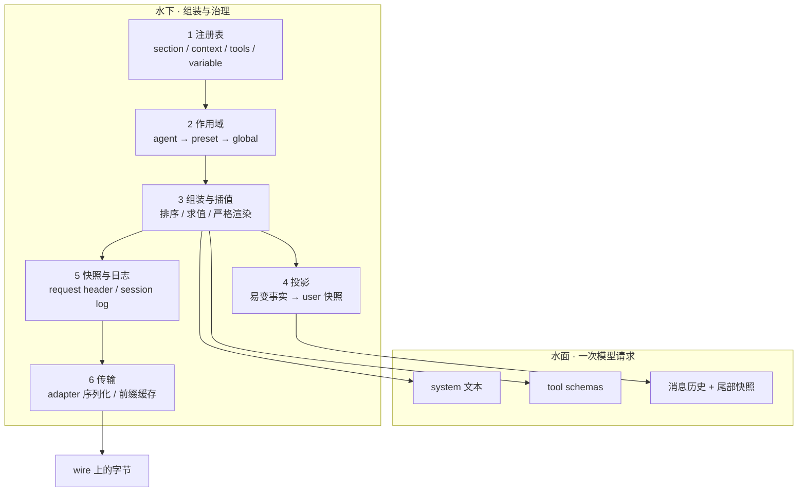
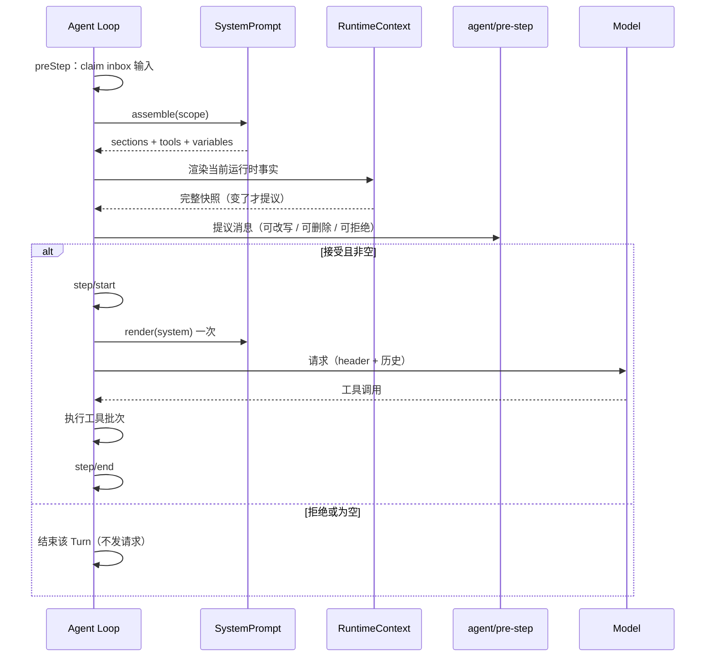
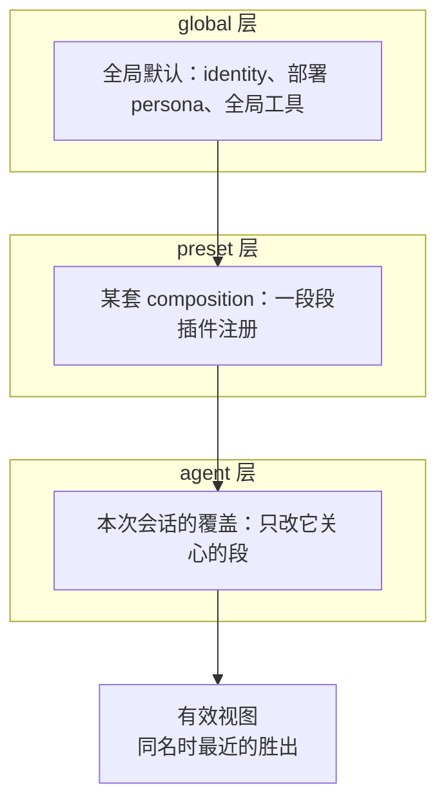
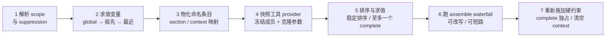
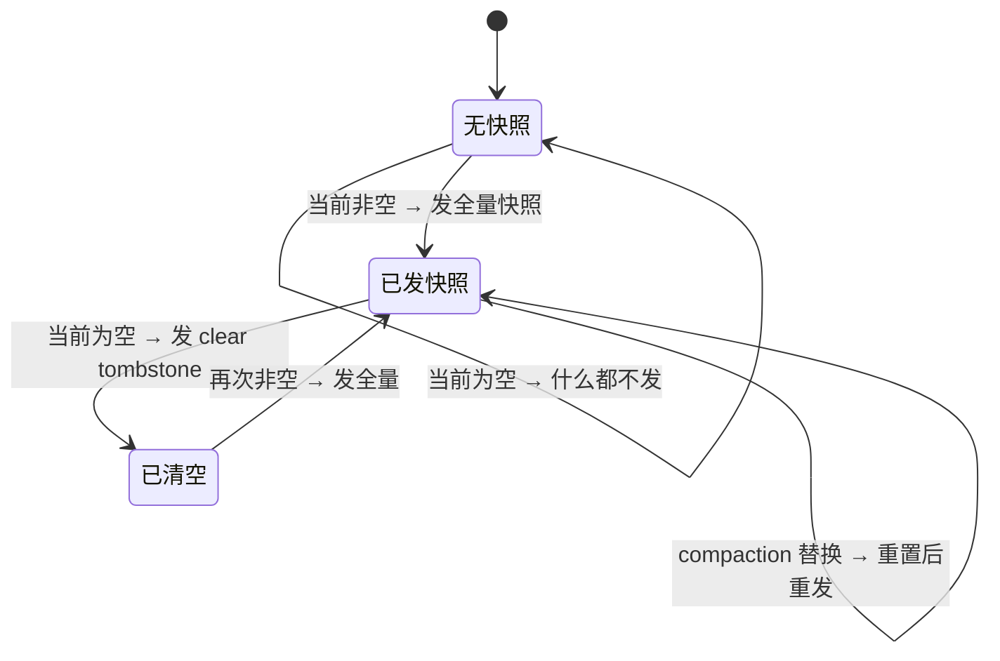
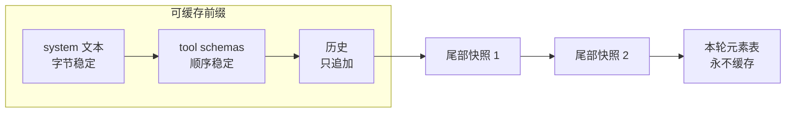

# DeepSeek Harness 提示词管理：冰山之下

> 整理日期：2026-10-28
> 对象：`deepseek-ai/deepseek-harness`，基线 commit `47f943859bef60e4160492346772ded9b24f765a`
> 目的：解释「模型看到的那段文本」下面，提示词如何注册、分层、组装、投影、快照、复用
> 读法：Ch1–2 心智模型 → Ch3–8 稳定层 → Ch9–11 易变层 → Ch12–13 可重放与缓存 → Ch14–15 取舍与落地
> 边界：讲机制，不鼓励照抄。每章末尾有一句对 `mobile-use` 的映射，Ch15 给完整落地方案

---

## 一句话总览

DSH 不维护一份 prompt 模板。它维护一张**注册表**；每个 Step 从注册表重新组装一次；稳定部分进 system，易变事实作为 user 消息追加在历史之后；组装结果先写日志，再发请求。

三个目标贯穿全部设计：

1. **按 Agent 组合** —— 不同 agent 共享一套段，只覆盖自己那几段。
2. **确定性重放** —— 模型看到的每样东西都能从 session log 重建。
3. **前缀缓存稳定** —— 稳定字节在前，易变字节在后。

后面每一个看起来「奇怪」的设计，都是这三条之一的解。

## 目录

- [第 1 章　冰山模型：模型看到的那一段，下面有六层](#ch01)
- [第 2 章　生命周期与一次 Step 的旅程](#ch02)
- [第 3 章　四条车道与五种注册项](#ch03)
- [第 4 章　Section 注册表：name、order、complete](#ch04)
- [第 5 章　变量、渲染与所有权](#ch05)
- [第 6 章　Scope 分层：shadow 的是 provider](#ch06)
- [第 7 章　工具接口：schema 与 guidance 是两次注册](#ch07)
- [第 8 章　组装流水线：七步与失败面](#ch08)
- [第 9 章　Runtime context：只追加的全量快照](#ch09)
- [第 10 章　Context 插件：四类来源的刷新规则](#ch10)
- [第 11 章　Pre-step 与「分布式的消息顺序」](#ch11)
- [第 12 章　Request header：稳定那一半的重放锚点](#ch12)
- [第 13 章　KV cache：是结果，不是机制](#ch13)
- [第 14 章　取舍：哪些值得搬，哪些是插件生态的税](#ch14)
- [第 15 章　给 mobile-use 的最小蓝图](#ch15)
- [附录 A　源码地图](#appa)
- [附录 B　术语表](#appb)
- [附录 C　自检清单](#appc)

---

<a id="ch01"></a>
## 第 1 章　冰山模型：模型看到的那一段，下面有六层

> **一句话结论**：你看到的 system prompt 只是请求体最上面的一层；DSH 真正维护的是「谁能往里加什么、什么时候加、加完存哪」。

### 水面

一次 DeepSeek 请求里，模型能看到的只有三样东西：

- 一段 system 文本
- 一组 tool schemas
- 一串消息（历史 + 本轮的 user 快照）

大多数人调 prompt，只盯着第一项的文字。DSH 的设计假设是：**这三样都是「提示词」，而且它们的顺序、来源、时机，比文字本身更容易决定行为。**

### 水下六层

| 层 | 回答的问题 | 主要机制 |
|---|---|---|
| 1 注册表 | 谁允许往 prompt 里加东西？ | `section` / `context` / `tools` / `variable` / `suppressRuntimeContext` |
| 2 作用域 | 这段是全局的，还是某个 agent 的？ | `agent → preset → global`，同名就近覆盖 |
| 3 组装 | 这些段按什么顺序、用什么值拼起来？ | 按 `order` 稳定排序、变量求值、严格插值 |
| 4 投影 | 每轮会变的事实怎么进来？ | 渲染成 user 快照，追加在历史之后 |
| 5 快照与日志 | 这次请求到底给模型看了什么？ | request header + session log，可重放 |
| 6 传输 | 最终怎么变成 wire 上的字节？ | adapter 序列化、前缀缓存 |



### 一个具体例子

`harness:identity` 是 DSH 里最不起眼的一段：

```
You are an AI agent powered by the DeepSeek Harness SDK.
```

它不是一个写死的字符串拼接位置，而是一条普通注册：

- `dsh-system-prompt` 用 `section({ name: 'harness:identity', order: -100, text })` 注册它
- `deployment:persona` 用 `order: 0` 注册在它后面，且可以被 agent 作用域的同名段覆盖
- 每次组装时，这两段和其他插件段一起参与排序、变量求值、插值
- 渲染结果进 `request/header.system`
- adapter 再把它序列化成 wire 上的第一条 system 消息

所以「模型看到的那句话」只是整条链路的终点，不是起点。

### 三个目标，一套机制

| 目标 | 机制上的体现 |
|---|---|
| 按 Agent 组合 | 命名 section + 作用域覆盖；子 agent 只换一段，不复制整份 |
| 确定性重放 | 组装结果先写 request header；易变事实也写进 log |
| 前缀缓存稳定 | system/tools 在前且稳定；易变事实只追加在尾部 |

> **源码锚点**
> - `packages/core/system-prompt/src/index.ts`（注册表、组装、渲染）
> - `packages/core/agent-loop/src/agent.ts`（preStep / step / request）
> - `packages/core/session/src/request-header.ts`（稳定半区的快照）
> - `docs/subsystems/system-prompt.md`（跨包类型）

### 坑

**只读最终 prompt，会误判「提示词写得好不好」。** 同一段文字，放在 system 里还是作为 user 快照追加，缓存命中率能差一个数量级；同一个工具说明，和 schema 一起注册还是单独注册，限制工具后的行为完全不同。文字只是冰山尖。

### 对你的映射

你的 [executor.md](file:///e:/MyCoding/mobile/mobile-use/minitap/mobile_use/agents/executor/executor.md) 是水面；[prompt.py](file:///e:/MyCoding/mobile/mobile-use/minitap/mobile_use/agents/executor/prompt.py) 是水下的一层——**渲染**。再往下的注册、作用域、投影、快照，目前没有对应物。

---

<a id="ch02"></a>
## 第 2 章　生命周期与一次 Step 的旅程

> **一句话结论**：生命周期决定「什么时候重新组装」，不决定「用哪份模板」；模板的拆分依据是波动性和所有权。

### 先纠正一个常见误解

很多人把 DSH 理解成「按 session / turn / step 切换不同的 prompt 模板」。不是。

- **生命周期**回答：什么时候重新算一次 prompt？答案是「每个 proposed Step」。
- **波动性**回答：什么内容放 system，什么内容放 user 消息？答案是「整场不变的进 system，每轮会变的追加」。
- **所有权**回答：这段文字归谁维护？答案是「拥有该事实的插件」。

三条线交叉，才是完整的提示词管理。

### 四个时间尺度

| 尺度 | 边界事件 | 重组装？ | 写 header？ | 易变事实？ |
|---|---|---:|---|---|
| Session | 创建 / 恢复 / 切换 preset | 首次 `initial` 或 `resume` | 是 | 无 |
| Turn | 用户一次输入到结束（`turn/start` → `turn/end`） | 是 | 只有内容变化才写 `change` | pre-step 阶段可能追加 |
| Step | 一次模型请求 + 工具批次（`step/start` → `step/end`） | 是 | 只有 canonical 内容变化才写 | 可能追加新快照 |
| Attempt | 同一 Step 内的 provider 重试 | **否** | 用同一份 system/tools 重建请求 | 否 |

三条容易记错的规则：

1. **工具结果回来 → 新 Step → 必须重组装。** 因为作用域里的 provider、运行时事实都可能已经变了。
2. **provider 报错重试 → 同一个 Step → 不重组装。** 重试只是再发一次请求，system 和 tools 复用本 Step 的组装结果。
3. **被拒绝或为空的 Step 也已经组装过。** 是否开 `step/start` 是在组装和投影之后才决定的。

### 一次 Step 的完整旅程



几个细节：

- `assemble()` 在 `preStep()` 里完成，**在 `agent/pre-step` 之前**。所以 listener 拿到的是已经组装好的 sections/tools/variables，只能在上面改，不能重新注册。
- `render(system)` 在 `step()` 里、provider 重试循环**之前**只做一次。所以重试不会重复插值。
- runtime context 的候选快照也在 `preStep()` 阶段产生，但它**不自动提交**；只有最终被接受进 decision，才会进消息列表。

### 失败面：挂在哪一步，日志里留下什么

| 失败点 | 已经写入日志 | 不会发生 |
|---|---|---|
| 组装 / provider / tool 排序失败 | `turn/start` | 无 `step/start`、无 header、无 adapter 调用 |
| 运行时上下文插值失败 | `turn/start` | 不打开 step |
| `agent/pre-step` 拒绝 | `turn/start`；inbox 的 claim 已持久化 | 无 step、无模型请求；Turn 以 blocked 结束 |
| 初始消息列表为空 | Turn 边界与 claim 事件 | 无 step；Turn 以 completed 结束 |
| system section 插值失败 | `turn/start`、`step/start`、已进入的 user 消息 | 不派发请求；`step/end` 仍在 finally 关闭 |
| 取消 / owner 销毁 | 无 step、无 chunks、无 assistant 消息、无 adapter 请求 | 整个 Turn 中止 |

这张表的用法：**排障时先看最后一条事件是什么**，就能判断它是在「组装层」「投影层」「准入层」还是「传输层」挂的。

> **源码锚点**
> - `packages/core/agent-loop/src/agent.ts:225-243`（preStep 边界）
> - `packages/core/agent-loop/src/agent.ts:332-370`（retry 边界）
> - `packages/core/agent-loop/tests/contract-regressions.spec.ts`（取消与失败分支）

### 坑

- **把「每轮」当「每次请求」。** 于是重试也重新拼 prompt，白付组装成本，还可能因为时间变化导致同一 Step 里 system 字节变了，缓存全失。
- **反过来，把「每次请求」当「每轮」。** 工具结果回来后不重组装，模型看到的是上一屏的过期描述。
- **在 `pre-step` 里做本该在注册时做的事。** 比如往里塞一段稳定指令，结果它每 Step 都随消息列表重发，还可能排到历史前面。

### 对你的映射

你的 `build_executor_messages()` 每个 executor 轮次都会重建整份消息列表，方向是对的。差别在于：你没有「组装 → 提议 → 准入 → step」这层，**每次 LLM 调用都直接组装并发送**；因此也不存在「重试复用组装结果」和「被拒的 step 已经组装过」这两个状态。

---

<a id="ch03"></a>
## 第 3 章　四条车道与五种注册项

> **一句话结论**：DSH 先把「模型能看到的输入」分成四条语义不同的车道，再谈怎么拼。

### 四条车道

| 车道 | 数据结构 | 落盘形态 | 典型内容 | 变化行为 |
|---|---|---|---|---|
| 稳定指令 | `PromptSection[]` | `request/header.system` | 身份、persona、循环、工具用法 | 每步重新渲染；值没变就不写新 header |
| 工具接口 | `ToolSchema[]` | `request/header.tools` | 工具名、描述、JSON 参数 | 每步规范化；按顺序比较 |
| 易变事实 | `PromptContext[]` | 带来源的 user 消息快照 | 沙箱模式、审批策略、委派状态 | 只有完整快照变化才追加 |
| 上下文插件 | `agent/pre-step` 消息 | 带来源的 user 消息 | 工作区指令、当前时间、tmux 位置、会话引用 | 每个插件自己管刷新、顺序、边界、来源 |

这张表是整份教程的索引：后面每一章都在展开其中一行。

### 五种注册项

`SystemPrompt` 不是一个「拼字符串的服务」，而是一个注册表。它只接受五种贡献：

| 注册 | 身份 | 求值 | 拆除 |
|---|---|---|---|
| `section({name, order, text, complete?})` | 名字在层内唯一 | 每次组装求值一次；插值更晚 | 随注册者的 effect 精确移除 |
| `context({name, order, text})` | 名字在层内唯一 | 运行时上下文被抑制时整条跳过 | 精确移除 |
| `suppressRuntimeContext()` | 匿名独立 token | 作用域链上任意一个激活即生效 | 只移除该 token |
| `tools(provider)` | 匿名 provider 成员 | 返回可见 schemas 和可选的 pre-restriction 名称 | 移除 provider |
| `variable(name, provider)` | 严格的 `[a-z][a-z0-9_]*` | 每次组装解析一次；可返回 `undefined` | 按名字精确移除 |

注意两个细节：

1. **注册和拆除是成对的。** 每个注册返回一个 disposer；插件卸载时，它贡献的段自动消失。这保证了「热插拔」不会留下孤儿 prompt 段。
2. **section 和 context 是两种东西，不是同一种东西的两种写法。** 一个进 header，一个进消息列表；混用会直接破坏缓存布局。

### 为什么 tool schema 也算「提示词」

三条理由，缺一不可：

- **它占 token。** 一个工具的参数 JSON 可能比整段 persona 还长。
- **它决定行为。** 模型能不能做一个动作，取决于它看到的 schema，而不是 system 里那句「你可以点屏幕」。
- **它影响缓存。** schema 的集合或顺序一变，从第一个变化的 schema token 开始，后面的前缀全部失效。

所以 DSH 把 schema 放进 `PromptAssembly`：**「告诉模型它能做什么」是一个整体**，即使 adapter 在 wire 上把 schema 放在单独字段。

### 为什么 variable 也是一种注册

`model` 和 `cwd` 不是模板里的字面量，而是由 agent loop 从 Agent / Session 上注册进来的：

```ts
ctx.systemPrompt.variable('model', () => agent.model)
ctx.systemPrompt.variable('cwd', () => session.cwd)
```

这是一个所有权选择：**模板只引用值，运行时对象仍然是值的源头。** 模板不需要知道 `cwd` 从哪来，也不需要在每次运行时被重写。

> **源码锚点**
> - `packages/core/system-prompt/README.md`（五种注册项的公开契约）
> - `docs/subsystems/system-prompt.md`（`PromptSection` / `PromptContext` 类型）
> - `packages/core/agent-loop/src/agent.ts`（`model` / `cwd` 变量）

### 坑

**把「system 里的一段文字」和「工具定义」当成两种东西。** 它们在组装层是同一件事的两个车道；只改一边，模型会收到「被告知能做」和「实际能做」不一致的信号。

### 对你的映射

你的 `system_message`、`goal_message`、`device_state`、`screen_elements`、反馈块，已经是四条车道的雏形。差别是：它们都在一个 `.md` 里、用同一种 Jinja 渲染、没有类型和落盘位置的区分。

---

<a id="ch04"></a>
## 第 4 章　Section 注册表：name、order、complete

> **一句话结论**：section 是「一段有名字、有顺序、有主人」的文本，不是一个字符串拼接位置。

### 形态

```ts
interface PromptSection {
  readonly name: string
  readonly order: number
  readonly text: string | ((context: AssembleContext) => string)
  readonly complete?: boolean
}
```

四个字段，各有硬约束：

| 字段 | 约束 | 违反时 |
|---|---|---|
| `name` | 同一层内唯一 | 注册时直接 throw |
| `order` | 必须是有限数 | 注册时 throw |
| `text` | 可以是静态串，也可以是每次组装的 provider；返回的是**未插值**文本 | provider 抛错则整次组装失败 |
| `complete` | 一个有效作用域内至多一个 | 两个则组装失败 |

### order 是契约，不是排版序号

官方约定：

- `-100`：harness 身份
- `0`：部署 persona
- `100–199`：工具用法指引
- 其他负数：也排在 persona 之前

`order` 只是数字，这个分带是**约定**。真正要记住的是：**同一层里两个段撞同一个 order，谁先谁后由注册顺序决定**，而注册顺序是插件加载顺序的产物——这是已知的确定性弱点。所以写新段时，先看带位，别挤在别人的数字上。

### `complete` 的确切语义

最容易误解的一点：`complete: true` **只收窄 sections，不收窄整个 assembly**。

- 变量、context、tools、waterfall 仍然照常执行。
- waterfall 仍然可以改变量、context、tools。
- waterfall 之后，注册表把「原本求值过的那个 complete 段」恢复成唯一的 section。
- 监听器不能替换它的名字或已求值文本，但**可以通过改变量间接改变它最终的渲染结果**（因为插值发生在更晚）。
- 如果运行时上下文被抑制，即使 waterfall 又把 context 加回来，也会被清空。

所以 `complete` 是「段级权威」，不是「整请求字节冻结」。真要字节固定，还得把它引用的变量也锁住。

### 一份典型的段清单

| order | name | 谁注册 | 内容 |
|---:|---|---|---|
| -100 | `harness:identity` | `dsh-system-prompt` | 固定的身份句 |
| 0 | `deployment:persona` | `dsh-system-prompt` / preset | 部署或 Agent 的 persona |
| 100 | `tool:bash` | `dsh-tool-bash` | bash 的跨调用用法 |
| 110 | `tool:read` | `dsh-tool-read` | read 的用法 |
| … | `tool:*` | 各工具包 | 各工具的坑与约定 |
| 200+ | 各插件自定义 | 各插件 | 工作流、输出风格等 |

这张表解释了一个设计选择：**工具说明跟着工具包走**，不存在一个中央文件写着所有工具的用法。加一个工具，就加一段；删一个工具，段随插件一起走。

> **源码锚点**
> - `packages/core/system-prompt/src/index.ts:337-455`（注册契约）
> - `packages/core/system-prompt/src/index.ts:467-541`（组装与 complete 恢复）
> - `packages/core/system-prompt/tests/scoped.spec.ts`（作用域覆盖行为）

### 坑

- **把 order 当排版序号。** 今天能用，明天两个插件撞带就变成「谁先加载谁在前」。
- **用 `complete` 做「冻结整个请求」。** 它冻不住 tools、contexts 和变量。
- **一个 agent 注册两份同义段。** 名字不同不算重复，模型会读到两套互相矛盾的规则。

### 对你的映射

你的 `system_message` 宏在效果上就是**一个 section**，只是它内部又用标题分成了若干块。要拿到 DSH 的可读性，第一步就是把它拆成 6–8 个有名字、有 order 的段。

---

<a id="ch05"></a>
## 第 5 章　变量、渲染与所有权

> **一句话结论**：模板只负责「在哪插值」，不负责「值从哪来」；值由拥有事实的人注册。

### 变量

- 注册名必须匹配 `[a-z][a-z0-9_]*`。
- 同一层内重复注册、或名字不可引用，注册时 throw。
- provider 每次组装求值一次，可以返回 `undefined`，表示「这次没有值」。
- 作用域内同名变量覆盖全局。
- **引用了一个注册过但值为 `undefined` 的变量，渲染时 throw。**

最后一条很重要：它把「值暂时没有」和「模板写错了」区分开。前者是组装期就能发现的状态，后者也是——两者都不允许静默变成空字符串。

### 严格渲染器

`renderPrompt(assembly)` 的规则，逐条看：

| 规则 | 行为 |
|---|---|
| 只认 `{{name}}` | `{{{model}}}`、`{{ model }}`、`{{model | upper}}` 都不认 |
| 只查 own property | `{{constructor}}`、`{{__proto__}}` 视为未知 |
| 未知引用 | throw |
| 注册了但值为 `undefined` | throw |
| 畸形完整组 | throw |
| 替换值不再扫描 | 值里出现 `{{x}}` 不会被二次替换 |
| 空段 | 消失，不留下空行 |
| 段之间 | 用空行连接 |
| 孤立的 `{{`（后面没有 `}}`） | 原样保留 |

这就是「fail loud beats shipping a malformed prompt」。宁可让这一轮失败，也不要把一份畸形提示词发给模型——因为模型不会告诉你它读到了半截指令，它只会表现得很奇怪。

### 渲染为什么「故意很晚」

section/context provider 返回的是**未插值**文本。顺序是：

1. 先求值 provider（拿到带 `{{var}}` 的文本）
2. 再解析变量
3. 最后才插值

好处是：同一段文本可以被不同变量组合复用；变量解析失败能和文本求值失败分开报错；`complete` 段的最终字节也能被变量影响。

### 三个反例

```text
{{cwd}}          → 正常，替换成注册值
{{constructor}}  → throw：不是 own property
{{{model}}}      → throw：畸形完整组
{{model}}        → 如果 model 注册了但返回 undefined → throw
```

> **源码锚点**
> - `packages/core/system-prompt/src/index.ts:204-294`（严格渲染）
> - `packages/core/system-prompt/tests/system-prompt.spec.ts:449-580`（变量与渲染测试）
> - `.agents/notes/implemented/architecture/2026-07-05-prompt-variables-and-tool-guidance-ownership.md`（设计理由）

### 坑

- **在模板里做条件、循环、计算。** 一旦模板能执行逻辑，「这段文字为什么长这样」就不再能从数据追溯。
- **用字符串拼接绕过变量。** 拼接出来的内容不参与变量解析，也不参与缓存字节的稳定性分析。
- **指望替换值被二次扫描。** 如果你在值里塞了 `{{x}}`，它不会被展开——这是有意为之，避免注入式递归。

### 对你的映射

Jinja 比 DSH 的渲染器强大得多：``、``、过滤器、宏都能写。这是能力，也是风险。建议保留 Jinja，但**约定只用 `{{var}}` 子集 + `StrictUndefined`**，条件和派生数据放回 Python。

---

<a id="ch06"></a>
## 第 6 章　Scope 分层：shadow 的是 provider

> **一句话结论**：覆盖的单位是「命名 provider」，不是「整份 prompt」。

### 作用域链

一次组装的解析顺序是：

```
agent → preset → global
```

最近的层覆盖最远的层。同名 section、context、variable 都是这个规则。



### 关键机制：先选 provider，再执行

覆盖不是「渲染完之后替换字符串」，而是**在 provider 求值之前就选定谁生效**。

测试里有一条很能说明问题的行为：一个作用域内的 `deployment:persona` 覆盖全局 persona 时，**被覆盖的全局 provider 根本不会被求值**。

这意味着：

- 子 agent 可以继承父 composition，只换一段，不需要复制整份 prompt。
- 被覆盖的段不会产生任何副作用（包括读文件、读环境、拼字符串）。
- 覆盖的成本是「多一层 map 查找」，不是「多渲染一遍再丢弃」。

### preset 是什么

一个 preset 就是一个目录，里面有一个 `agent.cordis.yml`，列出这套 composition 的插件行。

- roster 在进程里**只挂载一次**，在一个 standing scope 下。
- 每个命名它的 session 通过把 agent scope 的父链接到这个 mount 上加入。
- mount 的 tools、prompt sections、projection units 只存在一份，覆盖所有加入的 agent；插件按 Session/Agent 键状态，所以会话之间仍然隔离。
- 子 agent 用 `composeFrom()` 加入父的 standing composition，而不是重新 `mount()`。这样它拿到的是父**实际运行的那一代**，不会因为文件被改过而拿到另一个版本。

### 授权是 copy-only

DSH 没有「终端用户随便编辑 prompt」的 API。新建 preset 的唯一写操作是**整目录复制**一个已有 preset：

- 复制 composition、metadata、skills 目录、assets
- 改写 `preset.yml`：保留 description，丢掉 name 和 order
- 权限收紧到 owner-only，symlink 解引用
- 内置 preset 不允许删除

这条设计的产品含义：**prompt 是可组合的工程资产，不是运行时用户内容。** 要改，就复制一套再改。

> **源码锚点**
> - `packages/core/scope/src/store.ts:153-266`（层叠与覆盖）
> - `packages/core/system-prompt/tests/scoped.spec.ts:32-79`（被覆盖 provider 不执行）
> - `packages/preset/agent-presets/README.md`（preset 目录、挂载、copy-only 授权）

### 坑

- **以为 shadow 是后处理。** 于是写出「先渲染全局、再替换」的实现，副作用和成本都白付。
- **用「换整份 md 文件」实现覆盖。** 语言、agent、实验组各复制一份，最后没人知道哪份是基线。
- **把 preset 当热更新文件。** 运行中的 session 保留它加入时的那一代 composition；文件改动只影响之后创建的 session。

### 对你的映射

你现在是**整文件覆盖**：换语言 = 换 `executor-zh.md`，换 agent = 换另一个 `.md`。DSH 是**单段覆盖**。前者的问题是任何一处小差异都要复制全量；后者可以只覆盖 `persona` 或 `tool:bash` 一段。

---

<a id="ch07"></a>
## 第 7 章　工具接口：schema 与 guidance 是两次注册

> **一句话结论**：schema 和 guidance 是两次独立注册；隐藏 schema 不会删掉说明它的那段话。

### 工具的两半

| 半 | 表现 | 注册方式 | 模型感知 |
|---|---|---|---|
| schema | 名字、描述、JSON 参数 | `tools(provider)`，由 `ToolRegistry` 自动注册 | 决定「我能调什么、怎么调」 |
| guidance | 跨调用的坑与约定 | 各工具包自己的 `section` | 决定「我该怎么用、什么时候别用」 |

它们是**独立**的。这条独立性带来一个明确的坑：**把某个工具 restrict 掉，只会让 schema 从可见集合里消失，讨论它的那段 guidance 仍然在 system 里。**

所以 DSH 的 README 写了一句很直白的话：如果一个包要求两者同步移动，它必须让自己的 guidance provider 去检查当前作用域的可见性。

### canonical 顺序

工具 schema 的模型侧顺序是确定性的：

- 默认：locale-independent 的 code-unit 字典序。
- 显式 `toolOrder`：必须包含**恰好一个** `<unlisted-tools>` 占位；不能有重复；未列出的工具按字典序落在占位位置。
- 配置里列了一个 provider 的 `knownNames` 之外的名字 → 每次 `assemble()` 都拒绝。
- provider 返回保留名 `<unlisted-tools>` → 组装失败。

为什么要在注册表里做这件事，而不是让每个插件自己带权重：**注册顺序是插件加载的产物，不是语义。** 中央列表把「模型看到的顺序」变成一个可审查的配置。

### 顺序为什么是正确性问题

顺序影响三件事：

1. **正确性**：某些模型对工具顺序敏感，尤其是相似工具挨在一起时容易选错。
2. **重放**：同一份 log 要能重建出同一个 schema 序列。
3. **缓存**：schema 顺序一变，从第一个变化的 schema token 开始，前缀全部失效。

所以 canonical 排序不是「美化」，是组装层必须负责的确定性。

> **源码锚点**
> - `packages/core/system-prompt/src/index.ts:139-183`（排序算法）
> - `packages/core/tools/README.md`（`ToolRegistry.restrict()` 与可见性）
> - `packages/core/system-prompt/README.md`（schema 与 guidance 分离）

### 坑

- **restrict 之后忘了 guidance。** 模型被告知一个它调不到的工具，然后开始编造调用。
- **在 waterfall 里加/改工具顺序。** waterfall 之后没有第二道 canonical 化；谁改谁负责确定性。
- **以为同名 schema 会自动去重。** 这一层不做静默去重。

### 对你的映射

你刻意**不 bind_tools**：设备工具的 JSON schema 有 4,000+ token，而且不参与缓存；所以你把工具表写成 `executor.md` 里的文本，只把 `ExecutorOutput` 作为真正的结构化输出工具。

这在 DSH 的分类里是「把 schema 车道折叠进文本车道」。收益是 token 和缓存；代价是**工具表要手维护**，且模型看到的参数不会经过 provider 校验。这是一个有理有据的偏离，但要清楚它的代价。

---

<a id="ch08"></a>
## 第 8 章　组装流水线：七步与失败面

> **一句话结论**：组装是七步确定性流水线，排序和快照都在 waterfall 之前完成。

### 七步



逐步说明：

1. **解析作用域与抑制**：收集 scope 链，判断是否有全局或继承的 suppressor 激活。
2. **求值变量**：先全局，再从祖先到最近；近的覆盖同名。
3. **物化命名条目**：在任何文本 provider 执行之前，先构建有效的 section / context 映射。
4. **快照工具 provider**：冻结这一代的成员，逐个调用，克隆 schema 参数。
5. **排序与求值**：按 order 稳定排序，强制至多一个 complete，求值文本，规范化工具。
6. **跑 waterfall**：`system-prompt/assemble` 可以协作式改写，也可以短路。
7. **重新施加硬约束**：把原本求值的 complete 段恢复成唯一 section；抑制激活时清空 contexts。

### mutation 语义

这一层的细节，决定了「注册表是不是活的」：

| 行为 | 语义 |
|---|---|
| 工具 provider 成员 | 组装开始时快照；组装期间新注册的 provider 下一轮才出现 |
| 变量 | live map 迭代；前一个变量 provider 注册的变量，本次就可能出现 |
| section / context / tool 容器 | 每次组装都是全新的 |
| 工具参数 | 结构化克隆，防止下游改到注册对象 |
| 注册对象本身 | **是借用的，不是冻结的**；背后改它不会发 `system-prompt/change` |

最后一条是明确的 ownership caveat：**运行时的不可变性从「组装快照 / 请求快照」开始**，不是从注册那一刻开始。公开类型是 readonly，但这只是类型层面的约束。

### waterfall 的权威性

`system-prompt/assemble` 的返回值是权威的，**除了两件事**：

- 有效的 complete section 会在 waterfall 之后被恢复成唯一 section。
- 抑制激活时，contexts 会被清空。

所以监听器能做很多事，但不能绕过这两个硬约束。

> **源码锚点**
> - `packages/core/system-prompt/src/index.ts:467-541`（`assemble()` 主流程）
> - `packages/core/system-prompt/tests/system-prompt.spec.ts:212-333`（mutation 测试）
> - `docs/subsystems/system-prompt.md`（waterfall 契约）

### 坑

- **在 waterfall 里改顺序/加工具，却以为注册表会兜底。** 它不会。
- **以为注册完就冻结了。** 改注册对象不会触发变更事件，下一次组装可能悄悄换了内容。
- **用组装期间的副作用注册新段。** 工具 provider 是快照，变量是 live——两套语义混着用很容易写出「这次有、下次没有」的段。

### 对你的映射

你的 `build_executor_messages()` 是一条**硬编码流水线**：先 system，再 task started，再 goal，再历史，再设备状态、stall、视觉表、元素表。加一个块要改一个函数、加一个宏。好处是顺序一眼可见；DSH 的流水线更灵活，但顺序分散在多个插件里。

---

<a id="ch09"></a>
## 第 9 章　Runtime context：只追加的全量快照

> **一句话结论**：易变事实不进 system，而是作为「全量快照」追加在历史之后；变了才发，变空发 tombstone。

### 为什么不能进 system

假设「前台应用」放进 system。用户在任务里点开五个 app，每次 `focused_app` 变化，system 就变了。system 是请求的第一段字节，它一变，**后面全部历史的前缀缓存失效**。

你已经在 [prompt.py](file:///e:/MyCoding/mobile/mobile-use/minitap/mobile_use/agents/executor/prompt.py#L485-L600) 里实测过这件事：设备状态卡在历史前面时，缓存命中率 15.8%；挪到历史之后，历史那段被覆盖，命中率回升。

DSH 把这条经验做成了类型：**易变事实不是 section，是 `PromptContext`。**

### 渲染成什么

`PromptContext` 渲染成一条带来源的 user 消息，内容是一个带固定前导语的快照：

```
以下快照取代之前的快照：
- sandbox: ...
- approval: ...
- delegation: ...
```

「supersedes earlier snapshots」这句话不是装饰。它告诉模型：**别把旧快照和这份混在一起读**。历史里的旧快照仍然在，但语义上已经失效。

### 五状态机



逐条解释：

| 状态转移 | 行为 | 为什么 |
|---|---|---|
| 无 → 无 | 不发 | 没有旧语义需要清除 |
| 无 → 有 | 发全量 | 第一次建立语义 |
| 有 → 同文 | 不发 | 历史里已经带着有效快照 |
| 有 → 变文 | 发全量，不发 diff | 保证模型读到的是一份完整状态，不是拼图 |
| 有 → 空 | 发 tombstone | 否则旧快照会继续被当作有效 |
| compaction 替换 | 重置保留状态 | 承载快照的那条消息可能被压掉了，下一步必须重发 |

### 候选快照不自提交

投影器只是**提议**一条消息。它是否真的进入消息列表，取决于 `agent/pre-step` 的最终 decision：

- listener 可以删除它、改写它、重排它、拒绝它。
- 如果它被删掉，投影状态**不会**假装推进；下一个 Step 会再次提议。
- 如果它被接受，才成为本轮历史的一部分。

这个「提议 → 准入」的两段式，是 DSH 把「事实」和「策略」分开的地方：投影器管事实，pre-step 管这一次要不要说。

> **源码锚点**
> - `packages/core/agent-loop/src/runtime-context.ts:24-75`（投影状态机）
> - `packages/core/agent-loop/src/agent.ts:225-243`（pre-step 准入）
> - `packages/core/agent-loop/tests/request-reconstruction.spec.ts`（快照与重建）

### 坑

- **每轮都发同一份快照。** 语义没错，但白占 token，还会让历史里堆满重复快照。
- **只在字段变化时发半个快照。** 模型会把两份拼起来读，得到互相矛盾的状态。
- **删掉历史里的旧快照。** 历史是不可变的；正确做法是追加 tombstone 或新快照。
- **把 `context` 当 section 用。** 它进消息列表，不进 header；混用会破坏前缀。

### 对你的映射

你的 `device_state` 每轮重建一条 HumanMessage，追加在局部历史之后——方向是对的。差别是：你**无条件每轮都发**，没有「同文不发 / 变空发 tombstone / compaction 重置」三态。设备状态很短，无条件发的代价还能接受；如果以后加更多运行时事实，值得补上这三态。

---

<a id="ch10"></a>
## 第 10 章　Context 插件：四类来源的刷新规则

> **一句话结论**：每个上下文插件自己拥有「什么时候刷、排在哪、留多长、来源是谁」。

### 四类来源

| 插件 | 刷新 / 准入规则 | 放置与来源 |
|---|---|---|
| Agent instructions | 组合工作区文件，并跟踪工具碰过的路径；初始 Step 不会跑时保留 pending context | 在 claim 的批次之后、驱动层 runtime context 之前 |
| Time context | 每个 Step 一次，除非配置的刷新间隔仍覆盖上次注入；解析浏览器或回退时区 | 在下游 pre-step 决策之后追加带来源的快照 |
| Tmux context | 只在 Step 1；要求 shell 可用、刷新到期、位置查询成功、状态确实变化 | 把带来源的快照**前置**到 decision |
| Session reference | 显式由 host 准备；按 mention 顺序快照有界的被引用会话表面 | 返回一条聚合 recall 消息，交给调用方入队 |

### 它们的共同模式

四个插件看起来各干各的，但都在回答同一组问题：

1. **什么时候刷？** 每 Step、每 Turn、只在第一步、还是按间隔。
2. **排在哪？** 在 claimed batch 之前/之后、在 runtime context 之前/之后。
3. **留多长？** 有界快照、只在有效期内保留、compaction 后重发。
4. **来源是谁？** 消息要带 plugin 与 named-section 的 provenance，否则重放时说不清这条是谁加的。

### 为什么它们不进 system

因为它们的变化频率和生命周期各不相同：

- 工作区指令可能整个任务不变，但它读的是文件，**文件可能在任务中途被改**。
- 当前时间每 Step 都在变。
- tmux 位置只在第一步有意义。
- 会话引用是显式一次性的。

如果把它们塞进 system，你会得到一份「每个 Step 都可能变」的 system，前缀缓存直接报废。如果把它们统一成一种 context，又会丢掉各自的刷新规则。

> **源码锚点**
> - `packages/context/agent-instructions/src/index.ts:322-347`
> - `packages/context/time-context/src/index.ts:170-208`
> - `packages/context/tmux-context/src/index.ts:208-246`
> - `packages/core/agent-loop/src/runtime-context.ts`（运行时事实的基线实现）

### 坑

- **把插件当「往 system 里塞字」的快捷方式。** 它塞的是消息，不是 section。
- **让两个插件都负责同一件事。** 比如两个都注入当前时间，最后模型看到两个不同的「现在」。
- **不记 provenance。** 出问题时无法判断这条上下文是谁加的、按什么规则加的。

### 对你的映射

你现在有三个「手写插件」：`task_started_message`、`device_state`、`screen_elements`。它们的刷新规则写死在 `prompt.py` 里：

- task started：整场不变
- device state：每轮重建
- screen table：每轮重建，且必须最后

这已经是一种插件化，只是没有插件接口。Ch15 的 manifest 可以顺手把「刷新规则」写进每个消息块的元数据。

---

<a id="ch11"></a>
## 第 11 章　Pre-step 与「分布式的消息顺序」

> **一句话结论**：pre-step 的顺序由 listener 嵌套决定，灵活但把顺序变成了隐式契约。

### waterfall 的工作方式

`agent/pre-step` 是一条 waterfall：每个 listener 拿到当前 decision 和 `next()`，可以：

- 在 `next()` 之前改（前置）
- 在 `next()` 之后改（后置）
- 直接返回，短路后面的 listener
- 抛错，拒绝这次 Step

最终的消息顺序，取决于 listener 的嵌套顺序和各自在 `next()` 前后的行为。

### 它的两面

**优点**：每个插件自治。时间插件不需要知道 tmux 插件存在，只要各自决定「我这条放哪」。

**代价**：顺序变成分布式契约。

- 你无法在一个文件里看到最终顺序。
- 两个插件都选择「后置」，谁在谁后面取决于注册顺序。
- 调试「为什么这条消息排在元素表后面」要沿着 listener 链走一遍。

DSH 自己的文档也承认这一点：pre-step waterfall 很强，但**最终顺序依赖 listener 嵌套和每个插件的 before/after `next()` 行为**。

### 三条判据

要决定一条内容走哪条路，问三个问题：

| 判据 | 走 system section | 走 runtime context / pre-step |
|---|---|---|
| 整场不变吗？ | 是 | 否 |
| 是「规则/指令」还是「当前事实」？ | 规则 | 事实 |
| 需要来源与刷新审计吗？ | 不太需要 | 需要 |

三条都指向同一边时，选择很清楚；出现分裂时，优先看第二条——**指令进 system，事实进消息**。

### 反模式

- **稳定指令塞进 pre-step。** 它每 Step 都重发，还可能排到历史前面。
- **易变事实塞进 system。** 缓存从第一个变化的 token 开始报废。
- **靠插件加载顺序决定消息顺序。** 今天对，明天装个新插件就变。
- **在 pre-step 里重新组装 prompt。** 组装已经发生过了；你拿到的是组装结果，不是注册表。

> **源码锚点**
> - `packages/core/agent-loop/src/agent.ts:225-243`（pre-step 与准入）
> - `packages/core/agent-loop/src/runtime-context.ts:24-75`（提议与提交分离）

### 坑

**把「灵活」当成「不需要设计顺序」。** 插件越多，顺序越像一场隐式协商。单产品阶段，显式顺序通常比插件自治更值钱。

### 对你的映射

你的顺序是**一个函数里的显式序列**：system → task started → goal → 历史 → 设备状态 → stall → 视觉表 → 元素表。这是你的优势——顺序一眼可见，测试也能直接守。不要为了「插件化」把它换成注册顺序，除非你真的需要第三方扩展。

---

<a id="ch12"></a>
## 第 12 章　Request header：稳定那一半的重放锚点

> **一句话结论**：稳定那一半（system + tools + config）被快照进 request header，只有内容变化才写新版本。

### header 里有什么

- 解析后的调用配置（model、temperature 等）
- 哪些字段来自 adapter 默认值（用标记记录，避免「默认值变了但看不出来」）
- 渲染后的 system 文本
- 有序的 tool schemas

空 system / 空 tools 会被规范化成「字段不存在」，而不是空字符串或空数组。这样「没有」和「有但为空」在比较时不会混淆。

### 写策略

| 时机 | 写什么 |
|---|---|
| 第一次请求 | `initial`（或恢复会话时的 `resume`） |
| 之后的请求 | 只有 canonical equality 失败时，才写一份完整的 `change` 快照 |
| 每 Step 重新组装但内容没变 | **不写** |

canonical equality 比较四样东西：配置、adapter 默认标记、system 字节、按顺序的 schemas。

所以「每 Step 重新组装」不会导致「每 Step 都写一份 header」——只有真的变了才写。这也是为什么 DSH 敢每个 Step 都重组装。

### 离线重放

重放时，折叠最新的完整快照，就能得到当时模型看到的稳定半区：

```
request = 最新 header + Session.deriveMessages()
```

这条公式很重要：**没有第二个隐藏的对话存储。** 稳定指令和消息历史各有各的持久锚点，请求由两者拼出来。

> **源码锚点**
> - `packages/core/session/src/request-header.ts:14-70`（header 结构与比较）
> - `packages/core/agent-loop/src/agent.ts:403-495`（请求构建）
> - `packages/core/agent-loop/tests/request-reconstruction.spec.ts:433-455`（无变化不写 header）

### 坑

- **把 header 当日志副本。** 它是请求真值；日志是它的持久化形式。
- **每次请求都写全量。** 能工作，但大工具目录下日志体积会明显膨胀——这是 DSH 自己列出的成本。
- **只记录消息，不记录 system/tools。** 重放时模型看到的东西和你以为的不一样。

### 对你的映射

你现在没有 header 概念：每次调用从 `build_executor_messages()` 重新拼，拼完就发。要做重放或精确审计，至少要把**当轮的 system 字节 + 工具表文本 + 消息列表**落一份；否则事后无法回答「模型当时到底看到了什么」。

---

<a id="ch13"></a>
## 第 13 章　KV cache：是结果，不是机制

> **一句话结论**：KV cache 不是 harness 的功能，是「稳定前缀 + 只追加历史」布局的副产品。

### wire 上的顺序

DeepSeek adapter 的序列化顺序是：

1. system 文本作为第一条 wire 消息
2. 然后追加 `Session.deriveMessages()` 出来的历史

它总是请求 streaming usage，但**不设显式的 cache-control 指令**。DSH 自己也不维护 KV cache。

### 缓存怎么命中



规则只有一条：**前缀从第一个变化的 token 开始失效。**

所以布局就是缓存策略：

- system 必须逐字节稳定（persona 不塞任务时间、不塞前台 app）。
- tool schema 的集合和顺序必须稳定。
- 历史只能追加，不能改写。
- 每轮变的事实只能出现在尾部。

### 你已经有实测数据

[prompt.py](file:///e:/MyCoding/mobile/mobile-use/minitap/mobile_use/agents/executor/prompt.py#L1-L41) 的模块文档里记着两组数：

- 元素表排在历史前面：缓存命中率递减到 48%；排在后面：递增到 93%。
- 设备状态卡在历史前面：executor 命中率只有 15.8%（六个 agent 最差）。

这两组数和 DSH 的设计是同一个结论的两端：**它们从机制推出布局，你从实测推出布局。**

> **源码锚点**
> - `packages/llm/llm-deepseek/src/serialize.ts:143-186`（wire 顺序）
> - `packages/core/agent-loop/tests/request-cache.e2e.ts:71-103`（缓存读取的端到端契约，需 key）
> - DSH 分析文档第 12 节（缓存是 emergent，不是 harness 维护）

### 坑

- **把每轮变的东西放进 system。** 改一个字符，整段 system 之后全部重算。
- **把每轮变的东西放在历史前面。** 历史整段每轮重算——这是最贵的错误。
- **以为缓存需要显式指令。** 这条路径没有 cache-control；复用来自字节稳定。
- **频繁重排工具。** 顺序变一次，从第一个变化的 schema token 开始失效。

### 对你的映射

你已经在 `build_executor_messages()` 里把「每轮变的一律靠后」写成了硬顺序，并有测试守着「元素表必须是最后一条」。这已经拿到了 DSH 的核心收益。下一步是把这条纪律从**注释**变成**每个段的 lane 元数据**（Ch15）。

---

<a id="ch14"></a>
## 第 14 章　取舍：哪些值得搬，哪些是插件生态的税

> **一句话结论**：DSH 的每个优点都对应一个成本；单产品只需要搬「车道 + 命名 + 顺序 + 严格渲染」。

### 成本表

| 选择 | 收益 | 成本 / 边界 |
|---|---|---|
| 每个 proposed Step 重组装 | 没有陈旧的 change-driven 缓存；当前作用域永远是最新的 | 每个 Step 都付 provider 与组装成本 |
| 全量 header 快照 | 本地可重建、比较简单 | 工具目录大时，日志条目比增量大 |
| 追加易变上下文 | 保住前缀缓存与来源 | 快照会累积，直到被替换或 compaction |
| 分布式 pre-step 顺序 | 插件自治、可插拔 | 最终顺序依赖 listener 嵌套，调试成本高 |
| `complete` section | 强覆盖能力 | 最终字节仍受变量影响，不是真正冻结 |
| 作用域 shadowing | 单段覆盖，不复制全量 | 认知成本：你得知道当前作用域链 |
| 注册对象借用 | 注册便宜 | 背后改动不发事件，可能悄悄影响下一次组装 |
| canonical 工具顺序 | 正确性 + 重放 + 缓存 | 配置复杂；写错在首次组装才报错 |

### 值得搬的五件事

1. **按波动性分车道。** 稳定指令 / 工具接口 / 易变事实 / 偶尔上下文，四类不混。
2. **命名 + 顺序。** 每段有唯一名字和明确顺序，顺序是契约不是排版。
3. **严格插值。** 模板只做 `{{var}}`；未知变量和畸形语法直接失败。
4. **易变事实追加。** 不进 system，不写历史前面，变了才发全量。
5. **失败要响。** 组装失败、插值失败、配置错误，都在发请求之前暴露。

### 别搬的五件事

| 机制 | 为什么单产品不需要 |
|---|---|
| Cordis 插件系统 | 你没有第三方插件生态；注册表一个 Python 模块就够 |
| 作用域链 `agent → preset → global` | 6 个 agent、一套产品，整文件覆盖还能接受；等出现「同一 agent 多实验组」再上 |
| `system-prompt/assemble` waterfall | 没有多方协作改写，就没有 waterfall 的必要 |
| request header 重放 | 除非你要做审计、回放、跨进程恢复 |
| preset 目录 + copy-only 授权 | 除非你要让用户自己组合 agent |

一句话：**DSH 解决的是「几十个插件互相覆盖同一份 prompt」的问题；你解决的是「一个产品的提示词可读、可维护、可缓存」的问题。** 两者交集是车道和命名，不是框架。

> **参考**：DSH 分析文档第 13 节（Strengths, costs, and unresolved edges）。

### 对你的映射

你的规模（6 个 agent、单产品）刚好落在「值得搬的五件事」里，完全不需要「别搬的五件事」。这也是 Ch15 只给最小蓝图、不给框架的原因。

---

<a id="ch15"></a>
## 第 15 章　给 mobile-use 的最小蓝图

> **一句话结论**：把「一个宏库文件」换成「manifest + 每段一个文件 + 只做插值的渲染器」，就能拿到 DSH 80% 的可读性收益。

### 目标目录

```
minitap/mobile_use/agents/executor/
  prompt.py                    # 组装消息列表（保留）
  prompt_manifest.toml         # 段的清单：name / order / file
  prompts/
    system/
      00-identity.md
      10-role.md
      20-loop.md
      30-rules.md
      40-perception.md
      50-tools.md
      60-output.md
    messages/
      goal.md
      device-state.md
      screen-elements.md
      vision-subjects.md
      feedback.md
```

`executor.md` 从「宏库」退化成 manifest 的等价物，然后删掉；`executor-zh.md` 拆成每个段旁边的 `*.zh.md`。

### manifest

```toml
# prompt_manifest.toml
[[system]]
name = "identity"
order = -100
file = "system/00-identity.md"

[[system]]
name = "role"
order = 0
file = "system/10-role.md"

[[system]]
name = "loop"
order = 10
file = "system/20-loop.md"

[[system]]
name = "rules"
order = 20
file = "system/30-rules.md"

[[system]]
name = "perception"
order = 30
file = "system/40-perception.md"
when = "perception_enabled"     # 由 Python 判断，不写进模板

[[system]]
name = "tools"
order = 40
file = "system/50-tools.md"

[[system]]
name = "output"
order = 50
file = "system/60-output.md"
```

### 渲染器

```python
# agents/executor/prompt.py 里新增；示意，不是成品
from __future__ import annotations

from pathlib import Path
import tomllib

from jinja2 import Environment, StrictUndefined

_ENV = Environment(undefined=StrictUndefined, autoescape=False)


def _pick_language(path: Path, language: str) -> Path:
    """按段回落：缺这一段的中文版，只回落这一段。"""
    if language == "zh":
        zh = path.with_name(f"{path.stem}-zh{path.suffix}")
        if zh.is_file():
            return zh
    return path


def render_system(root: Path, values: dict, language: str = "en") -> str:
    manifest_path = root / "prompt_manifest.toml"
    manifest = tomllib.loads(manifest_path.read_text(encoding="utf-8"))
    sections = sorted(manifest["system"], key=lambda s: s["order"])

    chunks: list[str] = []
    for section in sections:
        if section.get("when") and not values.get(section["when"]):
            continue
        path = _pick_language(root / section["file"], language)
        source = path.read_text(encoding="utf-8")
        text = _ENV.from_string(source).render(**values).strip()
        if text:
            chunks.append(text)
    return "\n\n".join(chunks)
```

三条约定：

1. **模板只做 `{{var}}`。** 用 `StrictUndefined`；条件、循环、派生数据全部留在 Python。
2. **空段消失。** 渲染结果是空字符串的段不进结果，等价于 DSH 的「empty sections disappear」。
3. **顺序只由 manifest 决定。** 文件名前缀只是给人看的，真正的顺序在 `order` 里。

### 新旧映射

| 现在 | 之后 |
|---|---|
| `render_executor_system(ctx)` | `render_system(root, values, language)` |
| `system_message(platform, tools_list, perception)` 宏 | 7 个 section 文件，`platform/tools_list` 作为变量 |
| `` 包住视觉段 | manifest 的 `when` + Python 传值 |
| `render_goal_message` / `render_device_state` / `render_screen_message` | 保留函数，模板移到 `prompts/messages/` |
| `executor-zh.md` 整份翻译 | 每个段旁的 `*.zh.md`，缺段只回落缺的那段 |
| `tests/test_prompt_templates.py` 校验宏名 | 校验 manifest 的 name 唯一、file 存在、渲染非空 |

### 迁移四步

1. **抽 manifest，拆 system。** 把 `system_message` 里的文案原样搬到 7 个文件，不改一个字；顺序按现有标题。
2. **换渲染入口。** 用 `render_system` 替换 `render_executor_system`，跑现有测试；对比新旧渲染结果，允许空行差异，不允许内容差异。
3. **移 runtime 块。** 把 `goal_message` 等宏的正文搬到 `prompts/messages/`，`prompt.py` 的 render 函数保留，只换模板路径。
4. **加逐段中文。** 一次翻一段，缺哪段回落哪段；给每段首行加 `<!-- volatility: static|per-turn -->`，让「为什么它在这」写在文件里。

### 测试

- **顺序**：manifest 排序后与旧的硬编码顺序逐项一致。
- **字节稳定**：同一运行内连续调用 `render_system` 两次，结果相同。
- **最后一条**：`test_t18b_the_last_message_is_the_element_table` 继续守。
- **逐段回落**：删掉 `40-perception-zh.md`，只有 perception 段变英文，其余仍是中文。
- **失败要响**：manifest 重名 / 文件缺失 / 引用未定义变量，在启动时失败，而不是发请求时静默。

### 预期结果

- `executor.md` 222 行 → 7 个 10–40 行的小文件，改文案只看一个文件。
- `prompt.py` 里 13 个 `render_*` wrapper 收敛成 1 个 system 渲染 + 一组消息渲染。
- 语言、实验组、agent 变体可以只覆盖一段，不再复制全量。
- 缓存顺序从「注释里的纪律」变成「manifest 里的 lane」。

### 不做的部分

- 不引入插件加载器、作用域链、waterfall。
- 不做 request header 重放，先把「当轮 system 字节 + 消息列表」记进现有 telemetry 即可。
- 不追求 DSH 的 `complete` / 变量作用域；先拿到「段边界 + 顺序 + 严格插值」。

> **源码锚点（对照用）**
> - `packages/core/system-prompt/src/index.ts`（注册与组装的最小语义）
> - `packages/core/system-prompt/README.md`（order 带、严格渲染、empty 段消失）

---

<a id="appa"></a>
## 附录 A　源码地图

| 想确认什么 | 看哪个文件 |
|---|---|
| section / context / tools / variable 的公开契约 | `packages/core/system-prompt/README.md` |
| 注册、排序、渲染、assembled 类型 | `packages/core/system-prompt/src/index.ts` |
| 组装七步与 complete 恢复 | `packages/core/system-prompt/src/index.ts:467-541` |
| 严格插值与原型名拦截 | `packages/core/system-prompt/src/index.ts:204-294` |
| 工具 canonical 顺序 | `packages/core/system-prompt/src/index.ts:139-183` |
| 作用域层叠与 shadow | `packages/core/scope/src/store.ts:153-266` |
| preStep / step / retry 边界 | `packages/core/agent-loop/src/agent.ts:225-243`、`:332-370` |
| 运行时上下文投影 | `packages/core/agent-loop/src/runtime-context.ts:24-75` |
| request header 结构 | `packages/core/session/src/request-header.ts:14-70` |
| DeepSeek wire 序列化 | `packages/llm/llm-deepseek/src/serialize.ts:143-186` |
| preset 目录与挂载 | `packages/preset/agent-presets/README.md` |
| 工作区指令插件 | `packages/context/agent-instructions/src/index.ts:322-347` |
| 时间 / tmux 插件 | `packages/context/time-context/src/index.ts:170-208`、`packages/context/tmux-context/src/index.ts:208-246` |

路径都相对于 `deepseek-ai/deepseek-harness @ 47f943859bef60e4160492346772ded9b24f765a`。

<a id="appb"></a>
## 附录 B　术语表

| 术语 | 含义 |
|---|---|
| lane（车道） | 按语义和落盘位置划分的四类模型输入：稳定指令 / 工具接口 / 易变事实 / 上下文插件 |
| section | 稳定指令的一段，有 name、order、text，可声明 complete |
| context | 易变事实的一段，渲染成 user 快照，不进 header |
| scope | 注册的归属层：agent / preset / global；同名就近覆盖 |
| shadowing | 近层同名 provider 替换远层，且被替换者不执行 |
| assembly | 一次 `assemble()` 的产物：sections + tools + variables |
| render | 把未插值文本里的 `{{var}}` 替换成值；严格，未知即失败 |
| complete | 段级独占模式：waterfall 之后恢复为唯一 section |
| header | 稳定半区的持久快照：config + system 字节 + 有序 schemas |
| projection | 把运行时事实渲染成消息快照的状态机 |
| tombstone | 上下文变空时追加的清除标记，防止旧快照继续有效 |
| pre-step | 组装之后、step 开始之前的消息准入 waterfall |
| attempt | 同一 Step 内的一次 provider 请求；重试不重组装 |
| compaction | 历史表面被压缩替换；会重置运行时快照的保留状态 |

<a id="appc"></a>
## 附录 C　自检清单

把这十个问题套到你的实现上，能快速看出缺的是哪一层：

1. system 里有没有每轮会变的东西？
2. 易变事实是不是追加在历史之后，而不是插在前面？
3. 每段文本有没有唯一名字和明确顺序？
4. 两处注册同名段时，是报错还是悄悄覆盖？
5. 模板里有没有条件、循环或业务计算？
6. 变量由谁提供？未定义时是报错还是空字符串？
7. 工具 schema 和工具说明是不是同一份真值？
8. 换语言 / 换 agent 是整份复制，还是单段覆盖？
9. 组装结果能不能从日志重建出「模型当时看到的字节」？
10. 缓存失效时，你知道第一个变化的字节在哪吗？

十条里超过三条答不上来，说明你的问题不在「文案写得好不好」，而在水下那几层。

---

## 参考

- [DeepSeek Harness 官方](https://www.deepseek.com/en/harness/)
- [Prompt Assembly and Context Injection（源码分析）](https://hoco-scy.github.io/deepseek-harness-deep-dive/pages/prompt-context.html)
- [@deepseek-ai/dsh-system-prompt](https://www.npmjs.com/package/@deepseek-ai/dsh-system-prompt)
- [@deepseek-ai/dsh-agent-presets](https://www.npmjs.com/package/@deepseek-ai/dsh-agent-presets)
- [System Prompt Assembly 文档](https://raw.githubusercontent.com/deepseek-ai/deepseek-harness/47f943859bef60e4160492346772ded9b24f765a/docs/subsystems/system-prompt.md)
