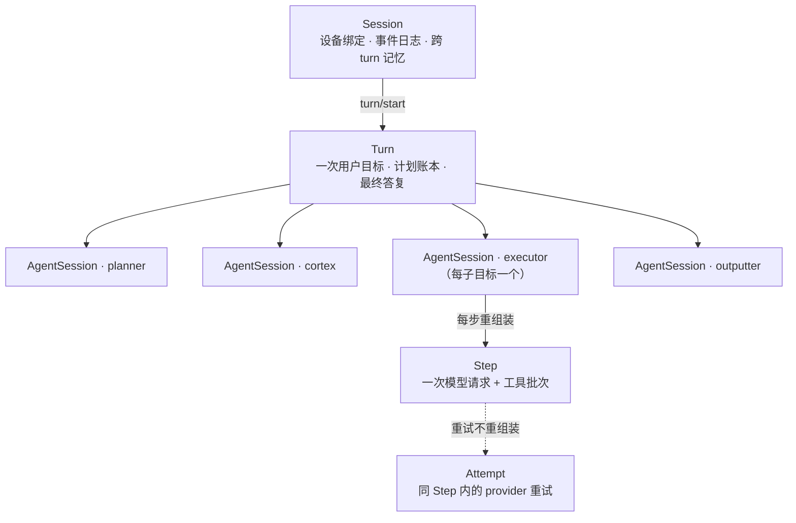

# 会话架构方案 v1

## 0. 边界声明

本文定义一次用户目标在 mobile-use 中的生命周期分层：Session / Turn / AgentSession / Step / Attempt，以及随之而来的上下文边界、事件日志与恢复语义。

**不覆盖**：设备控制、感知通道、工具实现、提示词文案、模型选型，以及 Executor 单步决策的内容（动作选择、熔断阈值）。

**与相邻链路的关系**：

- LangGraph 仍是调度器，图拓扑不变；会话层是图外的一等对象。
- 提示词的**内容**不变，变的只是**组装时机与所有者**。
- SDK 对外仍使用 `Task` 概念；`Task` 在运行时映射为一个 Turn。

**术语**：本文的 session 一律指 Session 层，不指 telemetry 的 `_session_id`、TUI 的 `TuiSession`、BrowserStack 的浏览器 session。新代码落在 `runtime/` 命名空间。

## 1. 现状与问题

| 现状 | 位置 | 事实 |
|---|---|---|
| `Agent` 持有设备与配置，可连续跑多个目标 | `sdk/agent.py` 的 `init` / `_run_task` | 事实上的 Session，但没有会话记录 |
| `Task` 一次跑完即弃 | `sdk/agent.py` 的 `_run_task` | 事实上的 Turn，但不可续跑 |
| `executor_messages` 是「一轮内」历史，Cortex 每次下发目标手写清空 | `graph/state.py` | 事实上的 AgentSession，生命周期靠隐式状态机 |
| 所有 agent 的推理汇进 `agents_thoughts: list[str]` | `graph/state.py` | 上下文无归属，压缩只能一刀切 |
| 提示词 volatility 命名为 `per-task / per-goal / per-turn` | `agents/executor/prompt_manifest.toml` | `per-turn` 实际每 step 变，`per-goal` 才是 agent-session 级（P2 已改名为 `per-turn / per-agent-session / per-step`） |
| 无事件日志、无 checkpoint | `graph/graph.py` 的 `compile()` | 进程中断只能整任务重跑，无法回答「模型当时看到了什么」 |

结论：分层不是新增概念，而是把已经存在的隐式生命周期显式化。**层边界 = 日志边界 = 上下文重建边界。**

## 2. 层级定义与职责

| 层 | 职责 | 生命周期 | 今天的对应物 |
|---|---|---|---|
| Session | 设备绑定、LLM profile、提示词语言、事件日志、跨 turn 的长期记忆 | 创建到销毁；可恢复 | `Agent` + `TuiSession` |
| Turn | 一次用户目标：计划与版本日志、子目标账本、预算、输出契约、最终结果 | 一次 `run_task` | `Task` + 一次图运行 |
| AgentSession | 某个 agent 的局部上下文域：system、局部历史、计数器、作用域（`turn` 或 `subgoal#n`） | agent 接管到交还 | `executor_messages` + 各节点局部状态 |
| Step | 一次模型请求的完整快照 + 工具批次 + usage | 一次请求 | Executor 节点的一次调用 |
| Attempt | 同一 Step 内的 provider 重试 | 请求内 | 现有解析失败重试 |

AgentSession 按 agent 划分：planner 与 outputter 各一个（作用域为 turn），cortex 一个（跨子目标存活），executor 每个子目标尝试一个。Contextor 不是 Step 的所有者，它属于 Step 的感知阶段。

## 3. 核心流程

一次 Turn 的执行顺序：planner step → plan_manager（确定性，无 Step）→ cortex step 下发目标 → executor agent-session 内循环 → cortex step 收结果 → plan_manager 落状态或换计划 → outputter step。

Step 内部固定八段，顺序不可交换：

1. perceive：Contextor 抓屏、建元素表、视觉主体。
2. assemble：从 prompt manifest 生成 system / tools / variables。
3. propose：易变事实作为候选消息（设备状态、元素表、视觉、失败反馈）。
4. admit：策略层决定候选是否进入本 Step。
5. render：插值一次，产出本 Step 的请求快照。
6. attempt：provider 请求；重试复用第 5 段结果。
7. act：派发工具批次。
8. commit：写入 `step/end`，消息进入 AgentSession 历史。

## 4. 关键决策

- **保留 LangGraph 作为调度器**。拓扑已按元素表契约调好（contextor → executor → tools → contextor），重写收益低于风险；会话层不需要侵入调度。
- **AgentSession 必须独立成层**。换取需要「可关闭、可播种」的上下文对象，否则清空历史永远是隐式状态机；压缩作用域也只能到 session 级。
- **每 Step 重组装，Attempt 复用**。屏幕每步都变，不重组装会喂过期元素表；重试重组装会破坏前缀缓存，还可能让同一 Step 的 system 字节漂移。
- **事件日志是会话真相**。Resume 需要确定性重放；LangGraph checkpointer 保存的是图状态，不含请求快照，只能降级为执行缓存。
- **所有 LLM agent 都有 AgentSession**。局部历史不能只有一个归属；全局 thoughts 列表无法按 agent 压缩与排查。
- **volatility 重命名为 `per-turn / per-agent-session / per-step`**。现有 `per-turn` 实际每步变，命名会把实现带偏；改名后目录、manifest、代码一一对应。
- **大对象按 ref 存**。元素表每步几十 KB，全量落盘会让日志失去可读性；内容寻址同时天然去重。

## 5. 状态语义

| 对象 | 取值 | 语义 | 何时变化 |
|---|---|---|---|
| Session | `open` / `closed` | 设备与会话记录的持有状态 | 创建时 open，销毁时 closed |
| Turn | `running` / `completed` / `failed` / `cancelled` / `budget_exceeded` | 一次目标执行的终态，口径沿用现有 SDK 任务状态 | 只在 `turn/end` 落定 |
| AgentSession | `open` / `closed` | 局部上下文是否仍可追加消息 | open 时接收 Step，关闭后只读 |
| AgentSession 关闭原因 | `completed` / `failed` / `handoff` / `turn_end` / `superseded` | 正常交还、明确放弃、换取重发；后两个是生命周期收尾 | 与关闭同时写入，不可后改 |
| Step | `started` / `ended` | 由边界事件定义，不设独立字段 | `step/start` 与 `step/end` 各写一次 |
| Attempt | 无状态 | 只记录请求结果，不改变 Step 状态 | 每次重试追加一条 |

Executor 的 `done` / `failed` 语义保持不变：分层只改变上下文归属，不改变「谁判定子目标完成」。

## 6. 接口契约

- **上下文唯一入口**：局部历史的内容仍由 State 持有（它是 resume 的真相）；AgentSession 只记录「这段历史属于谁、有多大」，节点不得绕过 State 另存一份消息。
- **换取契约**：Cortex 换招 = `close(executor_session, reason=handoff)` → 写 handoff（现有汇报摘要）→ `open(executor_session, seed=handoff)`。handoff 的生成逻辑复用 `build_executor_report`，不新增第二种摘要口径。
- **屏幕帧契约**：元素表与工具执行必须落在同一 Step 内；跨 Step 复用元素表一律禁止。
- **日志唯一入口**：所有事件经 SessionLog 追加，节点不得旁路写文件。
- **Resume 契约**：只能恢复到最后一个 `step/end`；屏幕不恢复，一律重新感知。设备可能已漂移，恢复后第一步必须重新确认前台应用与 app lock。
- **预算契约**：`total_steps` / `max_steps` 的口径不变，分层不引入新的计数。

接口签名与类定义见 `runtime/` 代码，文档只定边界。

## 7. 数据模型

实体关系：Session 1—N Turn 1—N AgentSession 1—N Step 1—N Attempt。

硬约束：

- 一个 Session 独占一台设备；同一时刻最多一个 `running` Turn。
- 每个 Step 必须属于一个 `open` 的 AgentSession；关闭后不可再追加 Step。
- 事件只追加、不可修改；`seq` 全局单调。
- 同一 Turn 内 Step 序号单调递增。
- 段边界只记条数（`history`），不持有消息；同一会话内单调不减，换取后从清空后的条数重新开始。
- Artifact 内容寻址；同一内容只落一份。

## 8. 实现边界

- **并发**：Turn 串行，沿用 `Agent._task_lock`；Session 不跨进程共享；AgentSession 与 Step 天然串行。
- **失败面**：组装失败 → `turn/start` 后无 Step；准入拒绝 → 不打开 Step；provider 失败 → 记 Attempt；取消 → Turn 中止，Step 在 finally 关闭。
- **日志体积**：元素表按 hash 去重；截图默认不落盘，沿用现有 trace 开关；单 Turn 日志上限在 P0 观测后定。
- **日志开关**：`MOBILE_USE_SESSION_LOG=0` 关闭整层；`MOBILE_USE_SESSION_LOG_DIR` 覆盖根目录（默认 `.mobile-use/sessions`）；`MOBILE_USE_SESSION_ID` 固定会话 id，用于进程重启后接着写同一份日志（seq 从上次最大值续）。事件类型与字段见 `runtime/events.py`。
- **中断对账**：新进程以同一 session id 启动时，`Session.start` 先把上一进程「有 start 无 end」的 step / agent_session / turn 补成 `aborted` / `interrupted` / `cancelled`，再写新的 `session/start`（带 `resumed`）。这一步只让日志自洽，不重跑任何逻辑。
- **执行快照**：图编译时挂 `AsyncSqliteSaver`，thread id 为 `<session_id>:<turn_id>`；`MOBILE_USE_CHECKPOINT=0` 关闭，`MOBILE_USE_CHECKPOINT_DB` 覆盖库路径（默认 `.mobile-use/checkpoints.db`）。快照只是续跑的缓存：正常收尾时删除该 thread；只有进程被杀、`finally` 没跑到才会留下。
- **续跑入口**：`Agent.resume_task(request=...)` 接上被中断的 Turn（不新开 id、不重发 `turn/start`，写 `turn/resume`），以 `input=None` 从最后一个 checkpoint 继续。前提是 `MOBILE_USE_SESSION_ID` 指向原来的会话 id，且 goal 与中断时一致；条件不满足即报错，不静默开新 turn。
- **恢复上限**：不能恢复屏幕中间态，只能恢复到 Step 边界；恢复后的首步必须重新感知。
- **升级路径**：P3 完成后再评估是否用显式 `TurnRunner` 替换图；在此之前不重写拓扑。

## 9. 迁移路径

| 阶段 | 内容 | 验收 |
|---|---|---|
| P0 观察层 | 引入四层 id、事件日志、Step 记录；行为零改动 | 一次任务产出完整事件链，动作步数与 token 与改造前一致 |
| P1 段边界 | AgentSession 记录局部历史条数（`history`）；数据仍归 State；`agents_thoughts` 拆分推迟 | 同一会话内单调不减，换取后从清空值重新开始 |
| P2 组装管线 | 落地八段 Step 流水线；重试复用渲染结果；volatility 重命名 | 缓存命中率不低于改造前，解析失败重试不二次组装 |
| P3 会话化 | Session 跨进程续写、中断对账、checkpoint 续跑（`Agent.resume_task`）已交付；上一 turn 摘要复用未做 | 同一 id 下 seq 续接、悬空边界补齐、进程重启从最后 checkpoint 继续 |

当前状态：**P0、P1、P2、P3 已落地，唯一未做的是「上一 turn 摘要复用」**。P0 交付 `runtime/` 四层对象 + 事件日志 + 四类节点的 Step 埋点，并在真机上覆盖正常完成、进程被杀、同子目标换发、结构化输出四条路径。P1 只交付段边界：`step/end` 与 `agent_session/close` 携带 `history`，消息本体仍由 State 持有 —— 搬进 Python 对象会切断 resume、并绕过 `asanitize_update` 的 trace 录制，收益为零。P2 把组装拆成 `assemble → propose → admit → render` 四段（`agents/executor/prompt.py`），重试复用同一份渲染结果，并把 volatility 改名为 `per-turn / per-agent-session / per-step`；四段是纯重构，产物逐字节不变。P3 交付同一 session id 跨进程续写（seq 续接）、中断 turn 对账，以及 sqlite checkpoint 续跑：真机上杀掉进程后 `Agent.resume_task` 从最后 checkpoint 继续，executor 的步号、停滞计数与局部历史条数都从快照恢复，屏幕则重新感知。摘要复用仍推迟：它要往下一 turn 的提示词里注入上轮结论，会改 prompt 字节，得先有 A/B 手段。`agents_thoughts` 拆分同理推迟。

## 10. 非目标与延后项

- 不引入 DSH 的插件、preset、waterfall pre-step 体系；本项目的节点固定，收益不成立。
- 不做「每个 Turn 重建 system」；稳定指令仍按 Session 恒定。
- 不做跨设备 Session 迁移。
- 多轮对话的产品化交互延后到 P3 之后；P3 只交付机制。
- 不改变 Executor 的决策内容与熔断阈值。
