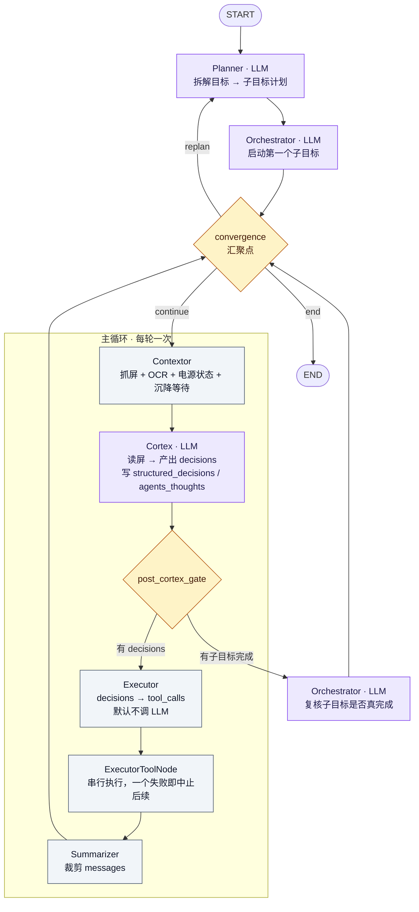
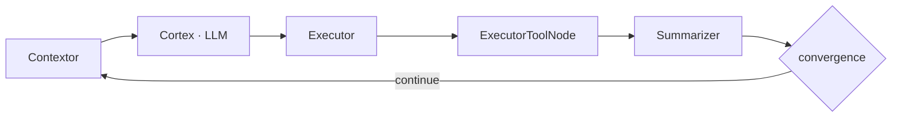
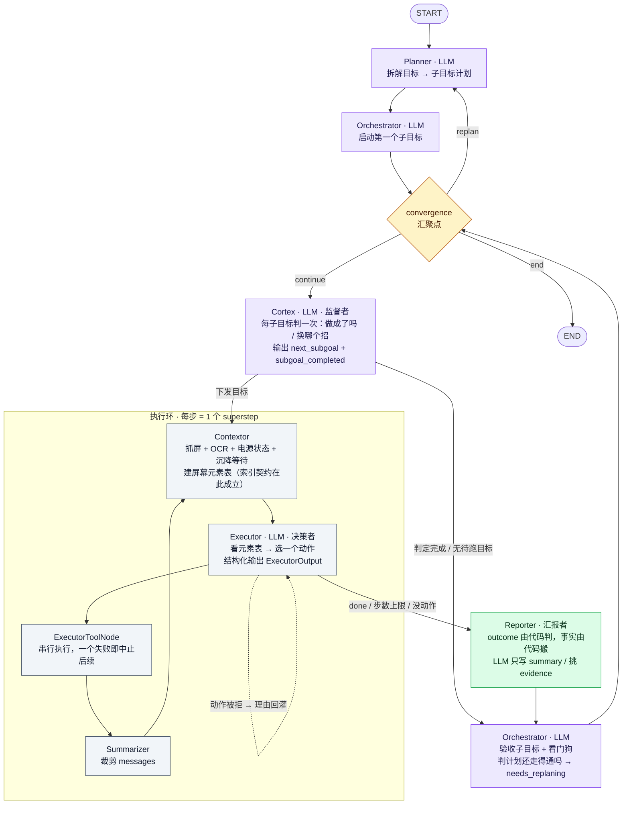

# 智能体协作 v2 · 设计文档

> **一句话**：把「Cortex 每轮做一次动作决策」改成「Executor 每轮做一次动作决策，Cortex 每子目标做一次判断」。
> 决策权下沉给执行者，监督权上移给监督者。
>
> 代码基线：`minitap/mobile_use/`，2026-10-21。
> 实测设备：Redmi Turbo 4 / Android 16。实测模型：MiniMax-M3.1-Flash-Preview（本机 override）。
> 本文所有数字都标了**证据等级**（见 §0.2）：✅ 实测可复算 / ⚠️ 过程记录 / ❌ 模拟 / ⚪ 静态测算。
> **模拟值和实测值一律不混排** —— 混排会让人把模拟结论当实测结论。

---

## 0. 文档说明

### 0.1 这份文档是什么

一份**纯设计文档**：讲清楚「改造前的架构长什么样」「改造后的架构长什么样」「为什么这么改」「实测下来收益到底有多少」「实现上有哪些技术细节」。

它**不包含**：实施排期、任务分派、审计修订记录、逐条 bug 修复流水。那些在 `doc/executor-autonomy-plan.md`（过程与审计记录）和 `doc/executor-contract.md`（接口契约 + 文件所有权）里。

### 0.2 证据等级约定（全文通用）

本文每个数字后面都带一个标记，**读的时候先看标记再下结论**：

| 标记 | 含义 | 怎么复算 |
|---|---|---|
| ✅ | **归档可复算**：数字来自 `probe_out/` 里的真机运行归档，或来自 `scripts/` 里可重跑的探针脚本 | 见 §8.1 的复现命令 |
| ⚠️ | **过程记录**：文档/审计里记下的数字，但**原始归档已被覆盖或未保留**，本次无法重新复算 | 只能当历史参考 |
| ❌ | **模拟**：合成参数跑出来的数，不是真实 API 的返回 | 只用于验证**相对关系**，绝对值不作数 |
| ⚪ | **静态测算**：读代码/数 token 得来的理论值，不涉及运行 | 可重跑探针确认 |

> ⚠️ **本文最重要的一条纪律**：**实测值和模拟值不混排**。
> §4 的收益对比表里每一行都标了等级 —— 有些行是 ✅（归档），有些是 ⚠️（过程记录）。
> 混排会让人把模拟结论当实测结论，这是本项目历史上最贵的一个教训。

### 0.3 配套文档

| 文档 | 内容 |
|---|---|
| `doc/executor-autonomy-plan.md` | 完整方案 + 独立审计记录 + 逐条实施结论（最完整，但很杂） |
| `doc/executor-contract.md` | 接口定义 + 文件所有权 + 逐任务要求 |
| `doc/agent-collaboration-overview.md` | **改造前**架构的完整讲解（State 总线、thoughts 压缩、前缀缓存块序、熔断 —— 这些机制讲解仍然成立） |

---

## 1. 新架构设计的目的

### 1.1 为什么要改：成本结构摆出来

改造前的真实归档（`probe_out/device_usage.jsonl`，52 次调用）：

| agent | 次数 | input | cached | output | 占比（次数/input/output） |
|---|---:|---:|---:|---:|---|
| **cortex** | **47** | 397,331 | 324,978 | **128,067** | **90.4% / 95.5% / 99.1%** |
| hopper | 4 | 17,432 | 9,018 | 973 | 7.7% / 4.2% / 0.8% |
| planner | 1 | 1,170 | 176 | 184 | 1.9% / 0.3% / 0.1% |

✅ 复算脚本：`scripts/audit_usage_breakdown.py`

**cortex 一家占了 90% 的调用次数、95% 的 input、99% 的 output。** 均值：input **8,454 tok/次**、output **2,725 tok/次**、缓存命中率 **81.8%**（整体 80.3%）。

耗时构成（`probe_out/cortex_profile_ocr_on.json`，同一任务 7 轮，全文 108.8 s）✅：

| 节点 | 次数 | 总耗时 | 均值 | 占全程 |
|---|---:|---:|---:|---:|
| **cortex** | 7 | **71.6 s** | 10,235 ms | **66%** |
| contextor | 7 | 5.7 s | 811 ms | 5% |
| executor | 5 | 0.2 s | 35 ms | 0.2% |

分桶：`llm_main` 占 cortex 总耗时的 **98.9%**（70.8 s / 71.6 s）；渲染均值 **1 ms**/轮；截图压缩均值 **47 ms**/轮 —— **感知侧根本不是瓶颈**。

> ⚠️ **注意两份归档不是同一次运行**：`device_usage.jsonl`（52 次调用的 token 结构，27 分钟的病态跑）和 `cortex_profile_ocr_on.json`（7 轮的耗时剖面，108.8 s 的成功跑）是**两次独立的运行**。
> **不要把两边的数字加在一起或相减** —— §4 的 A/B 才是同任务同运行的对比。

> **结论（物理事实）**：慢和贵的根因是「每轮都要跑一次带长推理的 Cortex LLM」，
> 不是抓屏慢，不是工具执行慢，也不是工具调用太多。

而改造前 Executor 侧**本来就不要钱**：`probe_out/bench_cortex_m31.json` ✅ 显示 `dispatch.hit = 10, miss = 0`，Executor 节点 10 次调用总共 **359 ms**（均值 36 ms）；同一次运行里 cortex 11 次调用花了 **109,596 ms**（均值 9,963 ms），`llm_calls_per_iteration = 1.45`。

> **⇒ 改造前的形态是：全世界的智能都压在 Cortex 一个节点上，Executor 是个哑执行器。**

### 1.2 四个设计目标

| # | 目标 | 具体含义 | 可验证判据 |
|---|---|---|---|
| **G1** | **决策成本从「每轮」降到「每子目标」** | Cortex 不再逐轮看屏逐轮决策，只在子目标边界做一次判断 | cortex 调用次数 ∝ 子目标数，而不是 ∝ 动作步数 |
| **G2** | **单次调用的输出体积塌缩** | Executor 只需吐一个动作 + 一句话思考，不再每轮写 2~4 句决策推理 | 单次决策 output token 大幅低于 2,725 |
| **G3** | **prompt 前缀可缓存** | 每轮变的块一律排末尾；静态块尽量多 | 缓存命中率相对同任务基线提升 |
| **G4** | **「事实不丢」「判断唯一」变成结构性保证** | 结论由代码判、事实由代码搬，LLM 只写人话 | `outcome` 不经 LLM；失败事实跨子目标可见 |

### 1.3 这四个目标要付的代价（先说清楚，后面 §4 才不会读歪）

改造后**每个子目标边界新增固定调用**（cortex 下发 + cortex 验收 + orchestrator 看门狗），而 Executor 每轮还要自己调一次 LLM。

> **⇒ 总调用次数必然上升，这是设计的一部分，不是缺陷。**
> 收益来自 G2/G3（每次调用更便宜），**不是**来自「少调几次」。
> 如果实测发现总次数大幅下降，说明实现偏离了设计，要查。

---

## 2. 之前的架构（v1）

> 完整讲解见 `doc/agent-collaboration-overview.md`。这里只保留设计文档需要的骨架。

### 2.1 全景图



> 配色：**紫 = 会调 LLM 的 agent**，灰 = 纯代码节点，橙 = 判定门。
> 一眼能看出：**常规一轮里只有 Cortex 一次 LLM 调用**，而这一调就是全部成本。

### 2.2 角色总表

| 智能体 | 职责一句话 | 调 LLM | 在主循环 |
|---|---|---|---|
| **Planner** | 把目标拆成子目标 | ✅ | 只在开始 / 重规划时 |
| **Orchestrator** | 验收里程碑、决定重规划 | ✅ | 只在有完成上报时 |
| **Contextor** | 看屏（层级树 / OCR / 截图 / 电源状态） | ❌（仅 app-lock 分支） | ✅ 每轮 |
| **Cortex** | **决定下一个动作**（看屏 + 逐个动作决策 + 写长推理） | ✅ | ✅ **每轮** |
| **Executor** | 把决策落成工具调用（哑执行器） | ⚠️ 默认**不调** | ✅ 每轮 |
| **Summarizer** | 裁剪历史 | ❌ | ✅ 每轮 |

### 2.3 三条流转路径



- **路径 A · 主循环（动作流）**：`contextor → cortex → executor → executor_tools → summarizer → convergence`。系统 90% 的时间在这。**每轮一次 Cortex LLM 调用**。
- **路径 B · 里程碑复核流**：`cortex 报完成 → post_cortex_gate → orchestrator 验收 → convergence`。
- **路径 C · 重规划流**：`orchestrator 判 needs_replaning → 当前子目标 FAILURE → convergence → planner`。

### 2.4 v1 的结构性问题

| # | 问题 | 物理后果 |
|---|---|---|
| **P1** | **Cortex 每轮既看屏又决策又写长推理** | 8,454 tok in + 2,725 tok out 每轮；耗时 10.2 s/轮 |
| **P2** | **Cortex 的 prompt 背着全量工具 schema** | 4,009 tok 的 schema **不参与缓存键**，每轮满价重算 |
| **P3** | **Cortex 的 prompt 里混着三种寿命的内容** | 元素表每轮重编号、截图每轮变 —— 排在历史中间会把后面的历史一起击穿 |
| **P4** | **「完成」这件事没有独立证据** | Cortex 一次调用同时给动作 + 给完成理由 + 给推理散文，混在一个 JSON 里 |
| **P5** | **失败事实留不住** | 熔断账本「成功即清、换键即换」，汇报拿不到跨子目标的失败事实 |
| **P6** | **Executor 是哑的** | 想让它「换个招再来」必须绕回 Cortex 重新决策，链路成本高 |

---

## 3. 现有的架构（v2，已实施）

### 3.1 全景图



> 配色：**紫 = 决策型 LLM agent**（Planner / Orchestrator / Cortex），
> **绿 = 汇报型 Reporter**，**灰 = 纯代码节点**，**橙 = 判定门**。
> 一眼能看出：**执行环里那一圈全是灰的** —— 感知、决策、执行都在环内闭环，只有环断时才往上汇报。

### 3.2 角色总表

| 智能体 | 职责一句话 | 调 LLM | 频次 |
|---|---|---|---|
| **Planner** | 把目标拆成子目标 | ✅ | 开始 / 重规划 |
| **Orchestrator** | 验收子目标 **+ 看门狗**（判计划还走得通吗） | ✅ | **每子目标一次** |
| **Contextor** | 看屏 + **建屏幕元素表** | ❌ | 每步一次 |
| **Cortex** | **监督者**：每子目标判一次「做成了吗 / 换哪个招」 | ✅ | **每子目标 1~2 次** |
| **Executor** | **自主执行者**：自己看屏、自己决策、自己动手 | ✅ | **每步一次** |
| **Reporter** | **汇报者**：执行日志 → 结论层 + 事实层 | ✅（默认**免 LLM**） | 每子目标一次 |
| **Summarizer** | 裁剪历史 | ❌ | 每步一次 |

### 3.3 六条关键变更

| # | 变更 | 解决的 v1 问题 |
|---|---|---|
| **C1** | **Cortex 从「每轮」降为「每子目标」**，只做判断不产动作 | P1 |
| **C2** | **Executor 从「哑执行器」变成「自主执行者」**，每轮自己调 LLM 决策 | P6 |
| **C3** | **新增 Reporter 角色**，汇报 = 结论层 + 事实层两段 | P4 |
| **C4** | **Contextor 接管屏幕元素表的构建**（从 Cortex 搬过来） | P3 |
| **C5** | **执行环改成 graph 级环**（每步 = 1 个 super-step），工具执行完回 Contextor 重新抓屏 | P3 + 索引契约 |
| **C6** | **失败事实新增 append-only 账本** `executor_failures`，与熔断账本分开 | P5 |

### 3.4 两条硬约束（不是风格偏好，是物理约束）

**约束一：元素表契约 —— 执行环必须是 `contextor → executor → executor_tools` 同一轮。**

`Target.index` 是在**那一屏**上成立的编号。工具解析 `Target.index` 时读到的必须是 **Executor 看到的那张表**。

- ❌ **节点内自循环**（Executor 节点内部 while）：LangGraph 节点执行期间不能回写 state → 第 2 轮工具拿到的还是第 1 轮的 `latest_screen_elements` → 索引与当屏错位 → **点错元素**。
- ✅ **graph 级环**：工具执行完 → Summarizer → **回 Contextor**（重新抓屏 + 重建表）→ Executor。工具在同一个 super-step 内读到的就是当屏表。

> **代价是每步多一个 super-step**，换来的是 `ExecutorToolNode` **一行都不用改**（串行执行、一个失败即中止、`capture_executor_action`、`_stamp_action` 全部保留），改动面小一个数量级。

**约束二：看门狗 —— `reporter → orchestrator` 是无条件边。**

每个子目标结束都让 Orchestrator 看一眼计划。**没有它，计划级失败（子目标根本做不到）就没有任何处理者**：Cortex 会一直说「没完成」一直重发，唯一上限是 `recursion_limit`，触发后是 **`GraphRecursionError` 异常退出**，而不是「重新拆计划」。

### 3.5 汇报后的路由表（实装形态）

| 路径 | 触发条件 | 去向 |
|---|---|---|
| Cortex → Contextor | 有目标 **且** 这个目标还没跑过（`executor_steps == 0`） | 执行环 |
| Cortex → Orchestrator | 汇报说做成了 **且** 这份汇报还没判过 | 验收 → 标 SUCCESS → convergence |
| Cortex → Orchestrator | 没有待执行的目标 | 看门狗（计划走不通的处理者） |
| Executor → executor_tools | 有动作 | 执行 |
| Executor → Executor | 上一轮动作被 dispatcher 拒了 | **理由回灌，重新决策**（不重新抓屏） |
| Executor → Reporter | `done` / 步数上限 / 没有动作可执行 | 收尾汇报 |
| Reporter → Orchestrator | **无条件**（每子目标一次） | 看门狗 |
| convergence → Planner | Orchestrator 判 `needs_replaning` | 重规划 |
| convergence → Cortex | 计划正常 | 继续下一个子目标 |
| convergence → END | 全部子目标 SUCCESS | 结束 |

> 「汇报的新旧」由 `ReportLedger`（一次运行级的账本）记住 —— 读过的汇报必须作废，否则下一轮 Cortex 会把同一份汇报再判一遍，中间的子目标就被跳过。

---

## 4. 测试收益对比（真机实测）

### 4.1 对比条件

| 项 | 值 |
|---|---|
| 目标 | `打开设置，进入 WLAN 页面`（脚本校验两边一致 ✅） |
| 设备 | Redmi Turbo 4 / Android 16 |
| 模型 | MiniMax-M3.1-Flash-Preview（本机 override） |
| 改造前脚本 | `scripts/probe_baseline_before.py` → `probe_out/executor_ab_before.json` |
| 改造后脚本 | `scripts/probe_executor_e2e.py` → `probe_out/executor_e2e.json` |
| 汇总脚本 | `scripts/probe_ab_report.py` |

> ⚠️ **样本量 = 1**。两边各跑了一次。成功率、缓存率、耗时的差值里**噪声和信号分不开**。
> 下面这张表能支撑「哪个方向对」，**不能**支撑「这个方向好多少」。

### 4.2 主对比表（✅ 归档可复算）

| 指标 | 改造前 | 改造后 | 变化 |
|---|---:|---:|---:|
| **任务结果** | ✅ 成功 | ✅ 成功 | — |
| **总耗时** | 42.6 s | 246.0 s | **+203.4 s（5.8x）** |
| **LLM 调用次数** | 7 | 27 | **+285.7%** |
| **input token** | 22,365 | 124,611 | **+457.2%** |
| **cached token** | 4,884 | 66,436 | +1,260.3% |
| **output token** | 1,501 | 14,735 | **+881.7%** |
| **缓存命中率** | 21.8% | **53.3%** | **+31.5 pt** |
| **单次决策 output** | 273 tok（cortex） | **591 tok（executor）** | **+116.5%** ❌ |
| **单次决策 input** | 4,845 tok（cortex） | **5,826 tok（executor）** | **+20.3%** ❌ |

复算：`python scripts/probe_ab_report.py`（设 `PYTHONIOENCODING=utf-8`）

### 4.3 逐 agent 明细（✅ 归档可复算）

**改造前**（7 次调用）

| agent | 次数 | input | cached | output | 缓存命中率 |
|---|---:|---:|---:|---:|---:|
| cortex | 3 | 14,534 | 3,087 | 819 | 21.2% |
| hopper | 1 | 4,361 | 186 | 192 | 4.3% |
| orchestrator | 2 | 2,232 | 374 | 415 | 16.8% |
| planner | 1 | 1,238 | 1,237 | 75 | 99.9% |

**改造后**（27 次调用）

| agent | 次数 | input | cached | output | 缓存命中率 |
|---|---:|---:|---:|---:|---:|
| **executor** | **17** | 99,041 | 55,920 | 10,048 | **56.5%** |
| cortex | 6 | 19,277 | 9,894 | 3,652 | 51.3% |
| orchestrator | 3 | 5,055 | 434 | 830 | 8.6% |
| planner | 1 | 1,238 | 188 | 205 | 15.2% |
| **reporter** | **0** | 0 | 0 | 0 | — |

> 📌 **reporter 0 次调用** —— `ReporterNode(llm_free=True)` 默认免 LLM，summary 由代码生成、evidence 从日志里挑。事实字段本来就全是代码直搬的，正确性零损失。
> 📌 **cortex 6 次 = 3 个子目标 × 2（下发 1 + 验收 1）**；**orchestrator 3 次 = 每子目标一次看门狗**。

### 4.4 结论：兑现了什么，没兑现什么

#### ✅ 兑现的

| 目标 | 实测 | 证据 |
|---|---|---|
| **G3 · prompt 前缀可缓存** | 整体缓存命中率 **21.8% → 53.3%**（+31.5 pt）；executor 单独 **56.5%** | ✅ 归档 |
| **G3 · 块序修正** | 元素表放末尾：模拟均值 **97.3%**；放中间 **79.4%**；现状基线 74.6% | ❌ 模拟（见 §5.1） |
| **G3 · 块序修正** | 设备状态 / 失败清单从历史前面挪到历史后面：真机 executor 命中率 **15.8% → 54.4%** | ⚠️ 过程记录（归档已滚动） |
| **G2 · prompt 体积** | Executor 单轮 prompt **3,574 tok** vs 改造前 cortex **8,454 tok** → **2.4x 更小** | ✅ 可重跑探针 |
| **G2 · 工具 schema** | 17 个工具的 schema **4,471 → 4,009 tok**（手术省 462 tok / 10.3%）；Executor **完全不用 bind_tools** | ✅ 可重跑探针 |
| **G1 · Cortex 降频** | cortex 从「每轮」变成「每子目标 2 次」；本次 3 个子目标 → 6 次 | ✅ 归档 |
| **G4 · 判断唯一** | `outcome` 由代码判定，Reporter 0 次 LLM 调用 —— 「把失败说成完成」这个风险从根上消失 | ✅ 归档 + 80 个单测 |

#### ❌ 没兑现的

| 目标 | 预期 | 实测 | 差距 |
|---|---|---|---|
| **G2 · 单次输出塌缩** | 273 → ~150 tok（18x） | 273 → **591 tok（+116.5%）** | **方向反了** |
| **G2 · 单次输入塌缩** | 8,454 → ~2,900（2.9x） | 4,845 → **5,826（+20.3%）** | **方向反了** |
| **总成本** | 持平或下降 | **input +457% / output +882%** | **大幅上升** |
| **总耗时** | < 基线 | 42.6 s → 246.0 s（**5.8x**） | **大幅上升** |

### 4.5 没兑现的根因：固定开销摊不薄

**这不是实现 bug，是架构的固定开销被低估了。**

```
改造前：1 轮 = 1 次 cortex 决策（直接产出 1 个动作）
        整个任务 = 3 次 cortex + 2 orchestrator + 1 planner + 1 hopper = 7 次

改造后：1 个子目标 = N 步 executor + 2 次 cortex（下发+验收）+ 1 次 orchestrator（看门狗）
        3 个子目标 ≈ 17 + 6 + 3 + 1 = 27 次
```

**每个子目标边界新增了 3 次固定调用。** 只要「子目标内的步数」不够多，这 3 次就是纯开销。

本次实测：**3 个子目标 / 17 步 executor ≈ 5.7 步每子目标**，v1 是「3 次 cortex 决策覆盖整个任务」。

> **⇒ v2 的收益只在「子目标步数足够多」时才兑现。**
> 摊薄公式：每个子目标 ≈ `N` 步 executor + 3 次固定调用。
> N 越大，固定开销占比越低。N ≈ 3 时固定开销占 50%，N ≈ 12 时只占 20%。
>
> **当前 Planner 把子目标拆得太碎 —— 这是收益没兑现的第一原因，也是最大的可动杠杆（§7 L1）。**

### 4.6 这组数字**不能**说明什么

1. **样本量 = 1**，成功率 / 缓存率没有统计意义。
2. **两次跑的子目标数不同**（v1 是 3 次决策覆盖全任务，v2 是 3 个子目标 17 步），总耗时差值有噪声。
3. **只测了短任务**（3 个子目标 / 17 步）。方案的风险全在长任务上（thoughts 累积、步数上限、replan 触发），那些**还没测**。
4. **第四轮 → 第五轮不是同一个执行轨迹**（executor 走了 21 步 vs 17 步），两轮之间的差值同样分不开信号和噪声。
5. **「每子目标步数不是常数」**：同样是这个任务，第四轮 1.67 步/子目标、第五轮 5.7 步/子目标，**差了 3.4 倍**。⇒ 「先跑一次真机看步数分布再定参数」这个前置条件确实必要，只跑一次就会定出错的数。

---

## 5. 技术细节

### 5.1 Executor 的 prompt：块序 = 缓存命中率

**消息顺序是这里最重要的一件事**（`agents/executor/prompt.py`）：

```
[1] SystemMessage   executor.md 渲染结果（静态）           2,782 tok
[2] HumanMessage    目标陈述（子目标内恒定）                 16 tok
[3] ...             局部历史（动作 + 工具反馈）—— 只追加      ~3 tok/步
[4] HumanMessage    失败事实清单（每轮变：会增长）            28 tok
[5] HumanMessage    设备状态（每轮变：前台 app 会变）          20 tok
[6] HumanMessage    屏幕元素表（每轮变：重编号）—— 必须最后   725 tok
[7] HumanMessage    截图（仅 need_screenshot 时）
                   ────────────────────────────
                   合计                              3,574 tok
```

**为什么「每轮变的必须靠后」**：provider 的缓存是**前缀**匹配 —— 任何每轮变的内容排在中间，它之后的全部字节每轮都要重算。

```
错：[静态][目标][失败][设备][元素表][历史]  → 命中率递减
对：[静态][目标][失败][设备][历史][元素表]  → 命中率递增
```

两个探针的输出（❌ 模拟，但可重跑）：

| 探针 | 元素表在末尾 | 元素表在中间 | 现状基线 |
|---|---:|---:|---:|
| `scripts/probe_executor_prompt_layout.py` | **97.3%** | 79.4% | 74.6% |
| `scripts/audit_executor_cache_layout.py` | **84.3%**（79%→88% 递增） | 57.6%（79%→45% **递减**） | — |

> ❌ 两个探针都用**合成参数**，绝对值不同（97.3% vs 84.3%）。**可信的是相对关系**（末尾 ≫ 中间，且末尾递增、中间递减），绝对值不作数。
> 真实机侧的落地效果见 §4.4（21.8% → 53.3%）。

**元素表随屏幕行数线性增长**（5/30/60 行 → 190/665/1,235 tok）⚠️ 过程记录。
**元素表里的装饰行不裁** —— 真机逐个 adb 实点：126 行「装饰候选」里 **13.5% 点了屏幕真的变了**（Canvas / 自定义 View 画的可点区域在 uiautomator dump 里既无 clickable 也无文字）。「没有交互标记」推不出「点它没反应」。

### 5.2 Executor 绝不 bind_tools

| 形态 | token | 缓存行为 |
|---|---:|---|
| **① bind_tools 全量 JSON schema** | **4,009**（手术后；手术前 4,471） | ❌ **不参与缓存键 → 每轮满价** |
| ② `executor.md` 里的文本工具表（`## Tools` 节） | **565**（36 行） | ✅ 静态 → 可缓存 |
| ③ 只有名字的一行清单（`format_tools_list`） | **56** | ✅ 静态 → 可缓存 |

✅ 实测：`probe_out/probe_tool_schema_surgery.py`、`scripts/audit_cortex_prompt_budget.py`

**差 ~7 倍。** 如果 Executor 用 bind_tools：`每轮 input = 2,782 + 4,009 + 725 ≈ 7,516 tok` —— 比改造前的 cortex（8,454）只省 11%，而其中 4,009 tok 每轮都是满价。**方案直接作废。**

> 📌 **满价部分的账要算清楚**：4,009 tok 的 schema **每一轮都按满价计费**（不参与缓存键）。按 §4.3 实测的 **17 次 executor 调用**算，光这一项就是 **17 × 4,009 ≈ 68,000 tok 的纯满价 input** —— 而实测改造后的 executor 总 input 只有 99,041 tok。**这一项就能吃掉七成。**

**正确做法**：Executor 用**结构化输出**吐动作 JSON（只绑定 `ExecutorOutput` 这一个小 schema），工具用法靠 `executor.md` 的文本工具表教，复用现有的 `dispatch_decisions` 确定性直连。

### 5.3 复用 dispatcher 的两个坑

**坑 1：dispatcher 只吃数组，不吃单个动作对象。**

```
输入 {"action": "tap", "target": {"index": 7}}   → parse_actions 返回 None → 退回 LLM
输入 [{"action": "tap", "target": {"index": 7}}] → OK
```

⇒ `ExecutorOutput.actions` 的类型固定是 `list`，即使只有 1 个也必须包成 `[{...}]`。
**不给 dispatcher 加「接受对象」的兼容分支** —— 多一个入口就多一条要测的路径。

**坑 2（严重）：dispatcher 的兜底语义在新架构下会变成死循环。**

| | v1 | v2 |
|---|---|---|
| dispatcher 失败 → | 退回 Executor LLM **转写**同一批 decisions | ？ |
| Executor LLM 的角色 | 转写器（不决策） | **决策者本身** |

新架构里 Executor 的 LLM **就是决策者**。退回 LLM = 退回同一个决策者 —— 它看不到自己错在哪，**大概率输出同样的坏动作**。

⇒ **必须把 dispatcher 的拒绝理由当成工具结果回灌给 Executor**，作为下一轮 prompt 的一部分。

**回灌用 `HumanMessage`，不用 `ToolMessage`** —— 拒绝时根本没有派发出去，`ToolMessage.tool_call_id` 找不到对应的 assistant tool_call，OpenAI 兼容端点会 **400**。

> 路由判据相应改成「**最后一条消息是不是 HumanMessage**」—— 是就说明上一轮被拒了、理由已回灌 → 回 Executor 重新决策（屏幕没变，不用重新抓屏）。

### 5.4 一轮只执行一个动作（硬兜底）

**一轮只执行第一个动作，其余丢弃并回灌告知模型。** 这不是 prompt 偏好，是索引契约的前提：

> 一轮执行多个动作时，第二个动作的 `Target.index` 指向的是**第一个动作执行前**的屏 —— 屏幕已经被第一个动作改过了，那个编号可能已经不是同一个元素了。

prompt 里写了「一次只做一个动作」，但那是**软约束**；代码层做**硬兜底**，多出来的动作本轮不执行，并明确告诉模型「那些动作**没有被执行**，下一轮要重新决定」。

### 5.5 State 字段

**新增**

| 字段 | 类型 | 归谁 | 说明 |
|---|---|---|---|
| `executor_goal` | `str \| None` | Cortex → Executor | 本次子目标的目标陈述 |
| `executor_done` | `bool` | Executor | 本子目标结束（注意：**不等于「达成」**） |
| `executor_steps` | `int` | Executor | 本子目标已执行步数（熔断用，Cortex 换目标时归零） |
| `executor_failures` | `list[dict]` | Executor → Reporter | **append-only** 的失败事实账本 |
| `executor_report` | `ExecutorReport \| None` | Reporter → Cortex | 上次汇报（消费后即作废） |
| `total_steps` | `int` | Executor | 全任务累计动作步数（**不归零**），供 SDK 上报 |

**语义变更**

| 字段 | 变化 |
|---|---|
| `executor_messages` | 从「全局累积」变成「**本子目标内**」；清空责任从 Cortex 移到 Cortex 下发目标时（`RemoveMessage(id=REMOVE_ALL_MESSAGES)`） |
| `failed_targets` | 语义**不变**（熔断账本：同屏同目标连续失败的即时保护），只**新增**了并行的 `executor_failures` |
| `structured_decisions` / `cortex_last_thought` | **废弃**（Executor 自己决策，不再需要 Cortex 的动作 JSON） |

### 5.6 失败事实：两本账，不能合并

| | 熔断账本 `failed_targets` | **失败事实 `executor_failures`** |
|---|---|---|
| 语义 | 「同屏同目标连续失败」的即时保护 | 「跨子目标的失败事实」 |
| 清空时机 | **成功即清 / 换键即整表替换** | **只增不减**（子目标结束时才结算） |
| 谁读 | 工具层 `check_failure_breaker` | Reporter（写进汇报事实层） |
| 跨子目标 | ❌ 不保留 | ✅ **保留** |

**为什么必须分开**（实测）：

```
A 失败 2 次后账本: [('index=1|...|text=A', 2)]
B 失败后账本:      [('index=2|...|text=B', 1)]
breaker(A) 现在 = None      ← A 的熔断失效了！
账本长度 = 1                ← MAX_TRACKED_FAILURES=5 永远达不到
```

⇒ 子目标通常以**成功动作**收尾，那时账本已被清空 → 汇报的事实层大概率是**空的** → Cortex 收不到失败事实 → **重复派发同一个子目标**。

> 熔断账本**一个字不改**（`test_failed_targets.py` 9 项全过），只是**另加**一本 append-only 的事实账本。两件事，本来就该分开。

**目标键的坑**：无元素表时（iOS / 云设备）`target.index` 恒为 None → 键退化成 `text=...` 或 `"unknown"` → 「同一个 ocr_index 连着失败」被误判成「换了目标」，连续失败计数失效。⇒ `target_key` / `target_label` 改用 `index if index is not None else ocr_index`。

### 5.7 汇报结构：结论层 + 事实层

```python
class ExecutorReport(BaseModel):
    # ---- 结论层 ----
    outcome: Literal["completed", "failed", "blocked"]   # 代码判定，不经 LLM
    summary: str                                          # LLM 只写这一句
    evidence: str | None                                  # LLM 挑 + 代码校验

    # ---- 事实层：从执行日志直搬，逐字 ----
    actions_taken: list[str]
    failed_targets: list[FailedTarget]
    blocked_reason: str | None
```

**职责边界（关键）**：

| 谁 | 产出 | 依据 |
|---|---|---|
| **代码** | `outcome` | Executor 的 `done` + 熔断状态，**客观事实** |
| **代码** | `actions_taken` / `failed_targets` / `evidence` | 从执行日志直接搬，**逐字** |
| **Reporter（LLM）** | `summary` | 把动作序列压成 1~2 句人话 |
| **Cortex（LLM）** | 「这个子目标算不算完成」 | 看汇报 + evidence + 计划，**独立判断** |

**`outcome` 判定规则（纯代码，无歧义）**：

```
Executor 说 done=True（且没撞步数上限） → completed
有失败 且 未 done                      → failed
步数超限 / 熔断                        → blocked
```

**这带来三个好处**：① 「事实不丢」和「结构性保证」同时成立；② 测试**不需要真 LLM**，变确定性；③ Reporter 不需要强模型。

**`evidence` 的硬校验**：模型给的证据必须**真的在执行日志里**（归一化空白后子串匹配），否则换成代码挑的最后一条工具结果。「不要编造」是提示词里的软规则，这里再补一道硬检查。

### 5.8 三层熔断

```
第 1 层 · 工具级熔断（已有，直接复用）
    failed_targets 账本，同一目标连着失败 2 次 → 工具拒绝执行
    位置：tools/utils.py  check_failure_breaker
    → 挡住「反复点同一个已经不在屏上的元素」

第 2 层 · Executor 内部熔断（新增）
    单子目标步数上限 MAX_STEPS_PER_SUBGOAL = 12 → 强制收尾并汇报
    → 挡住「换个目标继续原地打转」

第 3 层 · 计划级熔断（已有，靠 §3.4 的看门狗接上）
    Orchestrator 每子目标看一次计划 → needs_replaning → 当前子目标 FAILURE → Planner 重规划
    → 挡住「整个计划走不通」
```

> 步数上限**先设 12** 而不是 8：真机日志实测轮/子目标 ≈ 4.0~5.3，但那是 **n=1** 的样本；Executor 只有一句目标陈述、没有全局视野，遇到走不通的子目标**不会放弃，只会磨**。宁可先设宽一点，用 telemetry 统计出真实分布再收紧。
> ⚠️ 实测证明这个分布**极不稳定**（同一个任务 1.67 vs 5.7 步/子目标，差 3.4 倍）。

### 5.9 三层失败的归属

| 失败层级 | 谁处理 | 动作 |
|---|---|---|
| **单个目标失败**（点空了） | Executor 内部 | 换目标继续（`failed_targets` 熔断器兜底） |
| **子目标失败**（这条路走不通） | **Cortex** | 换招重发 / 标记该子目标失败 |
| **计划失败**（整体走不通） | Orchestrator → Planner | `needs_replaning` → 重新拆计划 |

**「子目标失败」不惊动 Planner** —— 只有 Orchestrator 调 `fail_current_subgoal` 把子目标标成 FAILURE，`convergence_gate` 才会走 replan。Cortex 换招重发时**不动这个状态**，所以不会误触发。

**「不能无限重发」有三重兜底**：① Cortex 的 `give_up` 决策（没给 `next_subgoal` = 换招也没招了 → 标 FAILURE）；② 第 2 层步数熔断；③ Orchestrator 看门狗。

### 5.10 L3：失败路径的规则化换招（不调 LLM）

失败之后的「换个路径再来一次」在语义上是个**规则**：别重复上次的动作 / 换个入口 / 换个顺序 / 拆成更小的一步。规则完全能表达这件事，而 LLM 在这里要花 3~5 s + 1,000+ token，产出的大体是同一句话。

**硬边界**（三条都是必须的）：

| # | 边界 | 为什么 |
|---|---|---|
| 1 | `RULE_RETRY_BUDGET = 1`，用完必退回 LLM | 绝不能变成「永远不问 LLM」 |
| 2 | 规则**只能产出 `issue`**，永远不判 `give_up` | 「放弃」只有 LLM 知道子目标本身是不是走不通（功能不存在 / 没权限 / 数据不存在） |
| 3 | 只管 `failed` / `blocked`，`completed` 一律问 LLM 判证据 | 「可能做成了」才是真需要智能的地方 |

遥测 `decision_source = "rule" / "llm"` 可区分，看板上必须能分开看。

### 5.11 感知三通道，一条都不能丢

| 通道 | v1 位置 | v2 位置 |
|---|---|---|
| **屏幕元素表** | `cortex.py`（Cortex 自己建） | **Contextor**（每步重建，索引契约在此成立） |
| **截图按需** | `cortex.md` + `cortex/types.py` 的 `need_screenshot` + 同轮补图再问一次 | **Executor**（输出模型带 `need_screenshot`，同轮补图机制照搬） |
| **设备状态**（息屏 / 前台 app / 日期） | `cortex.py` | **Executor 的 prompt 设备状态行** |

**截图通道丢了的后果**：Executor 只能看元素表 + OCR，**分不清颜色 / 图标 / 被遮挡的目标** —— 这正是 UI 元素通道的盲区。

**设备状态通道丢了的后果**：真机实测「30 分钟息屏超时让一个任务从 30 步涨到 51 步还没跑完」。Executor 看不到「屏幕是灭的」，就会在黑屏上反复尝试。⇒ 息屏时明确告诉模型「先调 `wake_screen`，下一轮再读屏」。

**无元素表时（iOS / 云设备）必须换寻址字段**：有表 → `Target.index`；没表 → `Target.ocr_index`（OCR 块 `[i]` 的 1-based 下标）。
**提示侧和工具侧的判据必须一致**（同一个 `state.latest_screen_elements`）—— 两边判据不一致，表现是**每个动作都解析失败**。

### 5.12 解析失败的韧性

**真机实测**：模型有时不调用工具，直接写一段散文（`"The WLAN page is now open... done: true"`）。那段文字里**没有 `{`**，连 JSON 兜底提取都做不了。而 `with_fallback` 兜不住 —— 本机 override 里 fallback 和主模型是**同一个模型**，重试同样失败 → 异常一路冒到任务顶层，**整个任务挂掉**。

⇒ 三级降级：

```
1. 解析失败 → 带 nudge 重试一次（明确告诉模型「必须调用工具，不要写成文字」）
2. 仍失败 → 降级成「空动作 + 说明」，让流程继续
   （Reporter 会看到它，汇报成 failed，Cortex 换招重来）
3. 绝不因一次格式失误杀掉整个任务
```

**另一个坑**：dispatcher 把「空 actions」误报成「解析失败」—— 模型的格式**没问题**，被告知「格式错」只会让它去改格式、原地打转。⇒ dispatcher 区分两种情况：空数组 →「你没决定任何动作」；真解析失败 →「格式不对」。

### 5.13 配置与可观测性

**配置**

```python
AgentNode = Literal["planner", "orchestrator", "contextor",
                    "cortex", "executor", "reporter"]   # 新增 reporter

class LLMConfig(BaseModel):
    ...
    reporter: LLMWithFallback | None = None    # ← 可选 + 运行期回落 executor
```

**必须是可选的**：仓库里有 **15 处 `LLMConfig(...)` 构造点（分布在 10 个文件）** ✅ 可复算 + 5 个 preset + 已部署的 override 文件。做成必填 → 全部 `ValidationError`，还会打断已部署的配置。

**`default` preset 故意不写 `reporter`** —— 它是所有用户 override 的合并底座。底座写死 `reporter=openai` → 任何没写 reporter 的老 override 会让 reporter 独自留在 openai → `validate_providers()` 索要 `OPENAI_API_KEY` → **部署起不来**。不写 = 走回落，永远跟着 executor 的渠道。

**模型分层**（按「频次 × 要求」分）：

| 角色 | 频次 | 要求 | 理由 |
|---|---|---|---|
| Executor | 每步 1 次 | **快** | 决策简单：看表选一行。延迟直接叠加到总耗时 |
| Reporter | 每子目标 1 次（**默认免 LLM**） | 快 | 只写摘要 + 挑证据 |
| Cortex | 每子目标 1~2 次 | **准** | 真正的「一次定生死」：判子目标完成、判要不要换招 |
| Orchestrator | 每子目标 1 次 | **准** | 判「整个计划还走得通吗」是高层判断 |

> ⚠️ **反过来做是错的**：Executor 每轮都调强模型 → 延迟和成本双高，而它的任务只是选一行。
> 但**也不能全用快模型**：Cortex 判错一次，整个任务从错误的支点往前走。

**遥测**（`services/telemetry.py`，`schema_version: 2` + `deprecated_fields` 名单）

| 事件 | 用途 |
|---|---|
| `capture_executor_dispatch` | 动作是否被 dispatcher 接受 + 拒绝代码（**只放代码不放理由原文** —— 理由里可能有屏幕上的用户数据） |
| `capture_executor_step` | 每步的 token / 动作数 / 是否 done |
| `capture_reporter_report` | outcome 分布、summary 长度、有无 evidence、失败数 |
| `capture_subgoal_progress` | **`steps_per_subgoal`** —— 校准步数上限的唯一来源 |
| `capture_cortex_decision` | 含 `decision_source = "rule" / "llm"` |

> 📌 **usage 埋点是通的**：捕获槽里装的是**同一个 list 对象**（ContextVar 被复制时复制的是引用），所以图里 append 的原始 AIMessage 外面读得到。真机 graph 实测（§4.3 的同一次运行）executor **17 次调用 / 99,041 in / 55,920 cached / 10,048 out**，全是真实非零值。
> ⚠️ 代码里曾有「`services/usage_bridge.py` 从未存在，图里的 usage 收不到」这个**假结论**（其实真因是客户端没开 `stream_usage=True`），已在四处更正。**不要造这个文件。**

### 5.14 步数与递归预算

**LangGraph 的 `recursion_limit` 数的是「图的 super-step」（节点执行次数），不是「动作步数」。**

```
recursion_limit = max_steps × 9 + 32
```

系数 **9** 是实测的最坏情况（探针 `scripts/probe_superstep_budget.py` ✅ 可重跑，复刻真实拓扑 + 真 `State` + 真条件边，不调 LLM、不碰设备）：`super_steps = 3 + 4E + 5S`（E=executor 步数，S=子目标数）。

实测校验（探针输出）：`recursion_limit=400 → super_steps=78，executor 步=15，工具执行=12` → `3 + 4×15 + 5×3 = 78` ✅ **误差 0**。

**配套的默认值修正**：原来 `max_steps=400` 直接当 `recursion_limit`（≈66 个动作步 —— 改造前一轮要过 6 个 super-step 才跑 1 个动作，400/6 ≈ 66）；换算后同一个 400 变成 **400 个动作步** ⇒ 一次跑飞的任务从烧 66 步变成烧 400 步，**和降本目标正好相反**。⇒ 默认值下调为 `DEFAULT_MAX_STEPS = 80`（动作步，对应 `recursion_limit = 80×9+32 = 752`）。

**上报口径**：原来的 `steps_count = len(agents_thoughts)` 是失真的 —— 真机实测每动作步产生 ~3.9 条 thought（Contextor 每步写 1 条），**高估约 3.9 倍**。⇒ 新增 `state.total_steps`（executor 每轮 +1，跨子目标不归零），上报改用它。

---

## 6. 风险与对策

| # | 风险 | 概率 | 对策 | 状态 |
|---|---|---|---|---|
| R1 | Executor bind_tools → prompt 涨到 ~7,516，满价部分涨 ~7x，方案作废 | 中 | 强制文本工具表；**断言点在请求体的 `tools` 字段**，不是渲染字符串 | ✅ 已实施 + 单测锁住 |
| R2 | Executor 无跨子目标记忆 → 重复失败原地打转 | 高 | 三层熔断 + `executor_failures` 跨子目标保留 | ✅ 已实施 |
| R3 | 汇报压缩丢事实 → Cortex 重复派发同子目标 | 中 | 事实字段**全部代码直搬**，不经 LLM | ✅ 已实施 |
| R4 | Cortex 降频后看不见子目标内打转 | 中 | 第 2 层熔断（步数上限 12） | ✅ 已实施 |
| R5 | LLM 调用次数不降反升 | **确定发生** | 这不是风险是设计（§1.3）。收益在 output 和 prompt 体积 | ⚠️ **实测确实上升，且超出预期**（§4.4） |
| R6 | 墙钟时间反而变慢 | **高** | 实测 42.6 s → 246.0 s（5.8x）。**必须**把子目标步数提上去（§7 L1） | ❌ **未解决** |
| R7 | 索引契约被破坏 → 工具点错元素 | 中 | graph 级环 + 元素表搬到 Contextor；一轮只执行一个动作 | ✅ 已实施 |
| R8 | 子目标粒度不当 | 中 | 步数上限先设 12；telemetry 加 `steps_per_subgoal` 观测分布后再收紧 | 🟡 观测已接，值未定 |
| R9 | Reporter 把失败说成完成 | — | `outcome` 由代码判定，LLM 完全不碰事实字段 → **从根上消失** | ✅ 已实施 |
| R10 | 汇报后误跳 Planner | 中 | 汇报直接回 Cortex；子目标失败**不**设 FAILURE 状态 | ✅ 已实施 |
| R11 | dispatcher 兜底死循环 | 高 | 拒绝理由**回灌**给 Executor | ✅ 已实施 |
| R12 | 计划级失败无人处理 → 撞 `recursion_limit` 异常退出 | **致命** | 恢复 Orchestrator 看门狗（`reporter → orchestrator` 无条件边） | ✅ 已实施 + 24 个路由测试 |
| R13 | 感知通道丢失 → 看不见颜色/图标/遮挡、看不见息屏 | 高 | Executor 输出带 `need_screenshot`；prompt 有截图按需 + 设备状态 | ✅ 已实施 |
| R14 | 无元素表时每个动作都必然解析失败 | 高 | fallback 分支明确教 `ocr_index`；提示侧/工具侧同一个判据 | ✅ 已实施 |
| R15 | 模型不调工具直接写散文 → 解析失败 → 整个任务挂掉 | **致命** | 三级降级（nudge 重试 → 空动作降级），绝不因格式失误杀任务 | ✅ 已实施 |
| R16 | 可观测性静默破坏（TUI 新节点不可见 / telemetry 恒 False） | 中 | TUI `AGENT_LABELS` + 5 个遥测事件作为**实施步骤**，不能省 | ✅ 已实施 |
| R17 | 递归预算语义被打破（节点内 8 步只算 1 个 super-step） | 中 | graph 级环下每步 = 1 个 super-step；`max_steps × 9 + 32` 换算 | ✅ 已实施 |

---

## 7. 下一步杠杆（按性价比排序）

| # | 杠杆 | 预期 | 状态 |
|---|---|---|---|
| **L1** | **让子目标更大**（Planner 少拆 / Cortex 下发时合并） | **减少 N → 减少 3×N 次调用**，直接摊薄 §4.5 的固定开销 | 🟡 暂缓（等 `steps_per_subgoal` 的真实分布） |
| **L2** | **reporter 免 LLM** | 每子目标省 1 次调用 | ✅ 已实施（`llm_free=True`，实测 reporter 0 次调用） |
| **L3** | **cortex 失败路径走规则换招** | 失败路径省 1 次调用 | ✅ 已实施（⚠️ **真机效果未验过** —— 实测样本里没出现过失败路径） |
| **L4** | **元素表裁掉纯装饰行** | 整表省 ~147 tok/页 | ❌ **实测否掉，不裁**（13.5% 的「装饰行」点了真的有用） |
| **L5** | **工具结果截断**（局部历史里的工具回显截到 120 tok） | 历史成本减半 | ✅ 已实施（⚠️ **实测不触发** —— 真机工具结果 max 才 21 tok，是尾部护栏不是已兑现的降本） |
| **L6** | **设备状态/失败清单挪到局部历史之后** | executor 命中率 15.8% → 54.4% | ✅ 已实施 |

### L1 的具体设计（暂缓，先看数据）

现状：**子目标粒度完全由 prompt 决定** —— `planner.md` 写「High-level milestones, not button-by-button」，`cortex.md` 写「One goal at a time」，但**代码层没有任何约束**。

| 路径 | 做法 | 风险 |
|---|---|---|
| **L1-a 合并下发** | Cortex 下发目标时，把计划里**下一个子目标**也拼进当前目标陈述（"先做 A，然后做 B"） | Executor 可能只做完 A 就说 done |
| **L1-b 粒度下限** | 代码层检查：当前子目标只跑了 < N 步（N=2~3）就不许换目标 | 子目标真做完了但步数没到 N → 卡住 |

⇒ **建议先只做 L1-b，且 N 可配**，并在 prompt 里明确告诉模型「完成与否由证据决定，步数下限只是防止碎化，不是硬性要求」。

> **为什么现在不动**：实测「每子目标步数」在同一个任务上差了 3.4 倍（1.67 vs 5.7）。**没有数据就定 N 是拍脑袋**。等 telemetry 攒够分布再定。

---

## 8. 附录

### 8.1 数据出处与复现命令

```powershell
# 环境：Windows + PowerShell 7
$env:PYTHONIOENCODING='utf-8'      # 不设会 GBK 编码报错

# ✅ 真机 A/B 汇总（before + after 两份归档）
python scripts/probe_ab_report.py

# ✅ 成本结构复算（52 次调用的真实归档）
python scripts/audit_usage_breakdown.py

# ✅ Executor prompt 块序 + token 预算 + 缓存布局模拟
.\.venv\Scripts\python.exe scripts/probe_executor_prompt_layout.py

# ✅ 缓存布局对照模拟（另一套合成参数）
python scripts/audit_executor_cache_layout.py

# ✅ 工具 schema 手术前后体积
.\.venv\Scripts\python.exe probe_out/probe_tool_schema_surgery.py

# ✅ 提示词预算（cortex.md / executor.md 分节 token）
.\.venv\Scripts\python.exe scripts/audit_cortex_prompt_budget.py

# ✅ 新增的两个测试套件（80 个用例）
.\.venv\Scripts\python.exe -m pytest tests/mobile_use/test_executor_autonomy.py `
                                    tests/mobile_use/test_executor_graph_routing.py -q
```

| 数据 | 出处 |
|---|---|
| 改造后 A/B（27 次调用 / 246.0 s） | `probe_out/executor_e2e.json` ✅ |
| 改造前 A/B（7 次调用 / 42.6 s） | `probe_out/executor_ab_before.json` ✅ |
| 52 次调用的成本结构 | `probe_out/device_usage.jsonl` + `scripts/audit_usage_breakdown.py` ✅ |
| 改造前耗时剖面（cortex 10,235 ms/轮，占 66%） | `probe_out/cortex_profile_ocr_on.json` ✅ |
| 改造前 dispatch 命中（10/10，Executor 均值 36 ms） | `probe_out/bench_cortex_m31.json` ✅ |
| 工具 schema 4,471 → 4,009 tok | `probe_out/probe_tool_schema_surgery.py` ✅ |
| 元素表在末尾 97.3% / 中间 79.4% | `scripts/probe_executor_prompt_layout.py` ❌ 模拟 |
| 元素表在末尾 84.3% / 中间 57.6% | `scripts/audit_executor_cache_layout.py` ❌ 模拟 |
| executor prompt 3,574 tok / 元素表 725 tok | `scripts/probe_executor_prompt_layout.py` ✅ 可重跑 |
| cortex.md 1,638 tok / executor.md 2,755 tok | `scripts/audit_cortex_prompt_budget.py` ✅ 可重跑 |
| executor 命中率 15.8% → 54.4% | 过程记录（第四轮真机，归档已滚动）⚠️ |
| 轮/子目标 ≈ 4.0~5.3 | `probe_out/dump_run.log`（**UTF-16LE**，n=1）⚠️ |
| 装饰行 13.5% 可点 | `scripts/probe_decorative_clickable.py` ✅ 可重跑 |
| 工具结果 max 21 tok | `scripts/probe_tool_result_lengths.py` ✅ 可重跑 |
| super-step 预算模型（`3 + 4E + 5S`，误差 0） | `scripts/probe_superstep_budget.py` ✅ 可重跑 |

### 8.2 关键文件清单

| 文件 | 作用 |
|---|---|
| `graph/graph.py` | 新拓扑、四个路由门（`post_cortex_gate` / `post_executor_gate` / `convergence_gate`）、`ReportLedger` |
| `graph/state.py` | 新增/变更的 State 字段、索引契约的注释 |
| `agents/executor/executor.py` | 自主执行者节点：决策、熔断、拒绝回灌、解析失败降级 |
| `agents/executor/prompt.py` | **消息块序**（每轮变的靠后）、工具结果截断、OCR fallback |
| `agents/executor/types.py` | `ExecutorOutput` / `ExecutorReport` / `determine_outcome` |
| `agents/executor/executor.md` | Executor 的 system prompt（2,755 tok，静态） |
| `agents/reporter/reporter.py` | 汇报节点：结论层代码判、事实层直搬、免 LLM 摘要 |
| `agents/cortex/cortex.py` | 监督者：每子目标判一次、规则化换招、局部历史清空责任 |
| `agents/contextor/contextor.py` | 感知 + **建屏幕元素表**（从 Cortex 搬来） |
| `sdk/agent.py` | `compute_recursion_limit` / `count_action_steps`（步数与递归预算） |
| `config.py` | `reporter` 可选字段 + 回落 |
| `services/telemetry.py` | 5 个新事件 + `schema_version: 2` |

### 8.3 容易记错的点

1. **`executor_done = True` 不等于「目标达成」** —— 它也表示「撞步数上限了，收尾」。`determine_outcome_for` 因此要同时看 `executor_steps > MAX_STEPS_PER_SUBGOAL`。
2. **`failed_targets` 不是失败事实账本** —— 它成功即清、换键即换。失败事实在 `executor_failures`。
3. **有元素表用 `index`，没元素表用 `ocr_index`** —— 静态提示词只教 `index`，所以 fallback 分支必须**自带**一段「这里用 ocr_index」的说明，否则每个动作都被工具拒掉。
4. **回灌拒绝理由用 `HumanMessage`，不用 `ToolMessage`** —— 后者会 400。
5. **`reporter` 在 `default` preset 里故意不写** —— 写了会让没配 reporter 的老 override 部署不起来。
6. **`reporter` 是 `LLMConfig` 里唯一可选的角色** —— 15 处构造点 + 已部署的 override 一行都不用改。
